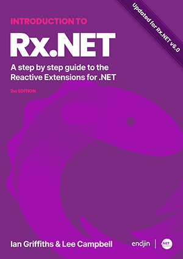

Reactive Extensions
======================

此存放庫包含四個函式庫，這些函式庫在概念上相關，因為它們都涉及對事物序列的 LINQ：

* [Reactive Extensions for .NET](Rx.NET/) 又稱 Rx.NET 或 Rx ([System.Reactive](https://www.nuget.org/packages/System.Reactive/)): 具有可組合、宣告式模型的事件驅動程式設計函式庫
* [AsyncRx.NET](AsyncRx.NET/)（實驗性預覽版）([System.Reactive.Async](https://www.nuget.org/packages/System.Reactive.Async/)): 適用於 `IAsyncObservable<T>` 的 Rx 實驗性實作，提供更深度的 `async`/`await` 支援
* [Interactive Extensions for .NET](Ix.NET/)，又稱 Ix ([System.Interactive](https://www.nuget.org/packages/System.Interactive/)): 適用於 `IAsyncEnumerable` 與 `IEnumerable` 的擴充 LINQ 運算子
* [LINQ for `IAsyncEnumerable`](./Ix.NET/Source/System.Linq.Async/) ([System.Linq.Async](https://www.nuget.org/packages/System.Linq.Async/)): 為 `IAsyncEnumerable` 實作標準 LINQ 運算子

每一項都會在後續的 README 中詳細說明。

## 免費《Introduction to Rx.NET》第二版電子書

<a href="https://introtorx.com/"></a>

當我們的程式碼需要回應事件時，反應式程式設計提供了清晰的架構。Rx.NET 函式庫旨在使雲端原生應用程式能夠以可靠、可預測的方式處理即時資料。

我們撰寫了一本免費書籍，解釋了支援 Rx 的重要抽象概念，並展示如何運用內建於 Rx.NET 函式庫中強大且廣泛的功能。

該書基於 Lee Campbell 於 2010 年出版的書籍（感謝捐贈給本專案），經過重新編寫以符合最新的 Rx.NET v6.0、.NET 8.0 以及物聯網（IoT）和即時串流資料處理等現代雲端原生使用案例。

《Introduction to Rx.NET》可在[線上](https://introtorx.com/)、[GitHub](Rx.NET/Documentation/IntroToRx/) 閱讀，並提供 [PDF](https://endjincdn.blob.core.windows.net/assets/ebooks/introduction-to-rx-dotnet/introduction-to-rx-dotnet-2nd-edition.pdf) 與 [EPUB](https://endjincdn.blob.core.windows.net/assets/ebooks/introduction-to-rx-dotnet/introduction-to-rx-dotnet-2nd-edition.epub) 格式下載。

<br clear="left"/>

## 取得套件

管道  | Rx | AsyncRx | Ix | System.Linq.Async
--- | --- | --- | --- |--- |
NuGet.org | [](https://www.nuget.org/packages/System.Reactive/)| [](https://www.nuget.org/packages/System.Reactive.Async/) | [](https://www.nuget.org/packages/System.Interactive/) | [](https://www.nuget.org/packages/System.Linq.Async/)
NuGet.org 預覽版（若比發行版更新） | [](https://www.nuget.org/packages/System.Reactive/) | [](https://www.nuget.org/packages/System.Reactive.Async/) | [](https://www.nuget.org/packages/System.Interactive/) | [](https://www.nuget.org/packages/System.Linq.Async/)
建構 | [](https://dev.azure.com/dotnet/Rx.NET/_build/latest?definitionId=9) | [](https://dev.azure.com/dotnet/Rx.NET/_build/latest?definitionId=191) | [](https://dev.azure.com/dotnet/Rx.NET/_build/latest?definitionId=28) | 作為 Ix 的一部分建構
[Azure<br>Artifacts](https://dev.azure.com/dotnet/Rx.NET/_packaging?_a=feed&feed=RxNet) | [](https://dev.azure.com/dotnet/Rx.NET/_packaging?_a=package&feed=5afc77bd-23b4-46f8-b725-40ebedab630c&package=3c02dce4-f7e9-43ec-a014-28ea9fc46f82&preferRelease=true) | [](https://dev.azure.com/dotnet/Rx.NET/_artifacts/feed/RxNet/NuGet/System.Reactive.Async/&preferRelease=true) | [](https://dev.azure.com/dotnet/Rx.NET/_packaging?_a=package&feed=5afc77bd-23b4-46f8-b725-40ebedab630c&package=a3311bc0-c6ea-4460-bea8-b65d633e2583&preferRelease=true) | [](https://dev.azure.com/dotnet/Rx.NET/_artifacts/feed/RxNet/NuGet/System.Linq.Async/&preferRelease=true)
發行歷史 | [ReleaseHistory](Rx.NET/Documentation/ReleaseHistory/) | [ReleaseHistory](Ix.NET/Documentation/ReleaseHistory/)| [ReleaseHistory](Ix.NET/Documentation/ReleaseHistory/)

若要取得每夜建構版本，請設定 NuGet 使用此摘要來源：`https://pkgs.dev.azure.com/dotnet/Rx.NET/_packaging/RxNet/nuget/v3/index.json`

### 加入對話

歡迎加入 https://reactivex.slack.com/ 上的 #rxnet 頻道與我們交流

## Rx 簡短簡介

在這個數位時代，即時資料流無處不在。金融應用程式仰賴對即時資訊的迅速回應。電腦網路一直以來都能提供有關其健康狀態與運作情況的廣泛資訊。公用事業公司（如供水商）擁有大量監控其運作的裝置。使用者介面與遊戲建構框架以極高的詳細程度回報使用者互動。送貨車輛持續回報其運送進度。飛機提供效能遙測資料，以便在潛在維護問題變得嚴重之前及早發現，而汽車現在也開始跟進。我們許多人都配戴或攜帶追蹤身體活動甚至[生命徵象](https://www.youtube.com/watch?v=6yjl_h7-WYA&t=2443s)的裝置。而機器學習的進步豐富了從不斷增長且多樣化的即時資料中獲取的深入分析見解。

但是，儘管即時資訊流如此普遍，它一直以來卻如同二等公民。幾乎所有程式設計語言都具備處理資料清單（例如陣列）的某種固有方式，但這些機制往往假設相關資料已經存在於記憶體中，隨時可供我們使用。所缺乏的是即時性——亦即資訊來源可能隨時根據自己的排程產生新資料的事實。

Rx 將對即時資訊串流的支援提升至與我們對陣列等資料結構所期望的相同層級。以下是一個範例：

```cs
var bigTrades =
    from trade in trades
    where trade.Volume > 1_000_000
    select trade;
```

這使用 C# 的 LINQ 功能將 `trades` 篩選為交易量大於一百萬的實體。此查詢運算式語法只是方法呼叫的簡寫，因此我們也可以這樣寫：

```cs
var bigTrades = trades.Where(trade => trade.Volume > 1_000_000);
```

這兩個（對等的）程式碼片段的確切行為取決於 `trades` 的型別。如果它是 `IEnumerable<Trade>`，則此查詢將僅反覆運算清單，且 `bigTrades` 將是僅包含符合物件的可列舉序列。如果 `trades` 是代表資料庫資料表的物件（例如 [Entity Framework](https://learn.microsoft.com/en-us/ef/core/) [DbSet](https://learn.microsoft.com/en-us/dotnet/api/microsoft.entityframeworkcore.dbset-1)），這將會被轉譯為資料庫查詢。但如果我們使用的是 Rx，`trades` 將會是 `IObservable<Trade>`，一個在即時事件發生時回報該事件的物件。而 `bigTrades` 也將會是 `IObservable<Trade>`，僅回報交易量超過一百萬的交易。我們可以向 Rx 提供一個回呼，在每次可觀察來源有資料提供給我們時叫用：

```cs
bigTrades.Subscribe(t => Console.WriteLine($"{t.Symbol}: trade with volume {t.Volume}"));
```

Rx 的兩個關鍵特點為：

* 明確定義表示與處理即時資料序列的方式 ([`IObservable<T>`](https://learn.microsoft.com/en-us/dotnet/api/system.iobservable-1))
* 一組運算子（例如剛才展示的 `Where` 運算子），讓事件處理邏輯能夠以宣告方式表達

Rx 在使用者介面中獲得了特別成功的應用。（在 .NET 之外也是如此——[RxJS](https://rxjs.dev/) 是 Rx 的 JavaScript 衍生版本，在使用者介面程式碼中非常受歡迎。）https://github.com/reactiveui/reactiveui 深度使用 Rx 來支援 .NET UI 開發。

Ian Griffiths 在 2020 年的 dotnetsheff 聚會上對 [Reactive Extensions for .NET](https://endjin.com/what-we-think/talks/reactive-extensions-for-dotnet) 進行了精簡的 60 分鐘概覽介紹。更多影片可在 [Rx 播放清單](https://www.youtube.com/playlist?list=PLJt9xcgQpM60Fz20FIXBvj6ku4a7WOLGb)中取得。

## AsyncRx.Net

雖然 Rx 是建立非同步程序模型的自然方式，但其原始設計假設處理通知的程式碼會同步執行。這是因為 Rx 的設計早於 C# 的 `async`/`await` 語言功能。因此，雖然 Rx 提供了可以在 [`IObservable<T>`](https://learn.microsoft.com/en-us/dotnet/api/system.iobservable-1) 與 [`Task<T>`](https://learn.microsoft.com/en-us/dotnet/api/system.threading.tasks.task-1) 之間轉換的配接器，但在某些情況下 `async` 並非可行的選項。

AsyncRx.Net 透過定義 `IAsyncObservable<T>` 解除了這項限制。這使得觀察者能夠使用非同步程式碼。例如，如果 `bigTrades` 是 `IAsyncObservable<Trade>`，我們可以這樣寫：

```cs
bigTrades.Subscribe(async t => await bigTradeStore.LogTradeAsync(t));
```

AsyncRx.Net 目前處於預覽階段。

## Interactive Extensions

Rx 定義了適用於其他提供者的所有標準 LINQ 運算子，但也新增了許多額外的運算子。例如，它定義了 `Scan`，執行與標準 [`Aggregate`](https://learn.microsoft.com/en-us/dotnet/api/system.linq.enumerable.aggregate) 運算子相同的基本處理，但不是在處理完每個元素後產生單一結果，而是在每一步之後產生包含彙總值的序列。（例如，若被彙總的運算是加法，`Aggregate` 會將總和作為單一輸出傳回，而 `Scan` 則會為每個輸入產生累計總和。給定序列 `[1,2,3]`，`Aggregate((a, x) => a + x)` 僅產生 `6`，而 `Scan` 則產生 `[1,3,6]`。）

Rx 定義的某些額外運算子僅在您處理事件時有用。但有些運算子適用於任何種類的序列。因此 Interactive Extensions（簡稱 Ix）為 `IEnumerable<T>` 定義了實作。Ix 實際上是 LINQ to Objects 的擴充，新增了許多額外的運算子。（隨著時間推移，.NET 執行階段函式庫新增了過去僅在 Ix 中提供的某些運算子，這證明了它的實用性。例如，.NET 6 新增了 [`MinBy`](https://learn.microsoft.com/en-us/dotnet/api/system.linq.enumerable.minby) 與 [`MaxBy`](https://learn.microsoft.com/en-us/dotnet/api/system.linq.enumerable.maxby)，這些運算子先前僅由 Ix 定義。）

這個函式庫被稱為「Interactive Extensions」，是因為在某種意義上「互動式」是「反應式」的相對面。（該名稱並非指使用者互動。）

## 適用於 `IAsyncEnumerable` 的 LINQ (`System.Linq.Async`)

Ix 開創的功能之一是 `IEnumerable<T>` 的非同步版本。這是另一個因極具實用性而最終被新增至 .NET 執行階段函式庫的功能範例：.NET Core 3.0 引入了 [`IAsyncEnumerable<T>`](https://learn.microsoft.com/en-us/dotnet/api/system.collections.generic.iasyncenumerable-1)，且相應的 C# (8.0) 版本透過其 `await foreach` 結構新增了對該介面的內建支援。

雖然 .NET Core 3.0 定義了 `IAsyncEnumerable<T>`，但並未新增任何對應的 LINQ 實作。雖然 [`IEnumerable<T>` 支援所有標準運算子](https://learn.microsoft.com/en-us/dotnet/api/system.linq.enumerable)（例如 `Where`、`GroupBy` 和 `SelectMany`），但 .NET 並未為 `IAsyncEnumerable<T>` 內建實作其中任何一個。然而，Ix 從一開始就為其原型版本的 `IAsyncEnumerable<T>` 提供了 LINQ 運算子，因此當 .NET Core 3.0 發行時，將所有這些現有 LINQ 運算子更新以與新的官方 [`IAsyncEnumerable<T>`](https://learn.microsoft.com/en-us/dotnet/api/system.collections.generic.iasyncenumerable-1) 搭配運作是一項相對簡單的工作。

因此，[System.Linq.Async](https://www.nuget.org/packages/System.Linq.Async/) NuGet 套件應運而生，為 `IAsyncEnumerable<T>` 提供 LINQ to Objects 實作，以對應 .NET 已為 `IEnumerable<T>` 內建的實作。

由於所有相關程式碼已是 Ix 專案的一部分（`IAsyncEnumerable<T>` 原本也由本專案定義），[System.Linq.Async](https://www.nuget.org/packages/System.Linq.Async/) NuGet 套件是作為 [Ix 專案](Ix.NET/) 的一部分進行建構的。


## 參與貢獻

參與貢獻的最佳方式包括試用功能、回報錯誤以及加入設計討論。

* 複製原始碼：`git clone https://github.com/dotnet/reactive`
* [建構、測試與偵錯原始碼](https://github.com/dotnet/reactive/wiki/Building%20Testing%20and%20Debugging)
* [如何貢獻](https://github.com/dotnet/reactive/wiki/Contributing-Code)
* [Pull requests](https://github.com/dotnet/reactive/pulls): [開啟中](https://github.com/dotnet/reactive/pulls?q=is%3Aopen+is%3Apr)/[已關閉](https://github.com/dotnet/reactive/pulls?q=is%3Apr+is%3Aclosed)

尋找可著手的項目？[待認領議題清單](https://github.com/dotnet/reactive/issues?q=is%3Aopen+is%3Aissue+label%3A%22Up+for+Grabs%22) 是一個絕佳的起點。

本專案採用了改編自[貢獻者公約](http://contributor-covenant.org/)的行為準則，以明確社群中的預期行為。此行為準則已被[許多其他專案採用](http://contributor-covenant.org/adopters/)。如需詳細資訊，請參閱[行為準則](http://www.dotnetfoundation.org/code-of-conduct)。

## .NET Foundation

本專案是 [.NET Foundation](http://www.dotnetfoundation.org/projects) 的一部分，連同其他
專案（如 [.NET Runtime](https://github.com/dotnet/runtime/)）。.NET Foundation 為此專案提供 DevOps 基礎架構，以編譯、測試、簽署和封裝這個下載量超過 1 億次的複雜解決方案。它還提供託管服務，使專案能夠在維護者之間傳承，為社群提供持續性。

## 目前核心團隊

目前維護 Rx 的人員包括：

<table>
  <tbody>
    <tr>
      <td align="center" valign="top">
        
        <br>
        <a href="https://github.com/idg10">Ian Griffiths</a>
        <p>Hove, UK</p>
        <p><a href="https://endjin.com/who-we-are/our-people/ian-griffiths/">Ian's blog on endjin.com</a>
      </td>
      <td align="center" valign="top">
        
        <br>
        <a href="https://github.com/HowardvanRooijen">Howard van Rooijen</a>
        <p>Winchester, UK</p>
        <p><a href="https://endjin.com/who-we-are/our-people/howard-van-rooijen/">Howard's blog on endjin.com</a>
      </td>
  </tbody>
</table>

Rx 已存在了大約十五年，因此我們非常感謝其建立者以及自此之後參與開發的許多人。完整清單請參閱 [AUTHORS.txt](AUTHORS.txt)。

## 發展藍圖

作為 .NET Conf 2023 的一部分，Ian Griffiths 提供了關於[將 Rx.NET 現代化以邁向 v6.0 及 v7.0 計畫](https://endjin.com/what-we-think/talks/modernizing-reactive-extensions-for-dotnet)的最新進展。

如需詳細資訊，請參閱以下討論：

- [未來 Rx.NET 套件封裝](https://github.com/dotnet/reactive/discussions/2038)
- [Rx.NET v6.0 與 v7.0 高階計畫](https://github.com/dotnet/reactive/discussions/1868)

我們制定了[發展藍圖](Rx.NET/Documentation/Rx-Roadmap-2023.md)，說明我們持續開發 Rx 的中期計畫。此圖展示了我們對使用 Rx 之平台的看法，以及這些不同目標的計畫支援生命週期：

![The support lifecycle for various .NET platforms, represented as a set of timelines, showing the published plans for widely used versions that are current as of 2023, with a particular focus on which versions will be current as of November 2023. The top section of the diagram shows .NET releases starting with .NET 6.0 being released in November 2021, and shows for each subsequent release occurring in November of each subsequent year, up as far as .NET 13.0 in November 2028. It also shows that even-numbered releases are Long Term Support (LTS for short) releases, supported for 3 years, while odd-numbered releases are supported only for 18 months. The section beneath this shows that .NET Framework versions 4.7.2, 4.8.0, and 4.8.1 will all be in support as of November 2023, and will continue to be in support beyond the timescale covered by this diagram, i.e., beyond November 2028. The section beneath this shows the release plan for MAUI, starting with version 8.0 on November 2023, and subsequent releases at the same time each subsequent year, up to version 13.0 in November 2028. The diagram shows that each of these versions is supported for only 18 months. Beneath this is are two lines showing Xamarin iOS 16.0, and Xamarin Android 13.0 support being active on November 2023, and running for 18 months. Beneath this is a line showing UWP version 10.0.16299 support being active on November 2023, and running beyond the timescale covered by the diagram. Beneath this is a section showing that Unity 2021 was released in 2021, and will go out of support near the end of 2023, and it shows a Unity 2022 release labelled as "Release soon," with a release date somewhere in the middle of 2023. The bottom of the diagram shows the endjin logo, and endjin's corporate motto: "we help small teams achieve big things."](Rx.NET/Documentation/RX-Platform-Support-Roadmap.png ".NET Platform Support Roadmap")
