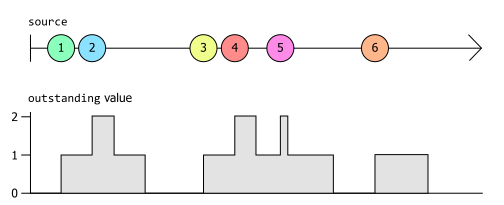

# 關鍵型別

Rx 是一個強大的框架，可以大幅簡化回應事件的程式碼。但要撰寫良好的 Reactive 程式碼，您必須了解基本概念。Rx 的基本建構區塊是一個名為 `IObservable<T>` 的介面。理解這一點及其對應的 `IObserver<T>` 是成功使用 Rx 的關鍵。

前一章展示了這個 LINQ 查詢運算式作為第一個範例：

```csharp
var bigTrades =
    from trade in trades
    where trade.Volume > 1_000_000;
```

大多數 .NET 開發人員都熟悉 [LINQ](https://learn.microsoft.com/en-us/dotnet/csharp/linq/) 的至少一種常見形式，例如 [LINQ to Objects](https://learn.microsoft.com/en-us/dotnet/csharp/programming-guide/concepts/linq/linq-to-objects) 或 [Entity Framework Core 查詢](https://learn.microsoft.com/en-us/ef/core/querying/)。大多數 LINQ 實作允許您查詢*待用資料*（data at rest）。LINQ to Objects 處理陣列或其他集合，而 Entity Framework Core 中的 LINQ 查詢針對資料庫中的資料執行，但 Rx 與眾不同：它提供了對即時事件串流定義查詢的能力——您稱之為*動態資料*（data in motion）。

如果您不喜歡查詢運算式語法，您可以透過直接呼叫 LINQ 運算子來撰寫完全等效的程式碼：

```csharp
var bigTrades = trades.Where(trade => trade.Volume > 1_000_000);
```

無論我們使用哪種風格，這都是 LINQ 的表達方式，表示我們希望 `bigTrades` 僅包含 `trades` 中 `Volume` 屬性大於一百萬的那些項目。

我們無法確切知道這些範例的作用，因為我們看不到 `trades` 或 `bigTrades` 變數的型別。這段程式碼的含義將根據這些型別而有很大差異。如果我們使用 LINQ to Objects，這兩個變數很可能都是 `IEnumerable<Trade>`。這意味著這兩個變數都參考代表集合的物件，我們可以使用 `foreach` 迴圈列舉其內容。這將代表*待用資料*，即我們的程式碼可以直接檢查的資料。

但讓我們透過明確指定型別來清楚說明程式碼的含義：

```csharp
IObservable<Trade> bigTrades = trades.Where(trade => trade.Volume > 1_000_000);
```

這消除了多義性。現在很清楚我們處理的不是待用資料。我們正在處理一個 `IObservable<Trade>`。但那究竟是什麼？

## `IObservable<T>`
    
[`IObservable<T>` 介面](https://learn.microsoft.com/en-us/dotnet/api/system.iobservable-1) 代表了 Rx 的基本抽象：某個型別 `T` 的值序列。在非常抽象的意義上，這意味著它代表與 [`IEnumerable<T>`](https://learn.microsoft.com/en-us/dotnet/api/system.collections.generic.ienumerable-1) 相同的東西。

差別在於程式碼如何取用這些值。`IEnumerable<T>` 允許程式碼檢索值（通常透過 `foreach` 迴圈），而 `IObservable<T>` 則在值可用時提供這些值。這種區別有時被定性為*推送*（push）與*拉取*（pull）。我們可以透過執行 `foreach` 迴圈從 `IEnumerable<T>` 中*拉取*值，但 `IObservable<T>` 會將值*推送*到我們的程式碼中。

`IObservable<T>` 如何將其值推送到我們的程式碼中？如果我們想要這些值，我們的程式碼必須*訂閱*該 `IObservable<T>`，這意味著為其提供一些它可以呼叫的方法。事實上，訂閱是 `IObservable<T>` 直接支援的唯一操作。以下是該介面的完整定義：

```csharp
public interface IObservable<out T>
{
    IDisposable Subscribe(IObserver<T> observer);
}
```

您可以在 GitHub 上檢視 [`IObservable<T>` 的原始碼](https://github.com/dotnet/runtime/blob/b4008aefaf8e3b262fbb764070ea1dd1abe7d97c/src/libraries/System.Private.CoreLib/src/System/IObservable.cs)。請注意，它是 .NET 執行階段函式庫的一部分，而不是 `System.Reactive` NuGet 套件。`IObservable<T>` 代表了一個非常重要的基本抽象，以至於它已內建於 .NET 中。（因此您可能想知道 `System.Reactive` NuGet 套件是用於什麼的。.NET 執行階段函式庫僅定義了 `IObservable<T>` 和 `IObserver<T>` 介面，而沒有定義 LINQ 實作。`System.Reactive` NuGet 套件為我們提供了 LINQ 支援，並且還處理執行緒相關問題。）

該介面的唯一方法清楚地說明了我們可以使用 `IObservable<T>` 做什麼：如果我們想接收它提供的事件，我們可以*訂閱*它。（我們也可以取消訂閱：`Subscribe` 方法傳回一個 `IDisposable`，如果我們對其呼叫 `Dispose`，它將取消我們的訂閱。）`Subscribe` 方法要求我們傳入 `IObserver<T>` 的實作，我們很快就會介紹它。

細心的讀者會注意到前一章中的一個範例看起來似乎無法運作。該程式碼建立了一個每秒產生一次事件的 `IObservable<long>`，然後使用以下程式碼訂閱了它：

```csharp
ticks.Subscribe(
    tick => Console.WriteLine($"Tick {tick}"));
```

那傳遞了一個委派，而不是 `IObservable<T>.Subscribe` 所要求的 `IObserver<T>`。我們很快就會介紹 `IObserver<T>`，但這裡所發生的一切只是該範例使用了來自 `System.Reactive` NuGet 套件的擴充方法：

```csharp
// 來自 System.Reactive 函式庫的 ObservableExtensions 類別
public static IDisposable Subscribe<T>(this IObservable<T> source, Action<T> onNext)
```

這是一個 helper 方法，它將委派包裝在 `IObserver<T>` 的實作中，然後將其傳遞給 `IObservable<T>.Subscribe`。其效果是我們可以只撰寫一個簡單的方法（而不是 `IObserver<T>` 的完整實作），可觀察來源將在每次想要提供值時呼叫我們的回呼。使用這種 helper 比我們自己實作 Rx 的介面更為常見。

### 熱來源與冷來源

由於 `IObservable<T>` 在我們訂閱之前無法向我們提供值，因此我們訂閱的時間點可能很重要。想像一個描述在某個市場中發生的交易的 `IObservable<Trade>`。如果它提供的資訊是即時的，它將不會告訴您在您訂閱之前發生的任何交易。在 Rx 中，這種來源被描述為*熱*（hot）來源。

並非所有來源都是*熱*的。沒有任何東西阻止 `IObservable<T>` 無論何時呼叫 `Subscribe` 都始終向任何訂閱者提供完全相同的事件序列。（想像一個 `IObservable<Trade>`，它不是回報即時資訊，而是根據記錄的歷史交易資料產生通知。）無論何時訂閱都完全沒有影響的來源稱為*冷*（cold）來源。

以下是一些可能表示為熱可觀察物件的來源：

* 來自感測器的測量值
* 來自交易交易所的價格刻度（ticks）
* 立即分發事件的事件來源，例如 Azure Event Grid
* 滑鼠移動
* 計時器事件
* 廣播，例如 ESB 通道或 UDP 網路封包

以及一些可以成為良好冷可觀察物件的來源範例：

* 集合的內容（例如由 [`IEnumerable<T> 的 ToObservable 擴充方法`](03_CreatingObservableSequences.md#從-ienumerablet) 傳回的內容）
* 固定範圍的值，例如 [`Observable.Range`](03_CreatingObservableSequences.md#observablerange) 產生的值
* 根據演算法產生的事件，例如 [`Observable.Generate`](03_CreatingObservableSequences.md#observablegenerate) 產生的事件
* 非同步作業的 Factory，例如 [`FromAsync`](03_CreatingObservableSequences.md#從-task) 傳回的 Factory
* 透過執行常規程式碼（如迴圈）產生的事件；您可以使用 [`Observable.Create`](03_CreatingObservableSequences.md#observablecreate) 建立此類來源
* 串流事件提供者，例如 Azure Event Hub 或 Kafka（或任何其他保留過去事件以便能夠從串流中的特定時刻傳遞事件的串流樣式來源；因此*不是* Azure Event Grid 樣式的事件來源）

並非所有來源都嚴格地完全是*熱*的或*冷*的。例如，您可以想像即時 `IObservable<Trade>` 的稍微變體，其中來源始終向新訂閱者回報最新的交易。訂閱者可以指望立即收到某些內容，然後在有新資訊到達時隨時保持最新狀態。新訂閱者始終會收到（可能相當舊的）資訊這一事實是類似*冷*的特徵，但只有第一個事件是*冷*的。全新的訂閱者仍然很可能會錯過早期訂閱者可以獲得的大量資訊，從而使該來源更偏向*熱*而不是*冷*。

有一個有趣的特殊情況，其中事件來源設計為使應用程式能夠精確按順序接收每個事件一次。Kafka 或 Azure Event Hub 等事件串流系統具有此特徵——它們保留事件一段時間，以確保取用端即使偶爾落後也不會錯過。處理程序的標準輸入（_stdin_）也具有此特徵：如果您執行命令列工具並在它準備好處理之前開始鍵入輸入，作業系統會將該輸入保留在緩衝區中，以確保不會遺失任何內容。Windows 為桌面應用程式執行類似的操作：每個應用程式執行緒都會獲得一個訊息佇列，以便如果您在它無法回應時點擊或鍵入，輸入最終將會被處理。我們可能會將這些來源視為*先冷後熱*。它們就像*冷*來源一樣，我們不會僅僅因為花費了一些時間才開始接收事件就錯過任何內容，但是一旦我們開始檢索資料，我們通常就無法倒退回起點。因此，一旦我們啟動並執行，它們就更像是*熱*事件。

如果我們想附加多個訂閱者，這種*先冷後熱*的來源可能會帶來問題。如果來源在發生訂閱時就立即開始提供事件，那麼對於第一個訂閱者來說這很好：它將接收正在等待我們開始的所有備份事件。但是如果我們想附加多個訂閱者，我們就遇到了一個問題：在我們設法附加第二個訂閱者之前，第一個訂閱者可能會收到在某個緩衝區中等待的所有通知。第二個訂閱者將會錯過。

在這些情況下，我們真正希望有一種方法在啟動事情之前設定好所有訂閱者。我們希望將訂閱與啟動行為分開。預設情況下，訂閱來源意味著我們希望它啟動，但 Rx 定義了一個專門的介面，可以為我們提供更多控制權：[`IConnectableObservable<T>`](https://github.com/dotnet/reactive/blob/f4f727cf413c5ea7a704cdd4cd9b4a3371105fa8/Rx.NET/Source/src/System.Reactive/Subjects/IConnectableObservable.cs)。它衍生自 `IObservable<T>`，並僅新增了一個方法 `Connect`：

```csharp
public interface IConnectableObservable<out T> : IObservable<T>
{
    IDisposable Connect();
}
```

這在這些情境中很有用，其中將存在某些擷取或產生事件的程序，我們需要確保在該程序啟動之前我們已做好準備。因為 `IConnectableObservable<T>` 在您呼叫 `Connect` 之前不會啟動，所以它為您提供了一種在事件開始流動之前附加所需數量的訂閱者的方法。

來源的「溫度」從其型別中不一定顯而易見。即使底層來源是 `IConnectableObservable<T>`，它也常常可以隱藏在程式碼層後面。因此，無論來源是熱的、冷的還是介於兩者之間的，大多數時候我們只會看到一個 `IObservable<T>`。由於 `IObservable<T>` 僅定義了一個方法 `Subscribe`，您可能想知道我們如何使用它執行任何有趣的操作。強大的功能來自於 `System.Reactive` NuGet 函式庫提供的 LINQ 運算子。

### LINQ 運算子與組合

到目前為止，我只展示了一個非常簡單的 LINQ 範例，使用 `Where` 運算子將事件篩選為符合特定條件的事件。為了讓您了解我們如何透過組合建構更進階的功能，我將介紹一個範例情境。

假設您想編寫一個程式來監看檔案系統上的某個資料夾，並在該資料夾中的任何內容發生變更時執行自動處理。例如，Web 開發人員通常希望在編輯器中儲存變更時觸發其用戶端程式碼的自動重新建構，以便他們可以快速檢視其變更的效果。檔案系統變更通常是突發的。文字編輯器在儲存檔案時可能會執行幾個不同的操作。（有些將修改儲存到新檔案中，然後在完成後執行幾次重新命名，因為這可以避免在您儲存檔案的時刻發生斷電或系統崩潰時遺失資料。）因此，您通常不會希望在偵測到檔案活動時立即採取動作。最好給它一點時間看看是否會發生更多活動，並在一切平靜下來後才採取動作。

因此，我們不應對檔案系統活動直接做出反應。我們希望在經歷一陣忙碌活動後一切歸於平靜的時刻採取動作。Rx 不直接提供此功能，但我們可以透過組合一些內建運算子來建立自訂運算子。以下程式碼定義了一個偵測並回報此類情況的 Rx 運算子。如果您是 Rx 的新手（如果您正在閱讀本文，這似乎很有可能），它可能不會立即顯而易見地看出它是如何運作的。與我到目前為止展示的範例相比，這在複雜性上有顯著的提升，因為這來自一個真實的應用程式。但我將一步一步地引導您，因此一切都會變得清晰。

```csharp
static class RxExt
{
    public static IObservable<IList<T>> Quiescent<T>(
        this IObservable<T> src,
        TimeSpan minimumInactivityPeriod,
        IScheduler scheduler)
    {
        IObservable<int> onoffs =
            from _ in src
            from delta in 
               Observable.Return(1, scheduler)
                         .Concat(Observable.Return(-1, scheduler)
                                           .Delay(minimumInactivityPeriod, scheduler))
            select delta;
        IObservable<int> outstanding = onoffs.Scan(0, (total, delta) => total + delta);
        IObservable<int> zeroCrossings = outstanding.Where(total => total == 0);
        return src.Buffer(zeroCrossings);
    }
}
```

關於這一點首先要說的是，我們實際上正在定義一個自訂的 LINQ 樣式運算子：這是一個擴充方法，就像 Rx 提供的所有 LINQ 運算子一樣，它將 `IObservable<T>` 作為其隱含引數，並產生另一個可觀察來源作為其結果。傳回型別略有不同：它是 `IObservable<IList<T>>`。這是因為一旦我們返回無活動狀態，我們將希望處理剛剛發生的所有事情，因此該運算子將產生一個清單，其中包含來源在其最近一陣忙碌活動中回報的每個值。

當我們想要展示 Rx 運算子的行為方式時，我們通常會繪製「彈珠」（marble）圖。這是一張展示一個或多個 `IObservable<T>` 事件來源的圖表，每個事件來源都由一條水平線表示。來源產生的每個事件都由該線上的圓圈（或「彈珠」）表示，水平位置代表時間。通常，該線左側有一條垂直條，表示應用程式訂閱來源的瞬間，除非它碰巧立即產生事件，在這種情況下它將以彈珠開始。如果該線右側有一個箭頭，則表示可觀察物件的生命週期超出了圖表。這是一張展示上述 `Quiescent` 運算子如何回應特定輸入的圖表：


這顯示來源（頂線）產生了幾個事件（在此範例中為值 `1` 和 `2`），然後停止了一段時間。在停止後不久，由 `Quiescent` 運算子傳回的可觀察物件（下線）產生了一個單一事件，其中包含包含這兩個事件的清單（`[1,2]`）。然後來源再次啟動，以相當快的連續產生值 `3`、`4` 和 `5`，然後安靜了一段時間。同樣，一旦安靜期持續足夠長的時間，由 `Quiescent` 傳回的來源就會產生一個單一事件，其中包含來自第二次活動突發的所有來源事件（`[3,4,5]`）。然後在此圖表中顯示的最後一點來源活動由單個事件 `6` 組成，隨後是更多的無活動狀態，同樣，一旦無活動狀態持續足夠長的時間，`Quiescent` 來源就會產生一個單一事件來回報此情況。由於來自來源的最後一次活動「突發」僅包含單個事件，因此 `Quiescent` 可觀察物件的最終輸出所回報的清單是具有單個值的清單：`[6]`。

那麼顯示的程式碼是如何實現這一點的呢？關於 `Quiescent` 方法首先要注意的是，它只是使用其他 Rx LINQ 運算子（`Return`、`Scan`、`Where` 和 `Buffer` 運算子明確可見，並且查詢運算式將使用 `SelectMany` 運算子，因為那是 C# 查詢運算式在連續包含兩個 `from` 子句時所做的事情）進行組合，從而產生最終的 `IObservable<IList<T>>` 輸出。

這是 Rx 的*組合式*方法，這也是我們通常使用 Rx 的方式。我們使用運算子的混合，以產生我們想要的效果的方式進行組合（_composed_）。

但是這個特定的組合如何產生我們想要的效果呢？我們有幾種方法可以從 `Quiescent` 運算子獲得我們正在尋找的行為，但是這個特定實作的基本思想是它記錄最近發生了多少個事件，然後每次該數字下降回零時都會產生一個結果。`outstanding` 變數參考追蹤最近事件數量的 `IObservable<int>`，這張彈珠圖顯示了它回應與前一張圖表上顯示的相同 `source` 事件時所產生的內容：

![Quiescent 運算子如何計算未完成事件的數量。一張 Rx 彈珠圖說明了兩個可觀察物件。第一個標記為「source」，它顯示了與前圖相同的六個數字標記事件，但這次也進行了顏色編碼，以便每個事件具有不同的顏色。如前所述，這些事件分為三組：事件 1 和 2 緊密相連，隨後是間隔。然後事件 3、4 和 5 緊密相連。然後在另一個間隔之後發生事件 6，不靠近任何事件。第二個可觀察物件標記為「outstanding」，對於「source」可觀察物件上的每個事件，它顯示兩個事件。每個這樣的配對具有與「source」行上相同的顏色；著色只是為了更容易查看此行上的事件如何與「source」行上的事件相關聯。每對中的第一個直接出現在其在「source」行上的對應事件下方，並且其數字始終比其直接前身大 1；第一個項目顯示數字 1。第二對中的第一個項目是下一個出現在此行上的項目，因此具有數字 2。但隨後出現了第一對中的第二個項目，這將數字降低回 1，隨後是第二對中的第二個項目，顯示 0。由於第一行上的第二批事件出現得相當接近，因此我們看到這些事件的值為 1、2、1、2、1，然後是 0。第一行上的最後一個事件（標記為 6）在第二行上有一個對應的配對，回報值為 1，然後是 0。總體效果是第二行「outstanding」行上的每個值告訴我們在過去 2 秒內從「source」行出現了多少個項目。](GraphicsIntro/Ch02-Quiescent-Marbles-Outstanding.svg)

我這次對事件進行了顏色編碼，以便我可以展示 `source` 事件與 `outstanding` 產生的對應事件之間的關係。每次 `source` 產生一個事件時，`outstanding` 都會在同一時間產生一個事件，其中該值比 `outstanding` 先前產生的值大 1。但每個這樣的 `source` 事件也會導致 `outstanding` 在兩秒後產生另一個事件。（這是兩秒鐘，因為在這些範例中，我假設 `Quiescent` 的第一個引數是 `TimeSpan.FromSeconds(2)`，如第一張彈珠圖所示。）第二個事件總是產生一個比先前的值小 1 的值。

這意味著從 `outstanding` 出現的每個事件都告訴我們 `source` 在過去兩秒內產生了多少個事件。該圖以稍微不同的形式顯示了相同的資訊：它將 `outstanding` 產生的最新值顯示為圖表。您可以看到每次 `source` 產生新值時，該值都會增加 1。而在 `source` 產生每個值兩秒後，它會回落 1。



在像最後一個事件 `6` 這樣的簡單情況下（其中它是大約在該時間發生的唯一事件），當事件發生時 `outstanding` 值增加 1，並在兩秒後再次下降。在圖片的左側它稍微複雜一些：我們相當快速地連續獲得兩個事件，因此 `outstanding` 值上升到 1，然後上升到 2，然後回落到 1，然後再次回落到 0。中間部分看起來稍微混亂一些——當 `source` 產生事件 `3` 時計數增加 1，然後當事件 `4` 傳入時上升到 2。在自事件 `3` 過去兩秒後它再次下降到 1，但隨後另一個事件 `5` 傳入，使總計回到 2。不久之後它再次下降到 1，因為自事件 `4` 發生以來已經過了兩秒。然後稍微晚一點，在事件 `5` 兩秒後，它再次下降到 0。

中間部分是最混亂的，但它也是最能代表該運算子設計用於處理的活動類型的部分。請記住，這裡的重點是我們期望看到一陣忙碌活動，如果這些活動代表檔案系統活動，它們往往本質上有些混亂，因為儲存裝置並不總是具有完全可預測的效能特徵（特別是如果它是具有活動部件的磁性儲存裝置，或者是可能涉及可變網路延遲的遠端儲存）。

掌握了這種對最近活動的度量，我們可以透過觀察 `outstanding` 何時回落到零來發現活動突發的結束，這正是上述程式碼中 `zeroCrossing` 所參考的可觀察物件所做的事情。（那只是使用 `Where` 運算子篩選掉除 `outstanding` 的目前值返回零的事件之外的所有內容。）

但是 `outstanding` 本身是如何運作的呢？這裡的基本方法是每次 `source` 產生一個值時，我們實際上都會建立一個全新的 `IObservable<int>`，它恰好產生兩個值。它立即產生值 1，然後在指定的時間範圍（在這些範例中為 2 秒）之後產生值 -1。這就是查詢運算式的這個子句中正在發生的事情：

```csharp
from delta in Observable
    .Return(1, scheduler)
    .Concat(Observable
        .Return(-1, scheduler)
        .Delay(minimumInactivityPeriod, scheduler))
```

我說過 Rx 完全是關於組合的，這裡當然也是如此。我們使用非常簡單的 `Return` 運算子來建立一個 `IObservable<int>`，該可觀察物件立即僅產生單個值然後終止。這段程式碼呼叫了它兩次，一次產生值 `1`，另一次產生值 `-1`。它使用 `Delay` 運算子，因此我們不是立即獲得該 `-1` 值，而是獲得一個等待指定時間週期（在這些範例中為 2 秒，但通常是任何 `minimumInactivityPeriod`）然後產生該值的可觀察物件。然後我們使用 `Concat` 將這兩個拼接在一起成為單一 `IObservable<int>`，該物件產生值 `1`，然後在兩秒後產生值 `-1`。

儘管這會為每個 `source` 事件產生一個全新的 `IObservable<int>`，但上面顯示的 `from` 子句是 `from ... from .. select` 形式的查詢運算式的一部分，C# 編譯器將其轉換為對 `SelectMany` 的呼叫，這具有將這些全部展平成單一可觀察物件的效果，這就是 `onoffs` 變數所參考的內容。這張彈珠圖說明了這一點：


這也再次顯示了 `outstanding` 可觀察物件，但我們現在可以看到它來自哪裡：它只是 `onoffs` 可觀察物件發出的值的執行中總計。這個執行中總計可觀察物件是使用以下程式碼建立的：

```csharp
IObservable<int> outstanding = onoffs.Scan(0, (total, delta) => total + delta);
```

Rx 的 `Scan` 運算子的運作方式很像標準 LINQ [`Aggregate`](https://learn.microsoft.com/en-us/dotnet/csharp/programming-guide/concepts/linq/aggregation-operations) 運算子，因為它將一個操作（在此情況下為加法）累積套用於序列中的每個項目。區別在於 `Aggregate` 僅在到達序列末尾時產生最終結果，而 `Scan` 顯示其所有工作過程，在每次輸入後產生到目前為止的累積值。因此這意味著每次 `onoffs` 產生一個事件時，`outstanding` 都會產生一個事件，並且該事件的值將是執行中總計——到目前為止來自 `onoffs` 的每個值的總和。

這就是 `outstanding` 如何告訴我們 `source` 在過去兩秒（或指定的任何 `minimumActivityPeriod`）內產生了多少個事件。

最後一塊拼圖是我們如何從 `zeroCrossings`（每次來源進入平靜狀態時產生一個事件）轉到輸出 `IObservable<IList<T>>`，後者提供最近一次活動突發中發生的所有事件。在這裡，我們只是使用 Rx 的 `Buffer` 運算子，它正是針對此情境設計的：它將其輸入切成區塊，為每個區塊產生一個事件，其值為包含該區塊項目的 `IList<T>`。`Buffer` 可以透過幾種方式分割事物，但在此情況下，我們使用的是每次某些 `IObservable<T>` 產生項目時開始新切片的形式。具體來說，我們透過在每次 `zeroCrossings` 產生新事件時建立一個新區塊來告訴 `Buffer` 切割 `source`。

（最後一個詳細資訊，以防您看到並感到好奇，是此方法需要一個 `IScheduler`。這是用於處理計時和並行存取的 Rx 抽象。我們需要它，因為我們需要能夠在一秒延遲後產生事件，而這種時間驅動的活動需要排程器。）

我們將在後續章節中更詳細地介紹所有這些運算子以及排程器的工作原理。目前，關鍵點在於我們通常透過建立處理和組合 `IObservable<T>` 來源的 LINQ 運算子組合來使用 Rx，以定義我們所需的邏輯。

請注意，該範例中的任何內容實際上都沒有呼叫 `IObservable<T>` 定義的唯一方法（`Subscribe`）。最終總會有某些地方的某些東西取用這些事件，但使用 Rx 的大部分工作往往需要以宣告方式定義我們所需的 `IObservable<T>`。

現在您已經看過了一個 Rx 程式設計的範例，我們可以解決有關 Rx 為什麼存在的一些顯而易見的問題。

### .NET 事件有什麼問題？

.NET 從二十多年前發布的第一個版本就內建了對事件的支援——事件是 .NET 型別系統的一部分。C# 語言以 `event` 關鍵字的形式對此提供了內在支援，以及用於訂閱事件的專用語法。那麼，當 Rx 在大約 10 年後出現時，為什麼它覺得需要為事件串流發明自己的表示形式呢？`event` 關鍵字有什麼問題？

.NET 事件的基本問題在於它們獲得了來自 .NET 型別系統的特殊處理。具有諷刺意味的是，這使得它們比根本沒有內建對事件概念的支援時更缺乏彈性。如果沒有 .NET 事件，我們將需要某種基於物件的事件表示形式，此時您可以對事件執行與對任何其他物件執行的相同操作：您可以將它們儲存在欄位中、將它們作為引數傳遞給方法、在它們之上定義方法等等。

公平地說，在 .NET 1.0 中，如果沒有泛型，實際上不可能定義一個良好的基於物件的事件表示形式，而 .NET 直到第 2 版才獲得泛型（在 .NET 1.0 發布三年半之後）。不同的事件來源需要能夠回報不同的資料，而 .NET 事件提供了一種按型別參數化事件的方法。但一旦泛型出現，就可以定義諸如 `IObservable<T>` 之類的型別，而事件提供的主要優勢就消失了。（另一個好處是用於實作和訂閱事件的某些語言支援，但原則上如果 Microsoft 選擇這樣做，這也可以為 Rx 做到。這不是一項需要事件與型別系統的其他功能有根本不同的功能。）

考慮我們剛才處理過的範例。可以定義我們自己的自訂 LINQ 運算子 `Quiescent`，因為 `IObservable<T>` 只是與任何其他介面一樣的介面，這意味著我們可以自由為其撰寫擴充方法。您無法為事件撰寫擴充方法。

此外，我們能夠包裝或調整 `IObservable<T>` 來源。`Quiescent` 將 `IObservable<T>` 作為輸入，並組合各種 Rx 運算子以產生另一個可觀察物件作為輸出。其輸入是可以訂閱的事件來源，其輸出也是可以訂閱的事件來源。您無法使用 .NET 事件執行此操作——您無法撰寫接受事件作為引數或傳回事件的方法。

這些限制有時被描述為 .NET 事件不是*頭等公民*（first class citizens）。在 .NET 中，您可以對值或參考執行某些操作，但不能對事件執行這些操作。

如果我們將事件來源表示為純舊介面，那麼它*就是*頭等公民：它可以使用我們對其他物件和值所期望的所有功能，這恰恰是因為它不是什麼特別的東西。

### 串流又如何？

我已經將 `IObservable<T>` 描述為代表事件的*串流*（stream）。這提出了一個顯而易見的問題：.NET 已經有了 [`System.IO.Stream`](https://learn.microsoft.com/en-us/dotnet/api/system.io.stream)，為什麼不直接使用它呢？

簡短的回答是串流很奇怪，因為它們代表了計算中一個古老的概念，早在第一個 Windows 作業系統發布之前就存在了，因此它們帶有相當多的歷史包袱。這意味著即使像「我有一些資料，並希望立即將其提供給所有感興趣的各方」這樣簡單的情境，透過 `Stream` 型別實作也出奇地複雜。

此外，`Stream` 沒有提供任何方法來指示將會出現什麼型別的資料——它只知道位元組。由於 .NET 的型別系統支援泛型，因此很自然地希望表示事件串流的型別能夠透過型別參數指示事件型別。

因此，即使您確實使用 `Stream` 作為實作的一部分，您也會希望引入某種包裝函式抽象。如果 `IObservable<T>` 不存在，您就需要發明它。

在 Rx 中使用 IO 串流當然是可能的，但它們不是正確的主要抽象。

（如果您不信服，請參閱[附錄 A：傳統 IO 串流有什麼問題](A_IoStreams.md)，以獲得關於為什麼 `Stream` 不適合此任務的更詳細解釋。）

現在我們已經了解了為什麼需要存在 `IObservable<T>`，我們需要看看它的對應介面 `IObserver<T>`。

## `IObserver<T>`

之前，我展示了 `IObservable<T>` 的定義。正如您所看到的，它只有一個方法 `Subscribe`。並且此方法只接受一個型別為 [`IObserver<T>`](https://learn.microsoft.com/en-us/dotnet/api/system.iobserver-1) 的引數。因此，如果您想觀察 `IObservable<T>` 所提供的事件，您必須為其提供一個 `IObserver<T>`。在到目前為止的範例中，我們只是提供了一個簡單的回呼，Rx 已經為我們將其包裝在 `IObserver<T>` 的實作中，但即使這在實務上非常常是我們接收通知的方式，您仍然需要了解 `IObserver<T>` 才能有效使用 Rx。它不是一個複雜的介面：

```csharp
public interface IObserver<in T>
{
    void OnNext(T value);
    void OnError(Exception error);
    void OnCompleted();
}
```

與 `IObservable<T>` 一樣，您可以在 .NET 執行階段 GitHub 儲存庫中找到 [`IObserver<T>` 的原始碼](https://github.com/dotnet/runtime/blob/7cf329b773fa5ed544a9377587018713751c73e3/src/libraries/System.Private.CoreLib/src/System/IObserver.cs)，因為這兩個介面都內建在執行階段函式庫中。

如果我們想建立一個將值列印到主控台的觀察者，它會像這樣簡單：

```csharp
public class MyConsoleObserver<T> : IObserver<T>
{
    public void OnNext(T value)
    {
        Console.WriteLine($"Received value {value}");
    }

    public void OnError(Exception error)
    {
        Console.WriteLine($"Sequence faulted with {error}");
    }

    public void OnCompleted()
    {
        Console.WriteLine("Sequence terminated");
    }
}
```

在上一章中，我使用了一個 `Subscribe` 擴充方法，該方法接受一個委派，每次來源產生一個項目時都會呼叫該委派。該方法由 Rx 的 `ObservableExtensions` 類別定義，該類別還為 `IObservable<T>` 定義了各種其他擴充方法。它包括 `Subscribe` 的多載，使我能夠撰寫與前面範例具有相同效果的程式碼，而無需提供我自己的 `IObserver<T>` 實作：

```csharp
source.Subscribe(
    value => Console.WriteLine($"Received value {value}"),
    error => Console.WriteLine($"Sequence faulted with {error}"),
    () => Console.WriteLine("Sequence terminated")
);
```

我們沒有傳遞所有三個方法的 `Subscribe` 多載（例如，我先前的範例只提供了一個對應於 `OnNext` 的單一回呼）等同於撰寫一個 `IObserver<T>` 實作，其中一個或多個方法僅具有空主體。無論我們覺得編寫自己的實作 `IObserver<T>` 的型別更方便，還是僅為其部分或全部 `OnNext`、`OnError` 和 `OnCompleted` 方法提供回呼，基本行為都是相同的：`IObservable<T>` 來源透過呼叫 `OnNext` 回報每個事件，並透過呼叫 `OnError` 或 `OnCompleted` 告訴我們事件已結束。

如果您想知道 `IObservable<T>` 和 `IObserver<T>` 之間的關係是否類似於 [`IEnumerable<T>`](https://learn.microsoft.com/en-us/dotnet/api/system.collections.generic.ienumerable-1) 和 [`IEnumerator<T>`](https://learn.microsoft.com/en-us/dotnet/api/system.collections.generic.ienumerator-1) 之間的關係，那麼您就抓住了關鍵。`IEnumerable<T>` 和 `IObservable<T>` 都代表*潛在*的序列。對於這兩個介面，它們只有在我們要求時才會提供資料。要從 `IEnumerable<T>` 中取得值，需要產生一個 `IEnumerator<T>`，同樣，要從 `IObservable<T>` 中取得值需要一個 `IObserver<T>`。

這種差異反映了 `IEnumerable<T>` 和 `IObservable<T>` 之間基本的*拉取 vs 推送*差異。對於 `IEnumerable<T>`，我們要求來源為我們建立一個 `IEnumerator<T>`，然後我們可以使用它來擷取項目（這就是 C# `foreach` 迴圈所做的事情），而對於 `IObservable<T>`，來源並不*實作* `IObserver<T>`：它期望*我們*提供一個 `IObserver<T>`，然後它將其值推送到該觀察者中。

那麼為什麼 `IObserver<T>` 具有這三個方法呢？還記得我說過在抽象意義上，`IObserver<T>` 代表與 `IEnumerator<T>` 相同的東西嗎？我是認真的。這可能是抽象意義上的，但它是精確的：`IObservable<T>` 和 `IObserver<T>` 旨在保留 `IEnumerable<T>` 和 `IEnumerator<T>` 的確切含義，僅改變取用的詳細機制。

要了解這意味著什麼，請考慮當您反覆運算 `IEnumerable<T>` 時（例如使用 `foreach` 迴圈）會發生什麼。在每次反覆運算時（更精確地說，在每次呼叫列舉程式的 [`MoveNext`](https://learn.microsoft.com/en-us/dotnet/api/system.collections.ienumerator.movenext) 方法時），可能會發生三件事：

* `MoveNext` 可能傳回 `true`，以指示列舉程式的 [`Current`](https://learn.microsoft.com/en-us/dotnet/api/system.collections.generic.ienumerator-1.current) 屬性中有一個值可用
* `MoveNext` 可能會擲回例外狀況
* `MoveNext` 可能傳回 `false`，以指示您已到達集合的末尾

這三種結果精確對應於 `IObserver<T>` 定義的三個方法。我們可以用稍微更抽象的術語來描述這些：

* 這是另一個項目
* 一切都出錯了
* 沒有更多項目了

這描述了在取用 `IEnumerable<T>` 或 `IObservable<T>` 時接下來可能發生的三件事。唯一的區別是取用端發現這一點的方式。對於 `IEnumerable<T>` 來源，每次呼叫 `MoveNext` 都會告訴我們這三者中的哪一個適用。而對於 `IObservable<T>` 來源，它將透過呼叫您的 `IObserver<T>` 實作的對應成員來告訴您這三件事之一。

## Rx 序列的基本規則

請注意，上面清單中的三種結果中有兩種是終結性的。如果您使用 `foreach` 迴圈反覆運算 `IEnumerable<T>`，並且它擲回例外狀況，則 `foreach` 迴圈將終止。C# 編譯器理解如果 `MoveNext` 擲回例外狀況，`IEnumerator<T>` 現在已完成，因此它處置它然後允許例外狀況傳播。同樣，如果您到達序列的末尾，那麼您就完成了，編譯器也理解這一點：它為 `foreach` 迴圈產生的程式碼會偵測 `MoveNext` 何時傳回 false，當發生這種情況時，它會處置列舉程式，然後移至迴圈後面的程式碼。

這些規則可能看起來如此顯而易見，以至於我們在反覆運算 `IEnumerable<T>` 序列時可能從未想過它們。可能不太立即顯而易見的是，完全相同的規則也適用於 `IObservable<T>` 序列。如果可觀察來源告訴觀察者序列已完成，或者回報錯誤，那麼在任一情況下，這都是來源被允許對觀察者執行的最後一件事。

這意味著這些範例將會違反規則：

```csharp
public static void WrongOnError(IObserver<int> obs)
{
    obs.OnNext(1);
    obs.OnError(new ArgumentException("This isn't an argument!"));
    obs.OnNext(2);  // 違反規則！我們已經回報了失敗，所以反覆運算必須停止
}

public static void WrongOnCompleted(IObserver<int> obs)
{
    obs.OnNext(1);
    obs.OnCompleted();
    obs.OnNext(2);  // 違反規則！我們已經說過我們完成了，所以反覆運算必須停止
}

public static void WrongOnErrorAndOnCompleted(IObserver<int> obs)
{
    obs.OnNext(1);
    obs.OnError(new ArgumentException("A connected series of statements was not supplied"));

    // 下一次呼叫違反規則，因為我們回報了錯誤，而且在執行此操作後您不得
    // 進行任何進一步的呼叫。
    obs.OnCompleted();
}

public static void WrongOnCompletedAndOnError(IObserver<int> obs)
{
    obs.OnNext(1);
    obs.OnCompleted();

    // 下一次呼叫違反規則，因為我們已經說過我們完成了。
    // 當您終止序列時，您必須在 OnCompleted 或 OnError 之間進行選擇
    obs.OnError(new ArgumentException("Definite proposition not established"));
}
```

這些以相當直接的方式對應於我們對 `IEnumerable<T>` 已經了解的事物：

* `WrongOnError`：如果列舉程式從 `MoveNext` 擲回例外狀況，它就完成了，您不得再次呼叫 `MoveNext`，因此您將無法從中獲得更多項目
* `WrongOnCompleted`：如果列舉程式從 `MoveNext` 傳回 `false`，它就完成了，您不得再次呼叫 `MoveNext`，因此您將無法從中獲得更多項目
* `WrongOnErrorAndOnCompleted`：如果列舉程式從 `MoveNext` 擲回例外狀況，這意味著它已完成，它已完成且您不得再次呼叫 `MoveNext`，這意味著它將沒有任何機會透過從 `MoveNext` 傳回 `false` 來表明它已完成
* `WrongOnCompletedAndOnError`：如果列舉程式從 `MoveNext` 傳回 `false`，它就完成了，您不得再次呼叫 `MoveNext`，這意味著它將沒有任何機會同時擲回例外狀況

因為 `IObservable<T>` 是基於推送的，所以遵守所有這些規則的責任落在了可觀察來源上。對於基於拉取的 `IEnumerable<T>`，使用 `IEnumerator<T>` 的程式碼（例如 `foreach` 迴圈）需要遵守這些規則。但它們本質上是相同的規則。

`IObserver<T>` 還有一個額外的規則：如果您呼叫 `OnNext`，您必須等待它傳回，然後才能對同一個 `IObserver<T>` 進行更多的方法呼叫。這意味著此程式碼違反了規則：

```csharp
public static void EverythingEverywhereAllAtOnce(IEnumerable<int> obs)
{
    Random r = new();
    for (int i = 0; i < 10000; ++i)
    {
        int v = r.Next();
        Task.Run(() => obs.OnNext(v)); // 違反規則！
    }}
```

這會呼叫 `obs.OnNext` 10,000 次，但它將這些呼叫作為在執行緒集區上執行的個別工作來執行。執行緒集區設計為能夠平行執行工作，這在這裡是一個問題，因為這裡沒有任何東西可以確保在下一個呼叫開始之前前一個對 `OnNext` 的呼叫已完成。我們違反了這樣的規則：在同一個觀察者上呼叫 `OnNext`、`OnError` 或 `OnComplete` 之前，我們必須等待對 `OnNext` 的每次呼叫傳回。（注意：這假設呼叫端不會將同一個觀察者訂閱到多個不同的來源。如果這樣做，您就不能假設對其 `OnNext` 的所有呼叫都遵守規則，因為不同的來源無法知道它們正在與同一個觀察者對話。）

此規則是 Rx.NET 內建的唯一反壓（back pressure）形式：由於規則禁止在先前對 `OnNext` 的呼叫仍在進行時呼叫 `OnNext`，這使得 `IObserver<T>` 能夠限制項目到達的速率。如果您只是在準備好之前不從 `OnNext` 傳回，則來源必須等待。但是，這存在一些問題。一旦涉及[排程器](11_SchedulingAndThreading.md)，底層來源可能不會直接連接到最終觀察者。如果您使用類似 [`ObserveOn`](11_SchedulingAndThreading.md#subscribeon-and-observeon) 的內容，則直接訂閱該來源的 `IObserver<T>` 可能只是將項目放入佇列中並立即傳回，然後這些項目將在不同的執行緒上傳遞給真正的觀察者。在這些情況下，由花費很長時間才從 `OnNext` 傳回所引起的「反壓」只會傳播到從佇列中拉取項目的程式碼為止。

可以使用某些 Rx 運算子（例如 [`Buffer`](08_Partitioning.md#buffer) 或 [`Sample`](12_Timing.md#sample)）來緩解這種情況，但沒有跨執行緒傳播反壓的內建機制。其他平台上的某些 Rx 實作已嘗試為此提供整合解決方案；過去當 Rx.NET 開發社群對此進行研究時，有些人認為這些解決方案存在問題，並且對於好的解決方案是什麼樣的沒有達成共識。因此，對於 Rx.NET，如果您需要在難以跟上時安排來源減速，則需要引入您自己的某些機制。（即使對於確實提供內建反壓的 Rx 平台，它們也無法對以下問題提供通用答案：我們如何使該來源更慢地提供事件？您如何（甚至是否能夠）執行該操作將取決於來源的性質。因此在任何情況下都可能需要進行一些客製化改編。）

這個我們必須等待 `OnNext` 傳回的規則很棘手且微妙。它可能不如其他規則那麼顯而易見，因為 `IEnumerable<T>` 沒有等效的規則——只有當來源將資料推入應用程式時才會出現違反該規則的機會。您可能會檢視上面的範例並想「好吧，誰會那樣做？」然而，多執行緒只是一種在技術上顯示違反規則是可能的簡單方法。更困難的情況是發生單執行緒重入的情況。看這段程式碼：

```csharp
public class GoUntilStopped
{
    private readonly IObserver<int> observer;
    private bool running;

    public GoUntilStopped(IObserver<int> observer)
    {
        this.observer = observer;
    }

    public void Go()
    {
        this.running = true;
        for (int i = 0; this.running; ++i)
        {
            this.observer.OnNext(i);
        }
    }

    public void Stop()
    {
        this.running = false;
        this.observer.OnCompleted();
    }
}
```

此類別接受一個 `IObserver<int>` 作為建構函式引數。當您呼叫其 `Go` 方法時，它會重複呼叫觀察者的 `OnNext`，直到有程式碼呼叫其 `Stop` 方法。

您能看到錯誤嗎？

我們可以透過提供一個 `IObserver<int>` 實作來看看會發生什麼：

```csharp
public class MyObserver : IObserver<int>
{
    private GoUntilStopped? runner;

    public void Run()
    {
        this.runner = new(this);
        Console.WriteLine("Starting...");
        this.runner.Go();
        Console.WriteLine("Finished");
    }

    public void OnCompleted()
    {
        Console.WriteLine("OnCompleted");
    }

    public void OnError(Exception error) { }

    public void OnNext(int value)
    {
        Console.WriteLine($"OnNext {value}");
        if (value > 3)
        {
            Console.WriteLine($"OnNext calling Stop");
            this.runner?.Stop();
        }
        Console.WriteLine($"OnNext returning");
    }
}
```

請注意，`OnNext` 方法檢查其輸入，如果大於 3，它會告訴 `GoUntilStopped` 物件停止。

讓我們來看看輸出：

```
Starting...
OnNext 0
OnNext returning
OnNext 1
OnNext returning
OnNext 2
OnNext returning
OnNext 3
OnNext returning
OnNext 4
OnNext calling Stop
OnCompleted
OnNext returning
Finished
```

問題就在接近尾聲的地方。具體來說是這兩行：

```
OnCompleted
OnNext returning
```

這告訴我們，對我們觀察者的 `OnCompleted` 呼叫發生在進行中的 `OnNext` 呼叫傳回之前。這不需要多執行緒就會發生。它的發生是因為 `OnNext` 中的程式碼決定是否要繼續接收事件，當它想要停止時，它立即呼叫 `GoUntilStopped` 物件的 `Stop` 方法。這沒有任何問題。觀察者被允許在 `OnNext` 內部對其他物件進行出站呼叫，事實上觀察者檢查傳入事件並決定它想要停止是相當常見的。

問題出在 `GoUntilStopped.Stop` 方法中。這呼叫了 `OnCompleted`，但它沒有嘗試確定對 `OnNext` 的呼叫是否正在進行中。

這可能是一個出奇棘手的問題。假設 `GoUntilStopped` *確實*偵測到正在進行對 `OnNext` 的呼叫。那又怎樣？在多執行緒情況下，我們可以透過使用 `lock` 或其他同步基元來確保對觀察者的呼叫一次發生一個來解決此問題，但在這裡行不通：對 `Stop` 的呼叫發生在呼叫 `OnNext` 的*同一執行緒*上。在呼叫 `Stop` 並且它想要呼叫 `OnCompleted` 的時刻，呼叫堆疊將看起來像這樣：

```
`GoUntilStopped.Go`
  `MyObserver.OnNext`
    `GoUntilStopped.Stop`
```
 
 我們的 `GoUntilStopped.Stop` 方法需要在呼叫 `OnCompleted` 之前等待 `OnNext` 傳回。但請注意，在我們的 `Stop` 方法傳回之前，`OnNext` 方法無法傳回。我們設法用單執行緒程式碼建立了一個死結！

在這種情況下修復它並不是那麼困難：我們可以修改 `Stop` 使其僅將 `running` 欄位設定為 `false`，然後將對 `OnComplete` 的呼叫移至 `Go` 方法中 `for` 迴圈之後。但更普遍地說，這可能是一個很難解決的問題，這是使用 `System.Reactive` 函式庫而不是僅嘗試直接實作 `IObservable<T>` 和 `IObserver<T>` 的原因之一。Rx 具有用於精確解決此類問題的通用機制。（我們將在探討[排程](11_SchedulingAndThreading.md)時看到這些。）此外，Rx 提供的所有實作都為您利用了這些機制。

如果您透過以宣告方式組合其內建運算子來使用 Rx，則永遠不必考慮這些規則。您可以在接收事件的回呼中依賴這些規則，而遵守規則主要是 Rx 的問題。因此，這些規則的主要作用是使取用事件的程式碼的生活更簡單。

這些規則有時表示為*文法*（grammar）。例如，考慮這個規則運算式：

```
(OnNext)*(OnError|OnComplete)
```

這形式化地擷取了基本概念：可以有任意數量的 `OnNext` 呼叫（甚至可能是零次呼叫），它們按順序發生，隨後是 `OnError` 或 `OnComplete`，但不能兩者兼有，並且在兩者之一之後不能有任何內容。

最後一點：序列可能是無限的。這對 `IEnumerable<T>` 也是如此。列舉程式在每次傳回 `MoveNext` 時完全可以傳回 `true`，在這種情況下，反覆運算它的 `foreach` 迴圈將永遠不會到達結尾。它可能會選擇停止（使用 `break` 或 `return`），或者非源自列舉程式的某些例外狀況可能會導致迴圈終止，但只要您繼續請求項目，`IEnumerable<T>` 產生項目是完全可以接受的。`IObservable<T>` 也是如此。如果您訂閱了一個可觀察來源，並且在您的程式結束時您尚未收到對 `OnComplete` 或 `OnError` 的呼叫，那不是錯誤。

因此，您可以爭辯說這是形式化描述規則的稍微更好的方式：

```
(OnNext)*(OnError|OnComplete)?
```

更微妙的是，可觀察來源被允許完全不執行任何操作。事實上有一個內建實作可以節省開發人員編寫不執行任何操作的來源的工作：如果您呼叫 `Observable.Never<int>()`，它將傳回一個 `IObservable<int>`，如果您訂閱它，它將永遠不會在您的觀察者上呼叫任何方法。這可能看起來不會立即有用——它在邏輯上等同於列舉程式的 `MoveNext` 方法永遠不會傳回的 `IEnumerable<T>`，這可能無法與崩潰進行有效區分。Rx 稍微有所不同，因為當我們對這種「永遠不會出現任何項目」行為進行建模時，我們不需要永遠封鎖執行緒來執行此操作。我們可以只決定永遠不對觀察者呼叫任何方法。這可能看起來很愚蠢，但正如您在 `Quiescent` 範例中所看到的，有時我們建立可觀察來源並不是因為我們想要從中出現的實際項目，而是因為我們對發生有趣事情的瞬間感興趣。能夠為「永遠不會發生任何有趣的事情」的情況建模有時很有用。例如，如果您編寫了一些程式碼來偵測意外的無活動狀態（例如停止產生值的感測器），並希望測試該程式碼，則您的測試可以使用 `Never` 來源而不是真實來源來模擬損壞的感測器。

我們尚未完全完成 Rx 的規則，但最後一個規則僅適用於當我們選擇在來源自然結束之前取消訂閱時。

## 訂閱生命週期

觀察者與可觀察物件之間的關係還有一個方面需要理解：訂閱的生命週期。

您已經從 `IObserver<T>` 的規則中知道，對 `OnComplete` 或 `OnError` 的呼叫表示序列的結束。我們將一個 `IObserver<T>` 傳遞給 `IObservable<T>.Subscribe`，現在訂閱結束了。但是如果我們想提前停止訂閱呢？

我之前提到過 `Subscribe` 方法傳回一個 `IDisposable`，這使我們能夠取消訂閱。也許我們訂閱來源只是因為我們的應用程式開啟了某個顯示某個程序狀態的視窗，並且我們希望更新該視窗以反映該程序的進度。如果使用者關閉該視窗，我們將不再需要這些通知。儘管我們可以忽略所有進一步的通知，但如果我們正在監視的事物永遠不會自然結束，那可能會是一個問題。我們的觀察者將在應用程式的生命週期內繼續接收通知。這是對 CPU 效能的浪費（從而導致功耗，對電池壽命和環境影響產生相應的影響），並且它還可能阻止記憶體回收行程回收本應變為可用的記憶體。

因此，我們可以透過對 `Subscribe` 傳回的物件呼叫 `Dispose` 來自由表示我們不再希望接收通知。但是，有一些不明顯的細節。

### 處置訂閱是選用的

您不需要對 `Subscribe` 傳回的物件呼叫 `Dispose`。顯然，如果您希望在處理程序的整個生命週期中保持訂閱事件，這是有道理的：您永遠不會停止使用該物件，所以您當然不會處置它。但可能不太明顯的是，如果您訂閱了一個確實會結束的 `IObservable<T>`，它會自動進行自我清理。

`IObservable<T>` 實作不允許假定您一定會呼叫 `Dispose`，因此如果它們透過呼叫觀察者的 `OnCompleted` 或 `OnError` 停止，則需要執行任何必要的清理工作。這很不尋常。在大多數 .NET API 傳回為您建立的實作 `IDisposable` 的全新物件的情況下，不處置它是一個錯誤。但是表示 Rx 訂閱的 `IDisposable` 物件是該規則的例外。您只需要在希望它們比其他情況更早停止時才處置它們。

### 取消訂閱可能會很慢甚至無效

`Dispose` 不一定會立即生效。顯然，在您的程式碼呼叫 `Dispose` 與 `Dispose` 實作達到實際執行某些操作的點之間需要一些非零的時間。不太明顯的是，一些可觀察來源可能需要執行非顯而易見的工作來關閉事物。

來源可能會建立一個執行緒以能夠監視並回報其所代表的任何事件。（在 .NET 8 上的 Linux 上執行時，對於上面顯示的檔案系統來源將會發生這種情況，因為 `FileSystemWatcher` 類別本身在 Linux 上建立了其自己的執行緒。）執行緒可能需要一段時間才能偵測到它應該關閉。

`IObservable<T>` 代表某些底層工作是相當常見的做法。例如，Rx 可以接受任何傳回 `Task<T>` 的 Factory 方法並將其包裝為 `IObservable<T>`。它將為每次呼叫 `Subscribe` 呼叫該 Factory 一次，因此如果單個此類 `IObservable<T>` 有多個訂閱者，每個訂閱者實際上都會獲得其自己的 `Task<T>`。此包裝函式能夠為 Factory 提供一個 `CancellationToken`，如果觀察者在工作自然執行完成之前透過呼叫 `Dispose` 取消訂閱，它將把該 `CancellationToken` 置於已取消狀態。這可能具有使工作停止的效果，但只有當工作碰巧正在監視 `CancellationToken` 時才有效。即使確實如此，將事情完全停止也可能需要一些時間。至關重要的是，`Dispose` 呼叫不會等待這種情況發生。它將嘗試發起取消，但它可能會在取消完成之前傳回。

### 取消訂閱時 Rx 序列的規則

前面描述的 Rx 序列的基本規則僅考慮了決定何時（或是否）停止的來源。如果訂閱者提前取消訂閱會發生什麼？只有一個規則：

一旦對 `Dispose` 的呼叫傳回，來源將不再對相關觀察者進行進一步呼叫。如果您對 `Subscribe` 傳回的物件呼叫 `Dispose`，那麼一旦該呼叫傳回，您可以確定您傳入的觀察者將不會再收到對其三個方法（`OnNext`、`OnError` 或 `OnComplete`）中任何一個的進一步呼叫。

這看起來可能足夠清楚，但它留下了一個灰色地帶：當您呼叫了 `Dispose` 但它尚未傳回時會發生什麼？規則允許來源在這種情況下繼續發出事件。事實上，它們不可能有其他要求：`Dispose` 實作取得足夠的進展以產生任何效果總是需要花費一些非零長度的時間，因此在多執行緒世界中，在對 `Dispose` 的呼叫開始與呼叫產生任何效果之間始終可能會傳遞事件。您可以依賴不再出現進一步事件的唯一情況是，如果您對 `Dispose` 的呼叫發生在 `OnNext` 處理常式內部。在這種情況下，來源已經註記了對 `OnNext` 的呼叫正在進行中，因此在開始對 `Dispose` 的呼叫之前進一步的呼叫已經被封鎖。

但是假設您的觀察者尚未處於 `OnNext` 呼叫的中間，以下任何一項都是合法的：

* 在 `Dispose` 開始後幾乎立即停止對 `IObserver<T>` 的呼叫，即使使任何相關底層程序停止需要相對較長的時間，在這種情況下您的觀察者將永遠不會收到 `OnCompleted` 或 `OnError`
* 產生反映關閉程序的通知（包括在嘗試使事情整齊停止時發生錯誤時呼叫 `OnError`，或者如果沒有問題停止則呼叫 `OnCompleted`）
* 在對 `Dispose` 的呼叫開始後的一段時間內再產生一些通知，但在某個任意點切斷它們，甚至可能失去對諸如在嘗試使事情停止時發生的錯誤之類的重要事項的追蹤

碰巧的是，Rx 偏好第一個選項。如果您使用的是由 `System.Reactive` 函式庫實作的 `IObservable<T>`（例如由 LINQ 運算子傳回的物件），它極有可能具有此特徵。這部分是為了避免觀察者試圖在其通知回呼內對其來源執行操作的棘手情況。重入往往很難處理，而 Rx 透過確保在開始關閉訂閱的工作之前已經停止向觀察者傳遞通知，從而避免了必須處理這種特定形式的重入。

這有時會讓人措手不及。如果您需要能夠取消正在觀察的某個程序，但需要能夠觀察它直到停止點為止所做的所有事情，那麼您不能使用取消訂閱作為關閉機制。一旦您呼叫了 `Dispose`，傳回該 `IDisposable` 的 `IObservable<T>` 就不再有義務告訴您任何事情。這可能會令人沮喪，因為 `Subscribe` 傳回的 `IDisposable` 有時似乎是關閉某件事的如此自然且簡單的方法。但基本事實是：一旦您發起了取消訂閱，您就不能依賴於獲取與該訂閱關聯的任何進一步通知。您*可能*會收到一些通知——來源被允許繼續提供項目，直到對 `Dispose` 的呼叫傳回為止。但您不能依賴它——來源也被允許立即保持沉默，這就是大多數由 Rx 實作的來源將做的事情。

這的一個微妙後果是，如果可觀察來源在訂閱者取消訂閱後回報錯誤，該錯誤可能會遺失。來源可能會在其觀察者上呼叫 `OnError`，但如果那是 Rx 提供的與已被處置的訂閱相關的包裝函式，它只會忽略該例外狀況。因此，最好將提前取消訂閱視為本質上混亂的，有點像中止執行緒：它可以完成，但資訊可能會遺失，並且存在會破壞正常例外狀況處理的競爭條件。

簡而言之，如果您取消訂閱，則來源沒有義務在事情停止時告訴您，並且在大多數情況下它絕對不會告訴您。

### 訂閱生命週期與組合

我們通常組合多個 LINQ 運算子來表達我們在 Rx 中的處理需求。這對訂閱生命週期意味著什麼？

例如，考慮這個：

```csharp
IObservable<int> source = GetSource();
IObservable<int> filtered = source.Where(i => i % 2 == 0);
IDisposable subscription = filtered.Subscribe(
    i => Console.WriteLine(i),
    error => Console.WriteLine($"OnError: {error}"),
    () => Console.WriteLine("OnCompleted"));
```

我們正在對 `Where` 傳回的可觀察物件呼叫 `Subscribe`。當我們這樣做時，它將反過來對 `GetSource` 傳回的 `IObservable<int>`（儲存在 `source` 變數中）呼叫 `Subscribe`。因此這裡實際上存在一個訂閱鏈。（我們只能存取 `filtered.Subscribe` 傳回的 `IDisposable`，但該傳回的物件將儲存它在呼叫 `source.Subscribe` 時收到的 `IDisposable`。）

如果來源自身結束（透過呼叫 `OnCompleted` 或 `OnError`），這將在整個鏈中級聯。因此 `source` 將對 `Where` 運算子提供的 `IObserver<int>` 呼叫 `OnCompleted`。而這反過來將對傳遞給 `filtered.Subscribe` 的 `IObserver<int>` 呼叫 `OnCompleted`，並且它將參考我們傳遞的三個方法，因此它將呼叫我們的完成處理常式。因此您可以透過說 `source` 完成了，它告訴 `filtered` 它已經完成，從而呼叫我們的完成處理常式來檢視這一點。（實際上這是一個非常輕微的過度簡化，因為 `source` 沒有告訴 `filtered` 任何事情；它實際上是在與 `filtered` 提供的 `IObserver<T>` 對話。如果您為同一可觀察鏈同時啟動了多個訂閱，則這種區別很重要。但在這種情況下，即使不是絕對精確，更簡單的描述方式也足夠好了。）

簡而言之，完成從來源冒泡，穿過所有運算子，並到達我們的處理常式。

如果我們透過呼叫 `subscription.Dispose()` 提前取消訂閱會怎樣？在這種情況下，一切都以相反的方式發生。`filtered.Subscribe` 傳回的 `subscription` 是第一個知道我們正在取消訂閱的物件，但隨後它將對為我們呼叫 `source.Subscribe` 時傳回的物件呼叫 `Dispose`。

無論哪種方式，從來源到觀察者的所有內容，包括位於兩者之間的任何運算子，都會被關閉。

現在我們了解了 `IObservable<T>` 來源與接收事件通知的 `IObserver<T>` 介面之間的關係，我們可以看看如何建立一個 `IObservable<T>` 執行個體來表示應用程式中感興趣的事件。
