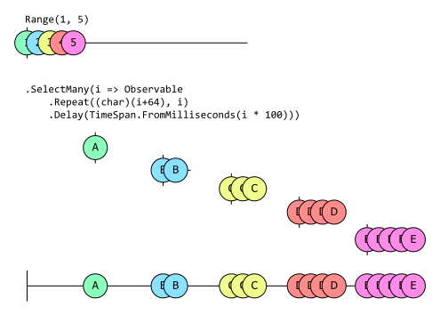

# 序列的轉換

我們取用的序列中的值並不總是符合我們需要的格式。有時資訊超出了我們的需要，我們需要僅挑選出感興趣的值。有時每個值都需要擴展為更豐富的物件或更多值。

到目前為止，我們已經介紹了序列的建立、轉換為序列以及透過篩選減少序列。在本章中，我們將探討序列的_轉換_。

## Select

最直接的轉換方法是 `Select`。它允許你提供一個接受 `TSource` 值並返回 `TResult` 值的函式。`Select` 的簽名反映了它將序列元素從一種型別轉換為另一種型別的能力，即從 `IObservable<TSource>` 轉換為 `IObservable<TResult>`。

```csharp
IObservable<TResult> Select<TSource, TResult>(
    this IObservable<TSource> source, 
    Func<TSource, TResult> selector)
```

你不需要變更型別——如果你願意，`TSource` 和 `TResult` 可以是相同的。第一個範例透過加上 3 來轉換整數序列，產生另一個整數序列。

```csharp
IObservable<int> source = Observable.Range(0, 5);
source.Select(i => i+3)
      .Dump("+3")
```

這使用了我們在[篩選章節](05_Filtering.md)開頭定義的 `Dump` 擴充方法。它產生以下輸出：

```
+3 --> 3
+3 --> 4
+3 --> 5
+3 --> 6
+3 --> 7
+3 completed
```

下一個範例以變更其型別的方式轉換值。它將整數值轉換為字元。

```csharp
Observable.Range(1, 5);
          .Select(i => (char)(i + 64))
          .Dump("char");
```

輸出：

```
char --> A
char --> B
char --> C
char --> D
char --> E
char completed
```

此範例將我們的整數序列轉換為元素具有匿名型別的序列：

```csharp
Observable.Range(1, 5)
          .Select(i => new { Number = i, Character = (char)(i + 64) })
          .Dump("anon");
```

輸出：

```
anon --> { Number = 1, Character = A }
anon --> { Number = 2, Character = B }
anon --> { Number = 3, Character = C }
anon --> { Number = 4, Character = D }
anon --> { Number = 5, Character = E }
anon completed
```

`Select` 是 C# 查詢運算式語法支援的標準 LINQ 運算子之一，因此我們可以像這樣編寫最後一個範例：

```csharp
var query = from i in Observable.Range(1, 5)
            select new {Number = i, Character = (char) (i + 64)};

query.Dump("anon");
```

在 Rx 中，`Select` 還有另一個多載，其中 `selector` 函式接受兩個值。額外的引數是元素在序列中的索引。如果元素在序列中的索引對你的選擇器函式很重要，請使用此方法。

## SelectMany

`Select` 為每個輸入產生一個輸出，而 `SelectMany` 則使每個輸入元素能夠轉換為任意數量的輸出。要了解這是如何運作的，我們先看一個僅使用 `Select` 的範例：

```csharp
Observable
    .Range(1, 5)
    .Select(i => new string((char)(i+64), i))
    .Dump("strings");
```

這會產生以下輸出：

```
strings-->A
strings-->BB
strings-->CCC
strings-->DDDD
strings-->EEEEE
strings completed
```

如你所見，對於 `Range` 產生的每個數字，我們的輸出都包含一個字元長度為該數字的字串。如果我們不是將每個數字轉換為字串，而是將其轉換為 `IObservable<char>` 呢？我們只需在建構字串後加上 `.ToObservable()` 即可做到這一點：

```csharp
Observable
    .Range(1, 5)
    .Select(i => new string((char)(i+64), i).ToObservable())
    .Dump("sequences");
```

（或者，我們也可以將選擇運算式替換為 `i => Observable.Repeat((char)(i+64), i)`。兩者的效果完全相同。）輸出並不是很實用：

```
strings-->System.Reactive.Linq.ObservableImpl.ToObservableRecursive`1[System.Char]
strings-->System.Reactive.Linq.ObservableImpl.ToObservableRecursive`1[System.Char]
strings-->System.Reactive.Linq.ObservableImpl.ToObservableRecursive`1[System.Char]
strings-->System.Reactive.Linq.ObservableImpl.ToObservableRecursive`1[System.Char]
strings-->System.Reactive.Linq.ObservableImpl.ToObservableRecursive`1[System.Char]
strings completed
```

我們得到了一個由可觀察序列組成的可觀察序列。但是看看如果我們現在將該 `Select` 替換為 `SelectMany` 會發生什麼：

```csharp
Observable
    .Range(1, 5)
    .SelectMany(i => new string((char)(i+64), i).ToObservable())
    .Dump("chars");
```

這給了我們一個 `IObservable<char>`，輸出如下：

```
chars-->A
chars-->B
chars-->B
chars-->C
chars-->C
chars-->D
chars-->C
chars-->D
chars-->E
chars-->D
chars-->E
chars-->D
chars-->E
chars-->E
chars-->E
chars completed
```

順序變得有點混亂，但如果你仔細觀察，你會發現每個字母出現的次數與我們發出字串時相同。例如只有一個 `A`，但 `C` 出現了三次，而 `E` 出現了五次。

`SelectMany` 期望轉換函式為每個輸入返回一個 `IObservable<T>`，然後將這些結果合併回單一結果。LINQ to Objects 的等價物稍微沒那麼混亂。如果你執行這段程式碼：

```csharp
Enumerable
    .Range(1, 5)
    .SelectMany(i => new string((char)(i+64), i))
    .ToList()
```

它將產生一個包含這些元素的清單：

```
[ A, B, B, C, C, C, D, D, D, D, E, E, E, E, E ]
```

這個順序比較不奇怪。更詳細地探討箇中原因是有價值的。

### `IEnumerable<T>` 與 `IObservable<T>` 的 `SelectMany` 比較

`IEnumerable<T>` 是拉取型的——序列僅在被要求時才產生元素。`Enumerable.SelectMany` 以非常特定的順序從其來源提取項目。它首先向其來源 `IEnumerable<int>`（前面範例中由 `Range` 返回的序列）請求第一個值。然後 `SelectMany` 呼叫我們的回呼，傳入此第一個項目，接著列舉我們回呼返回的 `IEnumerable<char>` 中的所有內容。只有當它耗盡此內容時，它才會向來源（`Range`）請求第二個項目。同樣地，它將該第二個項目傳遞給我們的回呼，然後完全列舉我們返回的 `IEnumerable<char>`，依此類推。因此我們首先從第一個巢狀序列中獲取所有內容，然後從第二個序列中獲取所有內容，等等。

`Enumerable.SelectMany` 能夠以這種方式進行有兩個原因。首先，`IEnumerable<T>` 的拉取特性使其能夠決定處理事物的順序。其次，對於 `IEnumerable<T>`，作業發生阻塞是正常的，也就是說，在它們為我們準備好某些東西之前不會返回。當前面的範例呼叫 `ToList` 時，在完全以所有結果填入 `List<T>` 之前它不會返回。

Rx 不是這樣的。首先，取用者無法告訴來源何時產生每個項目——來源在準備就緒時發出項目。其次，Rx 通常模擬持續進行的程序，因此我們不期望方法呼叫會阻塞直到完成。在某些情況下，Rx 序列自然會非常快速地產生其所有項目並盡快完成，但我們傾向於使用 Rx 建構模型的資訊來源通常不會以這種方式運作。因此 Rx 中的大多數作業不會阻塞——它們立即返回某些內容（例如 `IObservable<T>` 或表示訂閱的 `IDisposable`），然後稍後產生值。

我們目前正在檢查的範例的 Rx 版本實際上就是這些不尋常的情況之一，其中每個序列都盡快發出項目。從邏輯上講，所有巢狀的 `IObservable<char>` 序列都在同時並行進行。結果是一團混亂，因為這裡的每個可觀察來源都試圖以來源可以取用的最快速度產生每個元素。它們最終交錯的事實與這些可觀察來源使用 Rx 的_排程器_（scheduler）系統的方式有關，我們將在[排程與執行緒章節](11_SchedulingAndThreading.md)中對此進行描述。排程器確保即使在我們模擬邏輯上並行的程序時，也能維持 Rx 的規則，並且 `SelectMany` 輸出的觀察者一次只會獲得一個項目。以下彈珠圖顯示了導致我們看到混亂輸出的事件：

![一個 Rx 彈珠圖，顯示 7 個可觀察物件。第一個說明了 Range 運算子產生值 1 到 5。這些具有如下顏色代碼：綠色、藍色、黃色、紅色和粉紅色。這些顏色對應於圖中下方進一步的可觀察物件，稍後將對此進行描述。第一個可觀察物件中的項目間隔不均勻。第 2 個值緊跟在第 1 個值之後，但在第 3、第 4 和第 5 個項目之前有間隙。這些間隙與圖中下方顯示的活動相對應。在第一個可觀察物件下方是呼叫 SelectMany 運算子的程式碼，傳遞此 lambda："i => new string((char)(i+64),i).ToObservable()"。其下方還有 6 個可觀察物件。前 5 個顯示了 lambda 為每個輸入產生的個別可觀察物件。這些都以顏色標記以顯示它們如何對應：第一個可觀察物件的項目是綠色的，以指示該可觀察物件對應於 Range 發出的第一個項目，第二個可觀察物件的項目是藍色的，表明它對應於 Range 發出的第二個項目，依此類推，採用前面針對 Range 所描述的相同顏色順序。每個可觀察物件的第一個項目在水平方向上與 Range 中的對應項目對齊，這意味著每個可觀察物件都在 Range 可觀察物件發出值時啟動。這 5 個可觀察物件顯示了 lambda 為 Range 中的 5 個值中的每一個所返回的可觀察物件所產生的值。這些子可觀察物件中的第一個顯示值為 'A' 的單個項目，與 Range 可觀察物件中的值 1 垂直對齊，以指示當 Range 產生其第一個值時立即產生此項目。然後該子可觀察物件立即結束，指示僅產生了一個項目。第二個子可觀察物件包含兩個 'B' 值，第三個包含三個 'C' 值，第四個包含四個 'D' 值，第五個包含五個 'E' 值。這些項目的水平位置指示圖中前 6 個可觀察物件（Range 可觀察物件以及 lambda 產生的 5 個可觀察物件）在某種程度上全部重疊。最初這種重疊是極小的：第一個由 lambda 產生的可觀察物件在 Range 產生其第一個值的同時啟動，因此這兩個可觀察物件重疊，但由於此第一個子物件立即完成，因此它與其他物件都不重疊。第二個子物件在 Range 產生其第二個值時啟動，並設法產生兩個值然後在發生任何其他事情之前完成，因此到目前為止，lambda 產生的子可觀察物件僅與 Range 物件重疊，而不與彼此重疊。但是，當 Range 產生其第三個值時，產生的子可觀察物件會產生兩個 'C' 值，但接下來發生的事情（如項目的水平位置所示）是 Range 設法產生其第 4 個值，並且其對應的子可觀察物件接下來產生其第一個 'D' 值。在此之後，第三個子可觀察物件產生其第三個也是最後一個 'C'，因此這第三個子物件不僅與 Range 可觀察物件重疊，而且與第四個子物件重疊。然後第四個可觀察物件產生其第二個 'D'。然後 Range 產生其第五個也是最後一個值，並且對應的子可觀察物件產生其第一個 'E'。然後第四和第五個子可觀察物件交替，產生 'D'、'E' 和 'D'，此時第四個子可觀察物件已完成，現在第五個子可觀察物件不受干擾地產生其最後三個 'E' 值，因為此時它是唯一仍在執行的可觀察物件。圖表底部是代表 SelectMany 輸出的第 7 個可觀察物件。這顯示了來自 5 個子可觀察物件中的每一個的所有值，每個值都具有完全相同的水平位置（表示只要其任何子可觀察物件產生值，SelectMany 返回的可觀察物件就會產生值）。因此我們可以看到這個輸出可觀察物件產生了序列 'ABBCCDCDEDEDEEE'，這正是我們在前面範例輸出中看到的內容。](GraphicsIntro/Ch06-Transformation-Marbles-Select-Many-Marbles.svg)

我們可以做一點微調，以防止子序列全部嘗試在同一時間執行。（這也使用了 `Observable.Repeat`，而不是建構 `string` 然後在其上呼叫 `ToObservable` 的相當間接的途徑。我在先前的範例中這樣做是為了強調與 LINQ to Objects 範例的相似性，但是在 Rx 中你實際上不會那樣做。）

```csharp
Observable
    .Range(1, 5)
    .SelectMany(i => 
        Observable.Repeat((char)(i+64), i)
                  .Delay(TimeSpan.FromMilliseconds(i * 100)))
    .Dump("chars");
```

現在我們獲得了與 `IEnumerable<T>` 版本一致的輸出：

```
chars-->A
chars-->B
chars-->B
chars-->C
chars-->C
chars-->C
chars-->D
chars-->D
chars-->D
chars-->D
chars-->E
chars-->E
chars-->E
chars-->E
chars-->E
chars completed
```

這清楚說明了 `SelectMany` 允許你為來源產生的每個項目產生一個序列，並將所有這些新序列中的所有項目扁平化回包含所有內容的單一序列。雖然這可能會使其更容易理解，但在現實中你不會純粹為了使其更容易理解而引入這種延遲。這些延遲意味著所有元素出現將需要大約一秒半的時間。這個彈珠圖顯示上面的程式碼透過讓每個子可觀察物件產生一小束項目來產生看似合理的排序，而我們只是引入了空載時間（dead time）來實現分隔：



我引入這些間隙純粹是為了提供一個稍微不那麼令人困惑的範例，但如果你在實務上真的想要這種嚴格按順序的處理，你不會以這種方式使用 `SelectMany`。首先，這不能完全保證有效。（如果你嘗試此範例，但修改它以使用越來越短的時間間隔，最終你會達到項目再次開始混亂的程度。並且由於 .NET 不是即時程式設計系統，因此在此處實際上沒有安全的指定時間間隔可以保證順序。）如果你絕對需要在看到來自第二個子序列的任何項目之前獲取來自第一個子序列的所有項目，實際上有一種可靠的方法可以提出請求：

```csharp
Observable
    .Range(1, 5)
    .Select(i => Observable.Repeat((char)(i+64), i))
    .Concat())
    .Dump("chars");
```

然而，這不是展示 `SelectMany` 作用的好方法，因為這不再使用它。（它使用了 `Concat`，將在[結合序列](09_CombiningSequences.md)章節中進行討論。）當我們知道我們正在解包單值序列時，或者當我們沒有特定的排序要求並希望在元素從子可觀察物件中出現時隨時獲取元素時，我們會使用 `SelectMany`。

### SelectMany 的重要性

如果你按順序閱讀本書的各個章節，你應該已經在前面的章節中看到了 `SelectMany` 的兩個範例。[第 2 章 **LINQ 運算子與組合**小節](02_KeyTypes.md#linq-operators-and-composition)中的第一個範例使用了它。以下是相關程式碼：

```csharp
IObservable<int> onoffs =
    from _ in src
    from delta in 
       Observable.Return(1, scheduler)
                 .Concat(Observable.Return(-1, scheduler)
                                   .Delay(minimumInactivityPeriod, scheduler))
    select delta;
```

（如果你想知道其中對 `SelectMany` 的呼叫在哪裡，請記住，如果查詢運算式包含兩個 `from` 子句，C# 編譯器會將它們轉換為對 `SelectMany` 的呼叫。）這說明了 Rx 中的一種常見模式，可以將其描述為展開（fan out），然後再向內收合（fan in）。

你可能還記得，這個範例的運作方式是為 `src` 產生的每個項目建立一個新的、短暫的 `IObservable<int>`。（這些由範例中的 `delta` 範圍變數表示的子序列產生值 `1`，然後在指定的 `minimumActivityPeriod` 之後產生 `-1`。這使我們能夠計算最近發出的事件數量。）這是_展開_部分，其中來源序列中的項目產生新的可觀察序列。`SelectMany` 在這些情境中至關重要，因為它使所有這些新序列能夠扁平化回單一輸出序列。

我使用 `SelectMany` 的第二個地方略有不同：它是[第 3 章 **在 Rx 中表示檔案系統事件**小節](03_CreatingObservableSequences.md#representing-filesystem-events-in-rx)的最後一個範例。雖然該範例也將多個可觀察來源合併為單一可觀察物件，但該可觀察物件清單是固定的：來自 `FileSystemWatcher` 的每個不同事件都有一個。它使用了一個不同的運算子 `Merge`（我們將在[結合序列](09_CombiningSequences.md)中介紹），在該情境中使用它更簡單，因為你只需向其傳遞你想要合併的所有可觀察物件的清單。然而，由於此程式碼想要執行的其他幾件事（包括延遲啟動、自動化處置以及在多個訂閱者處於活動狀態時共享單一來源），用於實現此目的的特定運算子組合意味著我們返回 `IObservable<FileSystemEventArgs>` 的合併程式碼需要作為轉換步驟來呼叫。如果我們只是使用 `Select`，結果將會是 `IObservable<IObservable<FileSystemEventArgs>>`。該程式碼的結構意味著它只會產生單個 `IObservable<FileSystemEventArgs>`，因此雙層包裝的型別將相當不便。`SelectMany` 在這些情境中非常有用。如果運算子的組合引入了你不需要的多餘一層可觀察物件中的可觀察物件，`SelectMany` 可以為你解包一層。

這兩種情況——展開然後向內收合，以及移除或避免一層可觀察物件的可觀察物件——經常出現，這使得 `SelectMany` 成為一個重要的方法。（我在先前的範例中無法避免使用它，這並不奇怪。）

碰巧的是，`SelectMany` 在 Rx 所基於的數學理論中也是一個特別重要的運算子。它是一個基本運算子，從某種意義上說，可以使用它建構許多其他 Rx 運算子。[附錄 D 中的「使用 `SelectMany` 重新建立其他運算子」章節](D_AlgebraicUnderpinnings.md#recreating-other-operators-with-selectmany)展示了如何使用 `SelectMany` 實作 `Select` 和 `Where`。

## Cast

C# 的型別系統並非無所不知。有時我們可能知道從可觀察來源中出現的值的型別的一些資訊，而這些資訊並未反映在該來源的型別中。這可能是基於特定領域的知識。例如，對於船隻廣播的 AIS 訊息，我們可能知道如果訊息類型為 3，它將包含導航資訊。這意味著我們可以這樣寫：

```csharp
IObservable<IVesselNavigation> type3 = 
   receiverHost.Messages.Where(v => v.MessageType == 3)
                        .Cast<IVesselNavigation>();
```

這使用了 `Cast`，這是一個標準的 LINQ 運算子，每當我們知道某個集合中的項目屬於比型別系統所能推斷的型別更具體的型別時，我們就可以使用它。

`Cast` 與[第 5 章所示的 `OfType` 運算子](05_Filtering.md#oftype)之間的區別在於它們處理非指定型別項目的方式。`OfType` 是一個篩選運算子，因此它只會篩選掉不屬於指定型別的任何項目。但是對於 `Cast`（就像一般的 C# 轉型運算式一樣），我們宣告我們期望來源項目具有指定的型別，因此如果其來源產生與指定型別不相容的項目，則由 `Cast` 返回的可觀察物件將呼叫其訂閱者的 `OnError`。

如果我們使用其他更基本的運算子重新建立 `Cast` 和 `OfType` 的功能，可能更容易看出這種區別。

```csharp
// source.Cast<int>(); 等同於
source.Select(i => (int)i);

// source.OfType<int>();
source.Where(i => i is int).Select(i => (int)i);
```

## Materialize 與 Dematerialize

`Materialize` 運算子將 `IObservable<T>` 來源轉換為型別為 `IObservable<Notification<T>>` 的來源。它將為來源產生的每個項目提供一個 `Notification<T>`，並且如果來源終止，它將產生一個最終的 `Notification<T>`，指示它是成功完成還是出錯。

這很有用，因為它產生的物件描述了整個序列。如果你想以稍後可以重播的方式記錄可觀察物件的輸出...嗯，你可能會使用 `ReplaySubject<T>`，因為它是專門為該工作設計的。但是如果你想能夠執行除了僅重播序列之外的其他操作——在重播之前檢查項目甚至可能修改它們，你可能希望編寫自己的程式碼來儲存項目。`Notification<T>` 會很有幫助，因為它使你能夠以統一的方式表示來源所做的一切。你不需要單獨儲存有關序列是否或如何終止的資訊——此資訊就是最終的 `Notification<T>`。

你可以想像在單元測試中將此與 `ToArray` 結合使用。這將使你能夠獲得型別為 `Notification<T>[]` 的陣列，其中包含來源所做一切的完整描述，從而可以輕鬆編寫測試來詢問（例如）從序列中出現的第三個項目是什麼。（Rx.NET 原始程式碼本身在其許多測試中都使用了 `Notification<T>`。）

如果我們具體化（materialize）一個序列，我們可以看到返回的被包裝值。

```csharp
Observable.Range(1, 3)
          .Materialize()
          .Dump("Materialize");
```

輸出：

```
Materialize --> OnNext(1)
Materialize --> OnNext(2)
Materialize --> OnNext(3)
Materialize --> OnCompleted()
Materialize completed
```

請注意，當來源序列完成時，具體化序列會產生一個 'OnCompleted' 通知值，然後完成。`Notification<T>` 是一個抽象類別，具有三種實作：

 * OnNextNotification
 * OnErrorNotification
 * OnCompletedNotification

`Notification<T>` 公開了四個公用屬性以幫助你檢查它：`Kind`、`HasValue`、`Value` 和 `Exception`。顯然只有 `OnNextNotification` 會對 `HasValue` 返回 true 並具有有用的 `Value` 實作。類似地，`OnErrorNotification` 是唯一具有 `Exception` 值的實作。`Kind` 屬性返回一個 `enum`，允許你知道哪些方法適合使用。

```csharp
public enum NotificationKind
{
    OnNext,
    OnError,
    OnCompleted,
}
```

在下一個範例中，我們產生一個發生錯誤的序列。請注意，具體化序列的最終值是 `OnErrorNotification`。另請注意，具體化序列沒有發生錯誤，它成功完成了。

```csharp
var source = new Subject<int>();
source.Materialize()
      .Dump("Materialize");

source.OnNext(1);
source.OnNext(2);
source.OnNext(3);

source.OnError(new Exception("Fail?"));
```

輸出：

```
Materialize --> OnNext(1)
Materialize --> OnNext(2)
Materialize --> OnNext(3)
Materialize --> OnError(System.Exception)
Materialize completed
```

具體化序列對於執行序列的分析或記錄非常方便。你可以透過套用 `Dematerialize` 擴充方法來解包具體化的序列。`Dematerialize` 僅適用於 `IObservable<Notification<TSource>>`。

這完成了我們對轉換運算子的介紹。它們的共同特徵是針對每個輸入項目產生一個輸出（或在 `SelectMany` 的情況下是一組輸出）。接下來我們將探討能夠組合來自其來源多個項目之資訊的運算子。
