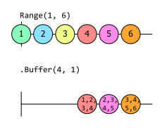

# 分割 (Partitioning)

Rx 可以將單一序列拆分為多個序列。這對於將項目分發給許多訂閱者很有用。在執行分析時，對分割區進行彙總可能很有用。你可能已經熟悉標準 LINQ 運算子 `GroupBy`。Rx 支援此功能，並且還定義了自己的一些運算子。

## GroupBy

`GroupBy` 運算子允許你分割序列，就像 `IEnumerable<T>` 的 `GroupBy` 運算子所做的那樣。開源的 [Ais.Net 專案](https://github.com/ais-dotnet)再次提供了一個有用的範例。其 [`ReceiverHost` 類別](https://github.com/ais-dotnet/Ais.Net.Receiver/blob/15de7b2908c3bd67cf421545578cfca59b24ed2c/Solutions/Ais.Net.Receiver/Ais/Net/Receiver/Receiver/ReceiverHost.cs)透過 Rx 提供 AIS 訊息，定義了類型為 `IObservable<IAisMessage>` 的 `Messages` 屬性。這是一個非常繁忙的來源，因為它會回報它能夠存取的每則訊息。例如，如果你將接收器連接到挪威政府慷慨提供的 AIS 訊息來源，每當_任何_船隻在挪威海岸的任何地方廣播 AIS 訊息時，它都會產生通知。有很多船隻在挪威周圍移動，所以這有點像消防水管。

如果我們確切知道我們感興趣的船隻，你已經在[篩選章節](05_Filtering.md)中看到了如何篩選此資料流。但如果我們不知道，卻仍然希望能夠執行與個別船隻相關的處理呢？例如，也許我們想在任何船隻變更其 `NavigationStatus`（回報諸如 `AtAnchor` 或 `Moored` 等值）時發現。篩選章節的 [`Distinct` 和 `DistinctUntilChanged` 一節](05_Filtering.md#distinct-and-distinctuntilchanged)展示了確切的作法，但它是從將資料流篩選為來自單一船隻的訊息開始的。如果我們嘗試直接在所有船隻的資料流上使用 `DistinctUntilChanged`，它將不會產生有意義的資訊。如果船隻 A 停泊而船隻 B 下錨，並且如果我們從船隻 A 和船隻 B 接收到交替的狀態訊息，`DistinctUntilChanged` 將把每則訊息報告為狀態變更，即使這兩艘船的狀態都沒有改變。

我們可以透過將「所有船隻」序列拆分為許多小子序列來解決此問題：

```csharp
IObservable<IGroupedObservable<uint, IAisMessage>> perShipObservables = 
   receiverHost.Messages.GroupBy(message => message.Mmsi);
```

這個 `perShipObservables` 是一個可觀察序列的可觀察序列。更具體地說，它是一個分組可觀察序列 (grouped observable sequences) 的可觀察序列，但正如你可以從 [`IGroupedObservable<TKey, T>` 的定義](https://github.com/dotnet/reactive/blob/95d9ea9d2786f6ec49a051c5cff47dc42591e54f/Rx.NET/Source/src/System.Reactive/Linq/IGroupedObservable.cs#L18)中所看到的，分組可觀察序列只是一種特殊的可觀察序列：

```csharp
public interface IGroupedObservable<out TKey, out TElement> : IObservable<TElement>
{
    TKey Key { get; }
}
```

每次 `receiverHost.Message` 回報 AIS 訊息時，`GroupBy` 運算子都會呼叫回呼函式以找出此項目屬於哪個群組。我們將回呼函式返回的值稱為_索引鍵 (key)_，並且 `GroupBy` 會記住它已經看到的每個索引鍵。如果這是一個新的索引鍵，`GroupBy` 會建立一個新的 `IGroupedObservable`，其 `Key` 屬性將是回呼函式剛返回的值。它會從外部可觀察序列（我們放在 `perShipObservables` 中的那個）發出這個 `IGroupedObservable`，然後立即讓該新的 `IGroupedObservable` 發出產生該索引鍵的元素（在此範例中為 `IAisMessage`）。但如果回呼函式產生了 `GroupBy` 之前看過的索引鍵，它會找到它已經為該索引鍵產生的 `IGroupedObservable`，並讓它發出該值。

因此在此範例中，其效果是每當 `receiverHost` 回報來自我們之前未曾收到訊息的船隻的訊息時，`perShipObservables` 都會發出一個新的可觀察序列，僅回報該船隻的訊息。我們可以使用它來在每次得知新船隻時進行回報：

```csharp
perShipObservables.Subscribe(m => Console.WriteLine($"New ship! {m.Key}"));
```

但這並沒有做任何我們無法使用 `Distinct` 實現的事情。`GroupBy` 的強大之處在於我們在這裡為每艘船獲得了一個可觀察序列，因此我們可以繼續設定一些針對每艘船的處理：

```csharp
IObservable<IObservable<IAisMessageType1to3>> shipStatusChangeObservables =
    perShipObservables.Select(shipMessages => shipMessages
        .OfType<IAisMessageType1to3>()
        .DistinctUntilChanged(m => m.NavigationStatus)
        .Skip(1));
```

這使用 [`Select`](06_Transformation.md#select)（在轉換章節中介紹）對來自 `perShipObservables` 的每個群組套用處理。請記住，每個這樣的群組代表一艘不同的船隻，因此我們在此處傳遞給 `Select` 的回呼函式將為每艘船恰好呼叫一次。這意味著我們現在可以安全地使用 `DistinctUntilChanged`。此範例提供給 `DistinctUntilChanged` 的輸入是一個僅代表來自一艘船之訊息的序列，因此這將在該船變更其狀態時告訴我們。這現在能夠完成我們想要的工作，因為每艘船都有自己的 `DistinctUntilChanged` 執行個體。`DistinctUntilChanged` 始終轉發它接收到的第一個事件——它僅在項目與前一個項目相同時才會丟棄項目，而在這種情況下沒有前一個項目。但這不太可能是此處正確的行為。假設我們從名為 `A` 的某艘船隻看到的第一則訊息回報了 `Moored` 狀態。在我們開始執行之前，它有可能處於某種不同的狀態，並且我們收到的第一份報告恰好代表了狀態的變更。但更可能的情況是，在我們開始之前它已經停泊了一段時間。我們無法確定，但大多數狀態報告並不代表變更，因此 `DistinctUntilChanged` 始終轉發第一個事件的行為在此處可能是錯誤的。因此我們使用 `Skip(1)` 來丟棄每艘船的第一則訊息。

此時我們有了一個可觀察序列的可觀察序列。外部序列為它看到的每艘相異船隻產生一個巢狀序列，並且該巢狀序列將回報該特定船隻的 `NavigationStatus` 變更。

我要做一個小調整：

```csharp
IObservable<IAisMessageType1to3> shipStatusChanges =
    perShipObservables.SelectMany(shipMessages => shipMessages
        .OfType<IAisMessageType1to3>()
        .DistinctUntilChanged(m => m.NavigationStatus)
        .Skip(1));
```

我已將 `Select` 替換為 [`SelectMany`，也在轉換章節中描述過](06_Transformation.md#selectmany)。你可能還記得，`SelectMany` 將巢狀可觀察序列扁平化回單一扁平序列。你可以在傳回類型中看到這一點：現在我們只得到一個 `IObservable<IAisMessageType1to3>`，而不是序列的序列。

等一下！我難道不是剛剛取消了 `GroupBy` 所做的工作嗎？我要求它按船隻 ID 分割事件，那麼為什麼我現在要將它重新合併回單一扁平流呢？這不就是我一開始擁有的東西嗎？

確實，資料流類型的形狀與我的原始輸入相同：這將是 AIS 訊息的單一可觀察序列。（它更專門一些——元素類型是 `IAisMessageType1to3`，因為那是可以獲取 `NavigationStatus` 的地方，但這些仍然都實作了 `IAisMessage`。）並且所有不同的船隻將在這個單一資料流中混合在一起。但我實際上並沒有消除 `GroupBy` 所做的工作。這個彈珠圖說明了正在發生的事情：

![彈珠圖顯示名為 receiverHost.Messages 的輸入可觀察序列如何展開為群組、進行處理，然後摺疊回單一來源。輸入可觀察序列顯示來自三艘不同船隻「A」、「B」和「C」的事件。每個事件都標有船隻報告的狀態。來自 A 的所有訊息都報告 Moored 狀態。B 做出兩次 AtAnchor 狀態報告，隨後是兩次 UnderwayUsingEngine 報告。C 報告兩次 UnderwaySailing，然後是 AtAnchor，然後再次是 UnderwaySailing。來自這三艘船的事件是交錯的——輸入線上的順序是 A、B、C、B、A、C、B、C、C、B、A。下一節標記為 perShipObservables，這顯示了按船隻對事件進行分組的效果。第一行僅顯示來自 A 的事件，第二行顯示來自 B 的事件，第三行顯示來自 C 的事件。下一節標有前面範例中的處理程式碼，並顯示另外三個可觀察序列，對應於圖表前面部分中的三個群組。但在這個群組中，A 的來源完全沒有顯示任何事件。第二行顯示 B 的單一事件，即它第一次報告 UnderwayUsingEngine。它顯示了 C 的兩個事件：它報告 AtAnchor 的那次，以及之後它報告 UnderwaySailing 的那次。圖表的最後一行是單一來源，結合了圖表上一節中剛剛描述的事件。](GraphicsIntro/Ch08-Partitioning-Marbles-Status-Changes.svg)

`perShipObservables` 區段顯示了 `GroupBy` 如何為每艘相異船隻建立單獨的可觀察序列。（此圖顯示了三艘船隻，名為 `A`、`B` 和 `C`。對於真實來源，`GroupBy` 會輸出更多可觀察序列，但原理保持不變。）我們在扁平化這些群組資料流之前對它們做了一些工作。如前所述，我們使用 `DistinctUntilChanged` 和 `Skip(1)` 來確保僅在確切知道船隻狀態已變更時才產生事件。（由於我們只看到 `A` 回報 `Moored` 狀態，因此據我們所知其狀態從未變更，這就是為什麼其資料流完全為空。）只有這樣，我們才將其扁平化回單一可觀察序列。

彈珠圖需要簡單才能放在一頁上，所以現在讓我們快速看一下一些真實的輸出。這證實了這與原始的 `receiverHost.Messages` 非常不同。首先，我需要附加一個訂閱者：

```csharp
shipStatusChanges.Subscribe(m => Console.WriteLine(
   $"Vessel {((IAisMessage)m).Mmsi} changed status to {m.NavigationStatus} at {DateTimeOffset.UtcNow}"));
```

如果我讓接收器執行約十分鐘，我會看到以下輸出：

```
Vessel 257076860 changed status to UnderwayUsingEngine at 23/06/2023 06:42:48 +00:00
Vessel 257006640 changed status to UnderwayUsingEngine at 23/06/2023 06:43:08 +00:00
Vessel 259005960 changed status to UnderwayUsingEngine at 23/06/2023 06:44:23 +00:00
Vessel 259112000 changed status to UnderwayUsingEngine at 23/06/2023 06:44:33 +00:00
Vessel 259004130 changed status to Moored at 23/06/2023 06:44:43 +00:00
Vessel 257076860 changed status to NotDefined at 23/06/2023 06:44:53 +00:00
Vessel 258024800 changed status to Moored at 23/06/2023 06:45:24 +00:00
Vessel 258006830 changed status to UnderwayUsingEngine at 23/06/2023 06:46:39 +00:00
Vessel 257428000 changed status to Moored at 23/06/2023 06:46:49 +00:00
Vessel 257812800 changed status to Moored at 23/06/2023 06:46:49 +00:00
Vessel 257805000 changed status to Moored at 23/06/2023 06:47:54 +00:00
Vessel 259366000 changed status to UnderwayUsingEngine at 23/06/2023 06:47:59 +00:00
Vessel 257076860 changed status to UnderwayUsingEngine at 23/06/2023 06:48:59 +00:00
Vessel 257020500 changed status to UnderwayUsingEngine at 23/06/2023 06:50:24 +00:00
Vessel 257737000 changed status to UnderwayUsingEngine at 23/06/2023 06:50:39 +00:00
Vessel 257076860 changed status to NotDefined at 23/06/2023 06:51:04 +00:00
Vessel 259366000 changed status to Moored at 23/06/2023 06:51:54 +00:00
Vessel 232026676 changed status to Moored at 23/06/2023 06:51:54 +00:00
Vessel 259638000 changed status to UnderwayUsingEngine at 23/06/2023 06:52:34 +00:00
```

這裡需要理解的關鍵點是，在十分鐘的時間內，`receiverHost.Messages` 產生了_數千_則訊息。（速率因一天中的時間而異，但通常每分鐘超過一千則訊息。當我執行它以產生該輸出時，程式碼大約處理了一萬則訊息。）但正如你所看到的，`shipStatusChanges` 只產生了 19 則訊息。

這展示了 Rx 如何以比單純彙總強大得多的方式馴服大量事件來源。我們不僅僅將資料縮減為只能提供概述的某些統計量測。平均值或變異數等統計度量通常非常有用，但它們並不總是能夠為我們提供我們想要的領域特定見解。例如，它們無法告訴我們有關任何特定船隻的任何資訊。但在這裡，每則訊息都告訴我們有關特定船隻的資訊。儘管我們正在檢視每艘船，但我們仍能夠保留這種詳細程度。我們已經能夠指示 Rx 在任何船隻變更其狀態時告訴我們。

這看起來我可能把這件事說得太誇張了，但實現這個結果花費了很少的精力，以至於很容易忽略 Rx 在這裡為我們做了多少工作。此程式碼執行以下所有操作：

- 監視在挪威海域運作的每一艘船
- 提供每艘船的資訊
- 以人類可以合理應付的速率回報事件

它可以接收數千則訊息並執行必要的處理以找到真正對我們重要的少數訊息。

這是轉換章節中[「SelectMany 的重要性」](06_Transformation.md#the-significance-of-selectmany)中描述的「展開然後再次收縮 (fanning out, and then back in again)」技術的範例。此程式碼使用 `GroupBy` 從單一可觀察序列展開為多個可觀察序列。此步驟的關鍵是建立巢狀可觀察序列，為我們想要進行的處理提供適當的詳細程度。在此範例中，詳細程度是「一艘特定的船」，但不必侷限於此。你可以想像希望按區域對訊息進行分組——也許我們對比較不同的港口感興趣，因此我們希望根據船隻最接近的港口或可能根據其目的地港口來分割來源。（AIS 提供了一種讓船隻廣播其預期目的地的方法。）在根據我們需要的任何條件對資料進行分割後，我們接著定義要為每個群組套用的處理。在這種情況下，我們只是觀察 `NavigationStatus` 的變更。這一步通常是發生容量縮減的地方。例如，大多數船隻每天最多只會變更幾次其 `NavigationStatus`。在將通知流減少為我們真正關心的那些事件之後，我們可以將其組合回單一資料流，以提供我們想要的高價值通知。

當然，這種能力是有代價的。讓 Rx 為我們完成這項工作並沒有花費太多程式碼，但我們讓它運作得相當辛苦：它需要記住迄今為止看過的每艘船，並為每艘船維護一個可觀察來源。如果我們的資料來源具有足夠廣泛的覆蓋範圍，可以接收來自數萬艘船隻的訊息，Rx 將需要維護數萬個可觀察來源，每個船隻一個。所示範例完全沒有類似非作用中逾時的機制——廣播即使是單一訊息的船隻也會在程式執行期間一直被記住。（惡意行為者偽造 AIS 訊息，每個訊息都帶有不同的虛構識別碼，最終將導致此程式碼因記憶體不足而崩潰。）根據你的資料來源，你可能需要採取措施來避免記憶體使用量的無限制增長，因此真實範例可能會變得比這更複雜，但基本方法是強大的。

現在我們已經看過了一個範例，讓我們更詳細地了解 `GroupBy`。它有幾種不同的形式。我們剛剛使用了這個多載：

```csharp
public static IObservable<IGroupedObservable<TKey, TSource>> GroupBy<TSource, TKey>(
    this IObservable<TSource> source, 
    Func<TSource, TKey> keySelector)
```

該多載使用你選擇的索引鍵類型的任何預設比較行為。在我們的案例中，我們使用了 `uint`（AIS 訊息中唯一識別船隻的 `Mmsi` 屬性的類型），它只是一個數字，因此它本質上是可比較的類型。在某些情況下，你可能需要非標準比較。例如，如果你使用 `string` 作為索引鍵，你可能希望能夠指定區分地區設定的大寫/小寫不敏感比較。對於這些情境，有一個接受比較子的多載：

```csharp
public static IObservable<IGroupedObservable<TKey, TSource>> GroupBy<TSource, TKey>(
    this IObservable<TSource> source, 
    Func<TSource, TKey> keySelector, 
    IEqualityComparer<TKey> comparer)
```

還有另外兩個多載使用 `elementSelector` 引數擴充了前兩個多載：

```csharp
public static IObservable<IGroupedObservable<TKey, TElement>> GroupBy<TSource, TKey, TElement>(
    this IObservable<TSource> source, 
    Func<TSource, TKey> keySelector, 
    Func<TSource, TElement> elementSelector)
{...}

public static IObservable<IGroupedObservable<TKey, TElement>> GroupBy<TSource, TKey, TElement>(
    this IObservable<TSource> source, 
    Func<TSource, TKey> keySelector, 
    Func<TSource, TElement> elementSelector, 
    IEqualityComparer<TKey> comparer)
{...}
```

這在功能上等同於在 `GroupBy` 之後使用 `Select` 運算子。

順便說一句，使用 `GroupBy` 時，你可能會想直接 `Subscribe` 巢狀可觀察序列：

```csharp
// 不要這樣做。請使用先前的範例。
perShipObservables.Subscribe(shipMessages =>
  shipMessages
    .OfType<IAisMessageType1to3>()
    .DistinctUntilChanged(m => m.NavigationStatus)
    .Skip(1)
    .Subscribe(m => Console.WriteLine(
    $"Ship {((IAisMessage)m).Mmsi} changed status to {m.NavigationStatus} at {DateTimeOffset.UtcNow}")));
```

這似乎具有相同的效果：這裡的 `perShipObservables` 是 `GroupBy` 返回的序列，因此它將為每艘不同的船產生一個可觀察資料流。此範例訂閱了該資料流，然後在每個巢狀序列上使用與之前相同的運算子，但不是使用 `SelectMany` 將結果收集到單一輸出可觀察序列中，而是明確地為每個巢狀資料流呼叫 `Subscribe`。

如果你不熟悉 Rx，這可能看起來是一種更自然的工作方式。但是，儘管這似乎會產生相同的行為，但它引入了一個問題：Rx 不明白這些巢狀訂閱與外部訂閱相關聯。在這個簡單的範例中，這不一定會導致問題，但如果我們開始使用其他運算子，就可能會導致問題。考慮這個修改：

```csharp
IDisposable sub = perShipObservables.Subscribe(shipMessages =>
  shipMessages
    .OfType<IAisMessageType1to3>()
    .DistinctUntilChanged(m => m.NavigationStatus)
    .Skip(1)
    .Finally(() => Console.WriteLine($"Nested sub for {shipMessages.Key} ending"))
    .Subscribe(m => Console.WriteLine(
    $"Ship {((IAisMessage)m).Mmsi} changed status to {m.NavigationStatus} at {DateTimeOffset.UtcNow}")));
```

我為巢狀序列新增了一個 `Finally` 運算子。這使我們能夠在序列因任何原因結束時呼叫回呼函式。但是即使我們從外部序列取消訂閱（透過呼叫 `sub.Dispose();`），這個 `Finally` 也永遠不會做任何事情。那是因為 Rx 無法知道這些內部訂閱是外部訂閱的一部分。

如果我們對早期版本進行相同的修改（其中這些巢狀序列由 `SelectMany` 收集到一個輸出序列中），Rx 就會理解對內部序列的訂閱之所以存在純粹是因為對 `SelectMany` 返回的序列進行了訂閱。（事實上，`SelectMany` 才是訂閱那些內部序列的關鍵。）因此如果我們在該範例中從輸出序列取消訂閱，它將正確地在任何內部序列上執行任何 `Finally` 回呼函式。

更一般地說，如果你有許多序列作為單一處理鏈的一部分而產生，通常最好讓 Rx 端對端地管理整個程序。

## Buffer

如果你需要批次處理事件，`Buffer` 運算子非常有用。這對效能很有用，特別是當你儲存有關事件的資料時。以 AIS 範例為例。如果你想將通知記錄到永續性儲存區中，儲存單一記錄的成本可能與儲存多筆記錄的成本幾乎相同。大多數儲存裝置都使用通常幾千位元組大小的資料區塊進行操作，因此儲存單一位元組資料所需的工作量通常與儲存幾千位元組所需的工作量相同。在我們擁有相當大的工作區塊之前進行資料緩衝的模式在程式設計中隨處可見。.NET 執行階段函式庫的 `Stream` 類別正是出於這個原因而具有內建緩衝區，因此它內建在 Rx 中也就不足為奇了。

效率考量並不是你可能想要在一個批次中處理多個事件而不是個別事件的唯一原因。假設你想產生有關某個資料來源之持續更新統計資料的串流。透過使用 `Buffer` 將來源分割成區塊，你可以計算例如過去 10 個事件的平均值。

`Buffer` 可以分割來自來源資料流的元素，因此它是與 `GroupBy` 類似的運算子，但是有幾個顯著的差異。首先，`Buffer` 不會檢查元素以確定如何分割它們——它純粹根據元素出現的順序進行分割。其次，`Buffer` 會等待直到完全填滿一個分割區，然後將所有元素呈現為 `IList<T>`。這可以使某些任務變得更容易，因為分割區中的所有內容都可以立即使用——值不會埋在巢狀的 `IObservable<T>` 中。第三，`Buffer` 提供了一些多載，使單一元素有可能出現在多個「分割區」中。（在這種情況下，`Buffer` 不再嚴格分割資料，但正如你將看到的，這只是其他行為的一個小變化。）

使用 `Buffer` 最簡單的方法是將相鄰元素收集到區塊中。（LINQ to Objects 現在有一個稱為 [`Chunk`](https://learn.microsoft.com/en-us/dotnet/api/system.linq.enumerable.chunk) 的等效運算子。Rx 沒有使用相同名稱的原因是 Rx 在 LINQ to Objects 之前 10 多年就引入了這個運算子。所以真正的問題是為什麼 LINQ to Objects 選擇了不同的名稱。這可能是因為 `Chunk` 不支援 Rx 的 `Buffer` 所支援的所有變化，但你需要詢問 .NET 執行階段函式庫團隊。）`Buffer` 的這個多載接受單一引數，指示你想要的區塊大小：

```csharp
public static IObservable<IList<TSource>> Buffer<TSource>(
    this IObservable<TSource> source, 
    int count)
{...}
```

此範例使用它將導航訊息拆分為 4 個區塊，然後繼續計算這 4 個讀數的平均速度：

```csharp
IObservable<IList<IVesselNavigation>> navigationChunks = 
   receiverHost.Messages.Where(v => v.Mmsi == 235009890)
                        .OfType<IVesselNavigation>()
                        .Where(n => n.SpeedOverGround.HasValue)
                        .Buffer(4);

IObservable<float> recentAverageSpeed = 
    navigationChunks.Select(chunk => chunk.Average(n => n.SpeedOverGround.Value));
```

如果來源完成，但產生的元素不是區塊大小的精確倍數，則最後一個區塊將會較小。我們可以使用以下更人為的範例看到這一點：

```csharp
Observable
    .Range(1, 5)
    .Buffer(2)
    .Select(chunk => string.Join(", ", chunk))
    .Dump("chunks");
```

正如你從這個輸出中看到的，最後一個區塊只有一個項目，即使我們每次要求 2 個：

```
chunks-->1, 2
chunks-->3, 4
chunks-->5
chunks completed
```

`Buffer` 在這裡別無選擇，因為來源已完成，如果它沒有產生最後那個尺寸不足的區塊，我們將永遠看不到最後一個項目。但除了這種來源結尾的情況之外，`Buffer` 的這個多載會等到它收集了足夠的元素來填滿指定大小的緩衝區之後才會將其傳遞下去。這意味著 `Buffer` 引入了延遲。如果來源項目相隔很遠（例如，當船隻不移動時，它可能每隔幾分鐘才回報一次 AIS 導航資料），這可能會導致長時間的延遲。

在某些情況下，我們可能希望在來源繁忙時批次處理多個事件，而不必在來源運作較慢時等待很長時間。這在使用者介面中會很有用。如果你想提供最新資訊，最好接受一個尺寸不足的區塊，以便你可以提供更及時的資訊。對於這些情境，`Buffer` 提供了接受 `TimeSpan` 的多載：

```csharp
public static IObservable<IList<TSource>> Buffer<TSource>(
    this IObservable<TSource> source, 
    TimeSpan timeSpan)
{...}

public static IObservable<IList<TSource>> Buffer<TSource>(
    this IObservable<TSource> source, 
    TimeSpan timeSpan, 
    int count)
{...}
```

其中第一個僅根據時間來分割來源。無論 `source` 產生值的速率為何，這都會每秒發出一個區塊：

```csharp
IObservable<IList<string>> output = source.Buffer(TimeSpan.FromSeconds(1));
```

如果 `source` 在任何特定區塊的生命週期內碰巧沒有發出任何值，`output` 將發出一個空清單。

第二個多載同時接受 `timespan` 和 `count`，本質上施加了兩個上限：在區塊之間你永遠不需要等待超過 `timespan` 的時間，並且你永遠不會收到包含超過 `count` 個元素的區塊。與僅包含 `timespan` 的多載一樣，如果來源產生元素的速度不夠快，無法在指定時間內填滿緩衝區，則這可以傳遞未滿甚至空的區塊。

### 重疊緩衝區 (Overlapping buffers)

在上一節中，我展示了一個範例，它為特定船隻收集了 4 個 `IVesselNavigation` 項目的區塊，並計算了平均速度。這種對多個樣本進行平均的方法可以有效平滑讀數中微小的隨機變化。因此在這種情況下，目的不是為了提高效率而批次處理項目，而是為了實現特定類型的計算。

但是該範例存在一個問題：因為它對 4 個讀數進行平均，所以每 4 則輸入訊息才產生一次輸出。而且由於船隻在不移動時可能每隔幾分鐘才報告一次速度，我們可能會等待很長的時間。

`Buffer` 的一個多載使我們能夠做得更好：與其平均前 4 個讀數，然後是其後的 4 個讀數，再其後的 4 個讀數等，我們可能希望在_每次船隻報告新讀數時_計算最後 4 個讀數的平均值。

這有時稱為滑動視窗 (sliding window)。我們想要處理讀數 1、2、3、4，然後是 2、3、4、5，然後是 3、4、5、6，依此類推。有一個緩衝區多載可以做到這一點。此範例顯示了先前平均速度範例中的第一個陳述式，但做了一個小修改：

```csharp
IObservable<IList<IVesselNavigation>> navigationChunks = receiverHost.Messages
    .Where(v => v.Mmsi == 235009890)
    .OfType<IVesselNavigation>()
    .Where(n => n.SpeedOverGround.HasValue)
    .Buffer(4, 1);
```

這會呼叫接受兩個 `int` 引數的 `Buffer` 多載。第一個引數的作用與之前相同：表示我們希望每個區塊中有 4 個項目。但第二個引數指示產生緩衝區的頻率。這表示我們希望來源產生的每 `1` 個元素（即每一個元素）都有一個緩衝區。（僅接受 `count` 的多載等同於為此多載的兩個引數傳遞相同的值。）

因此，這將等待直到來源產生 4 則合適的訊息（即滿足此處 `Where` 和 `OfType` 運算子的訊息），然後在從 `navigationChunks` 出現的第一個 `IList<VesselNavigation>` 中回報前四個讀數。但是來源只需再產生一則合適的訊息，然後這將發出另一個 `IList<VesselNavigation>`，其中包含與第一個區塊相同的 3 個值，接著是新值。當下一則合適的訊息出現時，這將發出另一個包含第 3、第 4、第 5 和第 6 則訊息的清單，依此類推。

此彈珠圖說明了 `Buffer(4, 1)` 的行為。



如果我們將其送入與先前範例相同的 `recentAverageSpeed` 運算式中，在第 4 則合適的訊息從來源出現之前我們仍然不會得到任何輸出，但從那時起，從來源出現的每一則合適訊息都將發出一個新的平均值。這些平均值仍將始終回報最近回報的 4 個速度的平均值，但我們現在獲得這些平均值的頻率是原來的四倍。

我們還可以使用它來改進前面回報船隻何時變更其 `NavigationStatus` 的範例。上一個範例告訴你船隻剛進入什麼狀態，但這引出了一個明顯的問題：它以前處於什麼狀態？我們可以使用 `Buffer(2, 1)`，以便每次看到指示狀態變更的訊息時，我們也可以存取先前的狀態變更：

```csharp
IObservable<IList<IAisMessageType1to3>> shipStatusChanges =
    perShipObservables.SelectMany(shipMessages => shipMessages
        .OfType<IAisMessageType1to3>()
        .DistinctUntilChanged(m => m.NavigationStatus)
        .Buffer(2, 1));

IDisposable sub = shipStatusChanges.Subscribe(m => Console.WriteLine(
    $"Ship {((IAisMessage)m[0]).Mmsi} changed status from" +
    $" {m[1].NavigationStatus} to {m[1].NavigationStatus}" +
    $" at {DateTimeOffset.UtcNow}"));
```

如輸出所示，我們現在可以回報先前的狀態以及剛進入的狀態：

```
Ship 259664000 changed status from UnderwayUsingEngine to Moored at 30/06/2023
 13:36:39 +00:00
Ship 257139000 changed status from AtAnchor to UnderwayUsingEngine at 30/06/20
23 13:38:39 +00:00
Ship 257798800 changed status from UnderwayUsingEngine to Moored at 30/06/2023
 13:38:39 +00:00
```

此變更使我們能夠移除 `Skip`。先前的範例之所以有這個，是因為我們無法判斷啟動後從任何特定船隻收到的第一則訊息是否代表變更。但是既然我們告訴 `Buffer` 我們想要成對的訊息，在看到具有兩種不同狀態的訊息之前，它不會為任何單一船隻提供任何內容。

你還可以使用此多載要求依時間而非計數定義的滑動視窗：

```csharp
public static IObservable<IList<TSource>> Buffer<TSource>(
    this IObservable<TSource> source, 
    TimeSpan timeSpan, 
    TimeSpan timeShift)
{...}
```

`timeSpan` 決定每個視窗涵蓋的時間長度，`timeShift` 決定啟動新視窗的間隔。

## Window

`Window` 運算子與 `Buffer` 非常相似。它可以根據元素計數或時間將輸入拆分為區塊，並且還支援重疊視窗。但是，它具有不同的傳回類型。在 `IObservable<T>` 上使用 `Buffer` 將傳回 `IObservable<IList<T>>`，而 `Window` 將傳回 `IObservable<IObservable<T>>`。這意味著 `Window` 不必等到填滿整個緩衝區後才產生任何內容。你可以說 `Window` 比 `Buffer` 更充分地擁抱了反應式典範。不過在獲得一些經驗之後，你可能會得出結論：`Window` 比 `Buffer` 更難使用，但在實務上很少更有用。

因為 `Buffer` 傳回 `IObservable<IList<T>>`，所以在擁有將進入該區塊的所有元素之前，它無法產生區塊。`IList<T>` 支援隨機存取——你可以詢問它有多少個元素，並且可以透過數字索引擷取任何元素，我們期望這些操作立即完成。（在技術上可以編寫一個代表尚未接收資料的 `IList<T>` 實作，並在資料可用之前嘗試使用其 `Count` 和索引子屬性時使其封鎖，但這會是一件奇怪的事情。開發人員期望清單立即傳回資訊，而 Rx 的 `Buffer` 產生的清單滿足了這一期望。）因此如果你編寫例如 `Buffer(4)`，在它擁有構成第一個區塊的所有 4 個項目之前它無法產生任何內容。

但由於 `Window` 傳回一個產生巢狀可觀察序列以代表每個區塊的可觀察序列，因此它可以在不一定擁有所有元素的情況下發出該序列。事實上，一旦知道需要一個新視窗，它就會立即發出一個新視窗。例如，如果你使用 `Window(4, 1)`，它傳回的可觀察序列會立即發出其第一個巢狀可觀察序列。然後一旦來源產生其第一個元素，該巢狀可觀察序列將發出該元素，然後將產生第二個巢狀可觀察序列。我們傳遞 `1` 作為 `Window` 的第 2 個引數，因此來源產生的每個元素都會獲得一個新視窗。一旦發出了第一個元素，來源發出的下一個項目將出現在第二個視窗中（也出現在第一個視窗中，因為在這種情況下我們指定了重疊視窗），因此第二個視窗在第一個元素出現後立即有效地_開啟_。因此 `Window` 傳回的 `IObservable<IObservable<T>>` 在該時間點產生一個新的 `IObservable<T>`。

巢狀可觀察序列在項目可用時產生它們。一旦 `Window` 知道該視窗中不會再有其他項目（即在 `Buffer` 本應為該視窗產生已完成的 `IList<T>` 的完全相同的時間點），它們就會完成。

`Window` 看起來可能比 `Buffer` 更好，因為它可以讓你隨時掌握區塊中的個別項目。但是，如果你正在進行的計算需要存取區塊中的每一個項目，這不一定對你有幫助。在收到區塊中的每個項目之前，你將無法完成處理，因此你不會提早產生最終結果，並且你的程式碼可能會更複雜，因為它不再能指望擁有方便地一次提供所有項目的 `IList<T>`。但是，如果你正在計算對區塊中項目的某種彙總，`Window` 可能會更有效率，因為它使你能夠在每個項目出現時處理它然後將其丟棄。如果區塊非常大，`Buffer` 必須保留每個項目直到區塊完成，這可能會使用更多記憶體。此外，在你不一定需要先查看區塊中的每個項目才能對這些項目執行有用操作的情況下，`Window` 可能使你能夠避免引入處理延遲。

`Window` 在 AIS `NavigationStatus` 範例中對我們沒有幫助，因為那裡的目標是回報每次變更的_變更前_和_變更後_狀態。在知道_變更後_的值之前我們無法做到這一點，因此提前接收_變更前_的值不會帶來任何好處。我們需要第二個值來執行我們嘗試做的事情，因此我們不妨使用 `Buffer`，因為它更容易。但是如果你想追蹤今天到目前為止回報移動的相異船隻數量，`Window` 將是一個合適的機制：你可以將其設定為每天產生一個視窗，並且你將能夠開始查看每個視窗內的資訊，而無需等到一天結束。

除了支援基於計數或基於持續時間的簡單拆分之外，還有更具彈性的方式來定義視窗邊界，例如此多載：

```csharp
// 將可觀察序列的每個元素投射到連續的非重疊視窗中。
// windowClosingSelector : 呼叫以定義所產生視窗邊界的函式。
// 當前一個視窗關閉時，將啟動一個新視窗。
public static IObservable<IObservable<TSource>> Window<TSource, TWindowClosing>
(
    this IObservable<TSource> source, 
    Func<IObservable<TWindowClosing>> windowClosingSelector
)
```

這些複雜多載中的第一個允許我們控制視窗何時關閉。每次建立視窗時都會呼叫 `windowClosingSelector` 函式，並且當來自 `windowClosingSelector` 的對應序列產生值時，每個視窗都會關閉。該值會被忽略，因此序列值的類型無關緊要；事實上你只需完成來自 `windowClosingSelector` 的序列即可關閉視窗。

在此範例中，我們建立一個帶有關閉選取器的視窗。我們每次都從該選取器傳回相同的主體 (subject)，然後每當使用者從主控台按下 Enter 鍵時從該主體進行通知。

```csharp
int windowIdx = 0;
IObservable<long> source = Observable.Interval(TimeSpan.FromSeconds(1)).Take(10);
var closer = new Subject<Unit>();
source.Window(() => closer)
      .Subscribe(window =>
       {
           int thisWindowIdx = windowIdx++;
           Console.WriteLine("--Starting new window");
           string windowName = $"Window{thisWindowIdx}";
           window.Subscribe(
              value => Console.WriteLine("{0} : {1}", windowName, value),
              ex => Console.WriteLine("{0} : {1}", windowName, ex),
              () => Console.WriteLine("{0} Completed", windowName));
       },
       () => Console.WriteLine("Completed"));

string input = "";
while (input != "exit")
{
    input = Console.ReadLine();
    closer.OnNext(Unit.Default);
}
```

輸出（當我在顯示「1」和「5」後按 Enter 鍵時）：

```
--Starting new window
window0 : 0
window0 : 1

window0 Completed

--Starting new window
window1 : 2
window1 : 3
window1 : 4
window1 : 5

window1 Completed

--Starting new window
window2 : 6
window2 : 7
window2 : 8
window2 : 9

window2 Completed

Completed
```

`Window` 最複雜的多載允許我們建立可能重疊的視窗。

```csharp
// 將可觀察序列的每個元素投射到零個或多個視窗中。
// windowOpenings : 其元素表示建立新視窗的可觀察序列。
// windowClosingSelector : 呼叫以定義關閉每個產生之視窗的函式。
public static IObservable<IObservable<TSource>> Window
    <TSource, TWindowOpening, TWindowClosing>
(
    this IObservable<TSource> source, 
    IObservable<TWindowOpening> windowOpenings, 
    Func<TWindowOpening, IObservable<TWindowClosing>> windowClosingSelector
)
```

此多載接受三個引數：

1. 來源序列
2. 指示何時應開啟新視窗的序列
3. 接受視窗開啟值並傳回視窗關閉序列的函式

此多載在開啟和關閉視窗的方式上提供了極大的彈性。視窗在很大程度上可以彼此獨立；它們可以重疊、大小各異，甚至跳過來自來源的值。

為了讓我們更容易進入這個更複雜的多載，讓我們先嘗試使用它來重新建立一個更簡單的 `Window` 版本（接受計數的多載）。為此，我們需要在初始訂閱時開啟一個視窗一次，並且在來源產生指定計數時開啟一次。每次達到該計數時，視窗都需要關閉。為了實現這一點，我們只需要來源序列。我們將多次訂閱它，但對於某些類型的來源，這可能會導致問題，因此我們透過 [`Publish`](15_PublishingOperators.md#publish) 運算子進行訂閱，該運算子在僅對底層來源進行一次訂閱的同時啟用多個訂閱者。

```csharp
public static IObservable<IObservable<T>> MyWindow<T>(
    this IObservable<T> source, 
    int count)
{
    IObservable<T> shared = source.Publish().RefCount();
    IObservable<int> windowEdge = shared
        .Select((i, idx) => idx % count)
        .Where(mod => mod == 0)
        .Publish()
        .RefCount();
    return shared.Window(windowEdge, _ => windowEdge);
}
```

如果我們現在想要擴充此方法以提供略過功能，我們需要有兩個不同的序列：一個用於開啟，一個用於關閉。我們在訂閱時開啟一個視窗，並在 `skip` 個項目通過後再次開啟。我們在視窗開啟後「`count`」個項目通過時關閉這些視窗。

```csharp
public static IObservable<IObservable<T>> MyWindow<T>(
    this IObservable<T> source, 
    int count, 
    int skip)
{
    if (count <= 0) throw new ArgumentOutOfRangeException();
    if (skip <= 0) throw new ArgumentOutOfRangeException();

    IObservable<T> shared = source.Publish().RefCount();
    IObservable<int> index = shared
        .Select((i, idx) => idx)
        .Publish()
        .RefCount();
 
    IObservable<int> windowOpen = index.Where(idx => idx % skip == 0);
    IObservable<int> windowClose = index.Skip(count-1);
 
    return shared.Window(windowOpen, _ => windowClose);
}
```

我們可以在這裡看到，由於 `windowClose` 序列是從函式傳回的，因此每次開啟視窗時都會重新訂閱它。這允許我們為每個視窗重新套用略過 (`Skip(count-1)`)。目前，我們忽略了 `windowOpen` 推播給 `windowClose` 選取器的值，但如果你在某些邏輯中需要它，可以使用它。

如你所見，`Window` 運算子可以非常強大。我們甚至可以使用 `Window` 來複製其他運算子；例如我們可以透過這種方式建立我們自己的 `Buffer` 實作。我們可以讓 `SelectMany` 運算子接受單一值（視窗）以產生另一種類型的零個或多個值（在我們的例子中是單一 `IList<T>`）。為了在不封鎖的情況下建立 `IList<T>`，我們可以套用 `Aggregate` 方法並使用新的 `List<T>` 作為種子 (seed)。

```csharp
public static IObservable<IList<T>> MyBuffer<T>(this IObservable<T> source, int count)
{
    return source.Window(count)
        .SelectMany(window => 
            window.Aggregate(
                new List<T>(), 
                (list, item) =>
                {
                    list.Add(item);
                    return list;
                }));
}
```

你可能會發現嘗試使用 `Window` 實作其他時間轉換方法（如 `Sample` 或 `Throttle`）是一個有趣的練習。

我們已經看到了幾種有用的方法，可以使用資料驅動的群組條件，或者使用 `Buffer` 或 `Window` 進行基於時間的分塊，將單一項目資料流分散到多個輸出序列中。在下一章中，我們將探討可以將來自多個資料流的資料組合在一起的運算子。
