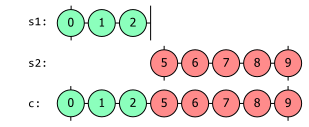
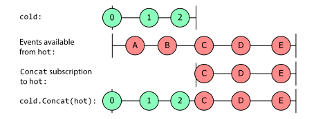
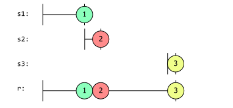
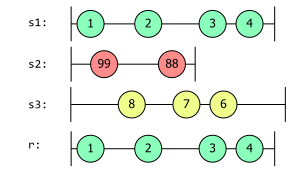
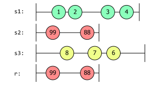
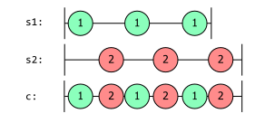
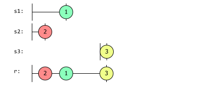

# 組合序列 (Combining sequences)

資料來源無處不在，有時我們需要使用來自多個來源的資料。具有多個輸入的常見範例包括：價格饋送、感測器網路、新聞饋送、社群媒體彙總器、檔案監控器、多點觸控表面、活動檢測/輪詢伺服器等。我們處理這些多個刺激的方式也各不相同。我們可能希望將其全部作為整合資料的洪流來使用，或者作為循序資料一次使用一個序列。我們也可以有序地獲取它，將來自兩個來源的資料值配對以便一起處理，或者可能只使用首先回應請求的來源的資料。

前面的章節還展示了資料處理的_展開然後再次收縮 (fan out and back in)_ 風格的一些範例，我們對資料進行分割，並對每個分割區進行處理，以便在重新組合之前將大量資料轉換為較低量但較高價值的事件。這種重組資料流的能力極大地增強了運算子組合的好處。如果 Rx 僅使我們能夠將組合套用為簡單的線性處理鏈，那麼它的功能將大大減弱。能夠將資料流拆開為我們提供了更大的彈性。因此，即使只有單一事件來源，我們通常仍需要將多個可觀察資料流組合為處理的一部分。序列組合使你能夠跨多個資料來源建立複雜的查詢。這開啟了編寫一些非常強大但簡潔的程式碼的可能性。

我們在前面的章節中已經使用過 [`SelectMany`](06_Transformation.md#selectmany)。這是 Rx 中的基本運算子之一。正如我們在[轉換章節](06_Transformation.md)中所看到的，可以使用 `SelectMany` 建構其他幾個運算子，其組合資料流的能力正是其強大之處的一部分。但是還有幾個更專門的組合運算子可用，這使得解決某些問題比使用 `SelectMany` 更容易。此外，我們之前見過的一些運算子（包括 `TakeUntil` 和 `Buffer`）具有我們尚未探索的可以組合多個序列的多載。

## 循序組合 (Sequential Combination)

我們將從最簡單的組合運算子開始，它們不嘗試並行組合。它們一次只處理一個來源序列。

### Concat

`Concat` 可以說是最簡單的組合序列方式。它與其他 LINQ 提供者中的同名方法具有相同的作用：串接兩個序列。產生的序列產生第一個序列中的所有元素，然後產生第二個序列中的所有元素。`Concat` 最簡單的簽章如下。

```csharp
public static IObservable<TSource> Concat<TSource>(
    this IObservable<TSource> first, 
    IObservable<TSource> second)
```

由於 `Concat` 是一個擴充方法，我們可以在任何序列上將其作為方法叫用，並將第二個序列作為唯一引數傳入：

```csharp
IObservable<int> s1 = Observable.Range(0, 3);
IObservable<int> s2 = Observable.Range(5, 5);
IObservable<int> c = s1.Concat(s2);
IDisposable sub = c.Subscribe(Console.WriteLine, x => Console.WriteLine("Error: " + x));
```

這個彈珠圖顯示了從兩個來源 `s1` 和 `s2` 出現的項目，以及 `Concat` 如何將它們組合成結果 `c`：



在有訂閱者訂閱其返回的 `IObservable<T>` 之前，Rx 的 `Concat` 不會對其來源執行任何操作。因此在這種情況下，當我們在 `c`（`Concat` 返回的來源）上呼叫 `Subscribe` 時，它將訂閱其第一個輸入 `s1`，並且每次產生一個值時，`c` 可觀察序列都會向其訂閱者發出相同的數值。如果我們在 `s1` 完成之前呼叫 `sub.Dispose()`，`Concat` 將取消訂閱第一個來源，並且永遠不會訂閱 `s2`。如果 `s1` 回報錯誤，`c` 將向其訂閱者回報相同的錯誤，並且同樣地，它將永遠不會訂閱 `s2`。只有當 `s1` 完成時，`Concat` 運算子才會訂閱 `s2`，此時它將轉發該第二個輸入產生的任何項目，直到第二個來源完成或失敗，或者應用程式從串接的可觀察序列取消訂閱。

儘管 Rx 的 `Concat` 與 [LINQ to Objects 的 `Concat`](https://learn.microsoft.com/en-us/dotnet/api/system.linq.enumerable.concat) 具有相同的邏輯行為，但仍需要注意一些 Rx 特有的細節。特別是，時間在 Rx 中通常比在其他 LINQ 實作中更為重要。例如，在 Rx 中，我們區分[_熱來源與冷來源_](02_KeyTypes.md#hot-and-cold-sources)。對於冷來源，訂閱的確切時間通常無關緊要，但熱來源本質上是即時的，因此你只會收到在訂閱期間發生的事件的通知。這可能意味著熱來源可能不適合與 `Concat` 一起使用。以下彈珠圖說明了一種產生可能令人驚訝的結果的情境：


由於 `Concat` 在第一個輸入完成之前不會訂閱其第二個輸入，因此它不會看到 `hot` 來源會傳遞給從一開始就一直在監聽的任何訂閱者的前幾個項目。這可能不是你期望的行為：它看起來肯定不像把第一個序列中的所有項目與第二個序列中的所有項目串接在一起。看起來它遺漏了來自 `hot` 的 `A` 和 `B`。

#### 彈珠圖的局限性 (Marble Diagram Limitations)

這最後一個範例揭示了彈珠圖掩蓋了一個細節：它們顯示來源何時開始、何時產生值以及何時完成，但它們忽略了這樣一個事實：為了能夠產生項目，可觀察來源需要一個訂閱者。如果沒有任何東西訂閱 `IObservable<T>`，那麼它實際上不會產生任何東西。`Concat` 直到第一個輸入完成才會訂閱其第二個輸入，因此可以說，與其顯示上面的圖表，不如顯示這個圖表更準確：


這使得更容易看出為什麼 `Concat` 會產生這樣的輸出。但是由於 `hot` 在這裡是一個熱來源，因此該圖表無法傳達 `hot` 完全按照自己的排程產生項目的事實。在 `hot` 有多個訂閱者的情況下，前面的圖表可以說更好，因為它正確反映了來自 `hot` 的每個可用事件（無論在任何特定時刻可能有多少個接聽程式訂閱）。但是，儘管這個約定適用於熱來源，但它不適用於冷來源，冷來源通常在訂閱時開始產生項目。由 [`Timer`](03_CreatingObservableSequences.md#observabletimer) 返回的來源會依定期排程產生項目，但該排程在發生訂閱的瞬間開始。這意味著如果有多個訂閱，就會有多個排程。即使我只有一個由 `Observable.Timer` 返回的單一 `IObservable<long>`，每個不同的訂閱者也將按照自己的排程取得項目——訂閱者以固定的間隔接收事件，_從他們碰巧訂閱的時間開始_。因此對於冷可觀察序列，通常使用這第二個圖表所使用的約定是有意義的，在該圖表中我們正在查看對來源的特定訂閱所接收到的事件。

大多數時候我們可以忽略這種微妙之處，悄悄地使用適合我們的任何約定。套用[矮胖子的話：當我使用彈珠圖時，它的意思就是我選擇的意思——不多也不少](https://www.goodreads.com/quotes/12608-when-i-use-a-word-humpty-dumpty-said-in-rather)。但是當你將熱來源和冷來源組合在一起時，可能沒有一種明顯最好的方式在彈珠圖中表示這一點。我們甚至可以做類似的事情，將 `hot` 所代表的事件與對 `hot` 的特定訂閱所看到的事件分開描述。




我們在彈珠圖中使用一個單獨的「泳道 (lane)」來代表對來源的特定訂閱所看到的事件。透過這項技術，我們還可以展示如果你將相同的冷來源傳遞給 `Concat` 兩次會發生什麼情況：


這突顯了作為冷來源，`cold` 分別為每個訂閱提供項目。我們看到相同的來源出現了相同的這三個值，但時間不同。

#### 串接多個來源 (Concatenating Multiple Sources)

如果你想要串接兩個以上的序列該怎麼辦？`Concat` 有一個接受多個可觀察序列作為陣列的多載。這使用 `params` 關鍵字進行標註，因此你不需要明確建構陣列。你可以只傳遞任意數量的引數，C# 編譯器將為你產生建立陣列的程式碼。還有一個接受 `IEnumerable<IObservable<T>>` 的多載，以防你想要串接的可觀察序列已經存在於某個集合中。

```csharp
public static IObservable<TSource> Concat<TSource>(
    params IObservable<TSource>[] sources)

public static IObservable<TSource> Concat<TSource>(
    this IEnumerable<IObservable<TSource>> sources)
```

`IEnumerable<IObservable<T>>` 多載會延遲評估 `sources`。在有人訂閱 `Concat` 返回的可觀察序列之前，它不會開始向其請求來源可觀察序列，並且僅在當前來源完成時才在產生的 `IEnumerator<IObservable<T>>` 上再次呼叫 `MoveNext`，這意味著它已準備好開始下一個序列。為了說明這一點，以下範例是一個迭代器方法，它返回序列的序列，並點綴著記錄。它返回三個可觀察序列，每個序列都有單一值 [1]、[2] 和 [3]。每個序列在計時器延遲時返回其值。

```csharp
public IEnumerable<IObservable<long>> GetSequences()
{
    Console.WriteLine("GetSequences() called");
    Console.WriteLine("Yield 1st sequence");

    yield return Observable.Create<long>(o =>
    {
        Console.WriteLine("1st subscribed to");
        return Observable.Timer(TimeSpan.FromMilliseconds(500))
            .Select(i => 1L)
            .Finally(() => Console.WriteLine("1st finished"))
            .Subscribe(o);
    });

    Console.WriteLine("Yield 2nd sequence");

    yield return Observable.Create<long>(o =>
    {
        Console.WriteLine("2nd subscribed to");
        return Observable.Timer(TimeSpan.FromMilliseconds(300))
            .Select(i => 2L)
            .Finally(() => Console.WriteLine("2nd finished"))
            .Subscribe(o);
    });

    Thread.Sleep(1000); // Force a delay

    Console.WriteLine("Yield 3rd sequence");

    yield return Observable.Create<long>(o =>
    {
        Console.WriteLine("3rd subscribed to");
        return Observable.Timer(TimeSpan.FromMilliseconds(100))
            .Select(i=>3L)
            .Finally(() => Console.WriteLine("3rd finished"))
            .Subscribe(o);
    });

    Console.WriteLine("GetSequences() complete");
}
```

我們可以呼叫這個 `GetSequences` 方法並將結果傳遞給 `Concat`，然後使用我們的 `Dump` 擴充方法來觀察發生的情況：

```csharp
GetSequences().Concat().Dump("Concat");
```

這是輸出：

```
GetSequences() called
Yield 1st sequence
1st subscribed to
Concat-->1
1st finished
Yield 2nd sequence
2nd subscribed to
Concat-->2
2nd finished
Yield 3rd sequence
3rd subscribed to
Concat-->3
3rd finished
GetSequences() complete
Concat completed
```

下面是套用於 `GetSequences` 方法的 `Concat` 運算子的彈珠圖。「s1」、「s2」和「s3」代表序列 1、2 和 3。分別地，「rs」代表結果序列。



你應該注意，一旦迭代器執行了它的第一個 `yield return` 來返回第一個序列，迭代器就不會繼續，直到第一個序列完成。迭代器呼叫 `Console.WriteLine` 在第一個 `yield return` 之後立即顯示文字 `Yield 2nd sequence`，但是你可以看到該訊息直到我們看到顯示來自 `Concat` 的第一個輸出的 `Concat-->1` 訊息以及由 `Finally` 運算子產生的 `1st finished` 訊息之後才出現在輸出中，該運算子僅在第一個序列完成後執行。（該程式碼還使第一個來源在產生其值之前延遲 500 毫秒，因此如果你執行此程式碼，你可以看到所有內容都會停止一會兒，直到第一個來源產生其單一值然後完成。）一旦第一個來源完成，`GetSequences` 方法就會繼續（因為一旦第一個可觀察來源完成，`Concat` 將向其請求下一個項目）。當 `GetSequences` 使用另一個 `yield return` 提供第二個序列時，`Concat` 會訂閱它，並且在該第二個可觀察序列完成之前，`GetSequences` 同樣不會取得進一步的進展。當被要求提供第三個序列時，迭代器本身會先等待一秒鐘，然後再產生第三個也是最後一個值，你可以從圖中 `s2` 的結尾和 `s3` 的開始之間的差距中看到這一點。

### Prepend

`Concat` 支援一種特定的情境，但方式稍微有些繁瑣。有時讓序列始終立即發出某些初始值會很有用。以我在本書中經常使用的範例為例，其中船隻傳輸 AIS 訊息以回報其位置和其他資訊：在某些應用程式中，你可能不想等到船隻下次碰巧傳輸訊息。你可以想像一個記錄任何船隻最後已知位置的應用程式。這將使應用程式可以提供例如 `IObservable<IVesselNavigation>`，它在訂閱時立即回報最後已知的資訊，然後在船隻產生任何較新訊息時繼續提供。

我們該如何實作這一點？我們希望最初具有類似冷來源的行為，但隨後轉換為熱來源。所以我們可以只串接兩個來源。我們可以使用 [`Observable.Return`](03_CreatingObservableSequences.md#observablereturn) 建立單一元素的冷來源，然後將其與即時資料流串接：

```csharp
IVesselNavigation lastKnown = ais.GetLastReportedNavigationForVessel(mmsi);
IObservable<IVesselNavigation> live = ais.GetNavigationMessagesForVessel(mmsi);

IObservable<IVesselNavigation> lastKnownThenLive = Observable.Concat(
    Observable.Return(lastKnown), live);
```

這是一個很常見的需求，Rx 提供了具有類似效果的 `Prepend`。我們可以用以下程式碼替換最後一行：

```csharp
IObservable<IVesselNavigation> lastKnownThenLive = live.Prepend(lastKnown);
```

這個可觀察序列將執行完全相同的操作：訂閱者將立即收到 `lastKnown`，然後如果船隻發出進一步的導航訊息，他們也將收到這些訊息。順便說一句，對於這種情境，你可能還想確保盡可能延遲查詢「最後已知」訊息。我們可以使用 [`Defer`](03_CreatingObservableSequences.md#observabledefer) 將此延遲到訂閱的時間點：

```csharp
public static IObservable<IVesselNavigation> GetLastKnownAndSubsequenceNavigationForVessel(uint mmsi)
{
    return Observable.Defer<IVesselNavigation>(() =>
    {
        // This lambda will run each time someone subscribes.
        IVesselNavigation lastKnown = ais.GetLastReportedNavigationForVessel(mmsi);
        IObservable<IVesselNavigation> live = ais.GetNavigationMessagesForVessel(mmsi);

        return live.Prepend(lastKnown);
    }
}
```

`StartWith` 可能會讓你想到 [`BehaviorSubject<T>`](03_CreatingObservableSequences.md#behaviorsubjectt)，因為那也確保了取用者在訂閱時立即收到一個值。這不太一樣：`BehaviorSubject<T>` 會快取其自己的來源發出的最後一個值。你可能會認為這會使其成為實作此船隻導航範例的更好方法。但是，由於此範例能夠為任何船隻返回來源（`mmsi` 引數是唯一識別船隻的[水上行動業務識別碼 (Maritime Mobile Service Identity)](https://en.wikipedia.org/wiki/Maritime_Mobile_Service_Identity)），因此它需要為你感興趣的每艘船都執行一個 `BehaviorSubject<T>`，這可能是不切實際的。

`BehaviorSubject<T>` 只能保留一個值，這對於此 AIS 情境來說很好，而 `Prepend` 也共享了這個限制。但是如果你需要一個來源以某個特定的序列開始呢？

### StartWith

`StartWith` 是 `Prepend` 的一般化，使我們能夠提供任意數量的要在訂閱時立即發出的值。與 `Prepend` 一樣，它隨後將繼續轉發從來源出現的任何進一步通知。

正如你從其簽章中看到的，此方法接受值的 `params` 陣列，因此你可以根據需要傳入任意多或少的值：

```csharp
// prefixes a sequence of values to an observable sequence.
public static IObservable<TSource> StartWith<TSource>(
    this IObservable<TSource> source, 
    params TSource[] values)
```

還有一個接受 `IEnumerable<T>` 的多載。請注意，Rx _不會_ 延遲其列舉。`StartWith` 在返回之前會立即將 `IEnumerable<T>` 轉換為陣列。

`StartsWith` 不是常見的 LINQ 運算子，它的存在是 Rx 所特有的。如果你想像 `StartsWith` 在 LINQ to Objects 中會是什麼樣子，它與 [`Concat`](https://learn.microsoft.com/en-us/dotnet/api/system.linq.enumerable.concat) 沒有實質上的不同。在 Rx 中存在差異是因為 `StartsWith` 有效地在_拉取 (pull)_ 和_推播 (push)_ 世界之間架起了橋樑。它有效地將我們提供的項目轉換為可觀察序列，然後將 `source` 引數串接到該序列上。

### Append

`Prepend` 的存在可能會讓你懷疑是否存在一個用於將單一項目新增至任何 `IObservable<T>` 末尾的 `Append`。畢竟這是一個常見的 LINQ 運算子；例如 [LINQ to Objects 有一個 `Append` 實作](https://learn.microsoft.com/en-us/dotnet/api/system.linq.enumerable.append)。Rx 確實提供了這樣的東西：

```csharp
IObservable<string> oneMore = arguments.Append("And another thing...");
```

沒有對應的 `EndWith`。沒有根本原因說明不能有這樣的東西，只是顯然沒有太多需求——[Rx 存放庫](https://github.com/dotnet/reactive)尚未收到功能請求。因此，儘管 `Prepend` 和 `Append` 的對稱性確實表明 `StartWith` 和尚未假設的 `EndWith` 之間可能存在類似的對稱性，但缺乏這個對應項似乎並沒有造成任何問題。能夠建立始終立即產生有用輸出的可觀察來源具有明顯的價值；除了滿足對對稱性的渴望之外，目前尚不清楚 `EndWith` 會有什麼用處。

### DefaultIfEmpty

我們將要檢驗的下一個運算子嚴格來說並不執行循序組合。然而，它是 `Append` 和 `Prepend` 的非常近的親屬。像那些運算子一樣，這將發出其來源所發出的所有內容。像那些運算子一樣，`DefaultIfEmpty` 接受一個額外的項目。不同之處在於它不會總是發出該額外的項目。

`Prepend` 在開頭發出其額外項目，而 `Append` 在結尾發出其額外項目，而 `DefaultIfEmpty` 僅在來源在不產生任何內容的情況下完成時才發出額外項目。因此這提供了一種保證可觀察序列不為空的方法。

你不必為 `DefaultIfEmpty` 提供值。如果你使用未提供此類值的多載，它將只使用 `default(T)`。這對於 _struct_ 類型將是類似零的值，對於參考類型將是 `null`。

### Repeat

循序組合序列的最後一個運算子是 `Repeat`。它允許你簡單地重複一個序列。它提供了可以指定重複輸入次數的多載，以及一個無限重複的多載：

```csharp
// Repeats the observable sequence a specified number of times.
public static IObservable<TSource> Repeat<TSource>(
    this IObservable<TSource> source, 
    int repeatCount)

// Repeats the observable sequence indefinitely and sequentially.
public static IObservable<TSource> Repeat<TSource>(
    this IObservable<TSource> source)
```

`Repeat` 在每次重複時都會重新訂閱來源。這意味著只有在每次訂閱時來源產生相同的項目時，這才會嚴格重複。與 [`ReplaySubject<T>`](03_CreatingObservableSequences.md#replaysubjectt) 不同，這不會儲存和重播從來源出現的項目。這意味著你通常不會想在熱來源上呼叫 `Repeat`。（如果你真的想要重複熱來源的輸出，結合使用 [`Replay`](15_PublishingOperators.md#replay) 和 `Repeat` 可能會符合需求。）

如果你使用無限重複的多載，那麼序列停止的唯一方法是發生錯誤或處置了訂閱。指定重複次數的多載將在發生錯誤、取消訂閱或達到該計數時停止。此範例展示了序列 [0,1,2] 重複三次。

```csharp
var source = Observable.Range(0, 3);
var result = source.Repeat(3);

result.Subscribe(
    Console.WriteLine,
    () => Console.WriteLine("Completed"));
```

輸出：

```
0
1
2
0
1
2
0
1
2
Completed
```

## 並行序列 (Concurrent sequences)

我們現在轉向用於組合可能並行產生值的可觀察序列的運算子。

### Amb

`Amb` 是一個名稱奇特的運算子。它是 _ambiguous_ 的縮寫，但這並沒有告訴我們比 `Amb` 更多的資訊。如果你對這個名稱感到好奇，可以在[附錄 D 中閱讀有關 `Amb` 的起源](D_AlgebraicUnderpinnings.md#amb)，但現在，讓我們看看它實際做了什麼。
Rx 的 `Amb` 接受任意數量的 `IObservable<T>` 來源作為輸入，並等待查看哪一個（如果有的話）首先產生某種輸出。一旦發生這種情況，它會立即取消訂閱所有其他來源，並轉發首先做出反應的來源的所有通知。

為什麼這很有用？

`Amb` 的一個常見使用案例是當你想要盡快產生某種結果，並且你有多個獲取該結果的選項，但你事先不知道哪個會最快。也許有多個伺服器都可以為你提供所需的答案，但無法預測哪個伺服器的回應時間最短。你可以向所有伺服器傳送請求，然後只使用第一個做出回應的伺服器。如果你將每個個別請求建模為其自己的 `IObservable<T>`，`Amb` 可以為你處理此問題。請注意，這效率不高：你要求多個伺服器都執行相同的工作，並且你將捨棄大部分伺服器的結果。（由於 `Amb` 在第一個來源做出反應時立即取消訂閱它不打算使用的所有來源，因此你可能可以向所有其他伺服器傳送訊息以取消請求。但這仍然有些浪費。）但是在某些情境下，及時性至關重要，對於這些情況，可能值得容忍一些浪費的精力以產生更快的結果。

`Amb` 與 `Task.WhenAny` 大致相似，因為它可以讓你偵測多個來源中的第一個何時執行操作。然而，這個類比並不精確。`Amb` 會自動取消訂閱所有其他來源，確保清理所有內容。使用 `Task` 時，你應該始終確保最終觀察所有工作，以防其中任何一個發生錯誤。

為了說明 `Amb` 的行為，這是一個彈珠圖，顯示了三個序列 `s1`、`s2` 和 `s3`，每個序列都能夠產生一系列值。標記為 `r` 的行顯示了將所有三個序列傳入 `Amb` 的結果。正如你所看到的，`r` 提供了與 `s1` 完全相同的通知，因為在此範例中，`s1` 是第一個產生值的序列。



此程式碼完全建立了該彈珠圖中描述的情況，以驗證這確實是 `Amb` 的行為方式：

```csharp
var s1 = new Subject<int>();
var s2 = new Subject<int>();
var s3 = new Subject<int>();

var result = Observable.Amb(s1, s2, s3);

result.Subscribe(
    Console.WriteLine,
    () => Console.WriteLine("Completed"));

s1.OnNext(1);
s2.OnNext(99);
s3.OnNext(8);
s1.OnNext(2);
s2.OnNext(88);
s3.OnNext(7);
s2.OnCompleted();
s1.OnNext(3);
s3.OnNext(6);
s1.OnNext(4);
s1.OnCompleted();
s3.OnCompleted();
```

輸出：

```
1
2
3
4
Completed
```

如果我們變更順序，使得 `s2.OnNext(99)` 發生在呼叫 `s1.OnNext(1);` 之前，那麼 s2 將首先產生值，彈珠圖將如下所示。



`Amb` 有幾種多載。前面的範例使用了接受序列的 `params` 陣列的多載。還有一個接受恰好兩個來源的多載，避免了 `params` 發生的陣列配置。最後，你可以傳入 `IEnumerable<IObservable<T>>`。（請注意，沒有接受 `IObservable<IObservable<T>>` 的多載。`Amb` 要求預先提供它監視的所有來源可觀察序列。）

```csharp
// Propagates the observable sequence that reacts first.
public static IObservable<TSource> Amb<TSource>(
    this IObservable<TSource> first, 
    IObservable<TSource> second)
{...}
public static IObservable<TSource> Amb<TSource>(
    params IObservable<TSource>[] sources)
{...}
public static IObservable<TSource> Amb<TSource>(
    this IEnumerable<IObservable<TSource>> sources)
{...}
```

重複使用 `Concat` 一節中的 `GetSequences` 方法，我們看到 `Amb` 在訂閱其返回的任何序列之前會完全評估外部 (IEnumerable) 序列。

```csharp
GetSequences().Amb().Dump("Amb");
```

輸出：

```
GetSequences() called
Yield 1st sequence
Yield 2nd sequence
Yield 3rd sequence
GetSequences() complete
1st subscribed to
2nd subscribed to
3rd subscribed to
Amb-->3
Amb completed
```

這是說明此程式碼行為的彈珠圖：


請記住，`GetSequences` 在被請求時會立即產生其前兩個可觀察序列，然後在產生第三個也是最後一個可觀察序列之前等待 1 秒。但與 `Concat` 不同的是，`Amb` 在從迭代器中擷取所有來源之前不會訂閱任何來源，這就是為什麼此彈珠圖顯示對所有三個來源的訂閱在 1 秒後開始。（前兩個來源更早可用——`Amb` 會在發生訂閱時立即開始列舉來源，但它會等到擁有所有三個來源後才訂閱，這就是為什麼它們都出現在右側。）第三個序列在訂閱和產生其值之間的延遲最短，因此儘管它是最後返回的可觀察序列，但即使有兩個序列在它之前一秒產生（由於 `Thread.Sleep`），它也能夠最快產生其值。

### Merge

`Merge` 擴充方法接受多個序列作為其輸入。每當這些輸入序列中的任何一個產生值時，由 `Merge` 返回的可觀察序列都會產生該相同的值。如果輸入序列在不同執行緒上同時產生值，`Merge` 會安全地處理此問題，確保一次傳遞一個項目。

由於 `Merge` 返回包含來自其所有輸入序列的所有值的單一可觀察序列，因此在某種意義上它類似於 `Concat`。但是，`Concat` 會等到每個輸入序列完成後才轉移到下一個序列，而 `Merge` 支援並行作用中的序列。一旦你訂閱了 `Merge` 返回的可觀察序列，它就會立即訂閱其所有輸入，轉發其中任何輸入所產生的所有內容。這個彈珠圖顯示了兩個並行執行的序列 `s1` 和 `s2`，`r` 顯示了使用 `Merge` 組合這些序列的效果：來自兩個來源序列的值都從合併的序列中出現。



`Merge` 的結果只有在所有輸入序列都完成後才會完成。但是，如果任何輸入序列錯誤終止，`Merge` 運算子將發生錯誤（此時它將取消訂閱所有其他輸入）。

如果你閱讀了[建立可觀察序列章節](03_CreatingObservableSequences.md)，你已經看過了一個 `Merge` 的範例。在[「在 Rx 中表示檔案系統事件」](03_CreatingObservableSequences.md#representing-filesystem-events-in-rx)一節的結尾，我使用它將表示 `FileSystemWatcher` 提供的各種事件的個別序列合併為單一資料流。再舉一個範例，讓我們再次看一下 AIS。沒有公開可用的單一全域來源可以將全球的所有 AIS 訊息作為 `IObservable<IAisMessage>` 提供。任何單一來源可能只覆蓋一個區域，甚至可能只覆蓋單一 AIS 接收器。使用 `Merge`，可以簡單地將這些組合成單一來源：

```csharp
IObservable<IAisMessage> station1 = aisStations.GetMessagesFromStation("AdurStation");
IObservable<IAisMessage> station2 = aisStations.GetMessagesFromStation("EastbourneStation");

IObservable<IAisMessage> allMessages = station1.Merge(station2);
```

如果你想組合兩個以上的來源，你有幾個選項：

- 將 `Merge` 運算子鏈結在一起，例如 `s1.Merge(s2).Merge(s3)`
- 將序列的 `params` 陣列傳遞給 `Observable.Merge` 靜態方法。例如 `Observable.Merge(s1,s2,s3)`
- 將 `Merge` 運算子套用於 `IEnumerable<IObservable<T>>`。
- 將 `Merge` 運算子套用於 `IObservable<IObservable<T>>`。

多載看起來像這樣：

```csharp
/// Merges two observable sequences into a single observable sequence.
/// Returns a sequence that merges the elements of the given sequences.
public static IObservable<TSource> Merge<TSource>(
    this IObservable<TSource> first, 
    IObservable<TSource> second)
{...}

// Merges all the observable sequences into a single observable sequence.
// The observable sequence that merges the elements of the observable sequences.
public static IObservable<TSource> Merge<TSource>(
    params IObservable<TSource>[] sources)
{...}

// Merges an enumerable sequence of observable sequences into a single observable sequence.
public static IObservable<TSource> Merge<TSource>(
    this IEnumerable<IObservable<TSource>> sources)
{...}

// Merges an observable sequence of observable sequences into an observable sequence.
// Merges all the elements of the inner sequences in to the output sequence.
public static IObservable<TSource> Merge<TSource>(
    this IObservable<IObservable<TSource>> sources)
{...}
```

隨著合併的來源數量的增加，接受集合的運算子相對於第一個多載具有優勢。（即，`s1.Merge(s2).Merge(s3)` 的效能略低於 `Observable.Merge(new[] { s1, s2, s3 })` 或等效的 `Observable.Merge(s1, s2, s3)`。）但是，對於只有三個或四個來源，差異很小，因此在實務上你可以根據自己的偏好樣式在前兩個多載之間進行選擇。（如果你合併 100 個或更多來源，差異會更加明顯，但是到那個階段，你可能無論如何都不想使用鏈結呼叫樣式。）第三個和第四個多載允許你合併可以在執行階段延遲評估的序列。

接受序列的序列的最後一個 `Merge` 多載特別有趣，因為它使得正在合併的來源集合可以隨著時間的推移而增長。只要你的程式碼保持訂閱 `Merge` 返回的 `IObservable<T>`，`Merge` 就會保持訂閱 `sources`。因此，如果 `sources` 隨著時間推移發出越來越多的 `IObservable<T>`，這些都將包含在 `Merge` 中。

這聽起來可能很熟悉。[`SelectMany` 運算子](06_Transformation.md#selectmany)能夠將多個可觀察來源扁平化回單一可觀察來源。這只是另一個例子，說明了為什麼我將 `SelectMany` 描述為 Rx 中的基本運算子：嚴格來說，我們不需要 Rx 提供給我們的很多運算子，因為我們可以使用 `SelectMany` 來建構它們。以下是使用 `SelectMany` 重新實作最後一個 `Merge` 多載的簡單範例：

```csharp
public static IObservable<T> MyMerge<T>(this IObservable<IObservable<T>> sources) =>
    sources.SelectMany(source => source);
```

除了說明我們在技術上不需要 Rx 為我們提供最後一個 `Merge` 之外，這也是為什麼它提供此功能很有幫助的一個很好的說明。這在做什麼並不是顯而易見的。為什麼我們要傳遞一個只返回其引數的 Lambda？除非你以前看過這個，否則可能需要一些思考才能弄清楚 `SelectMany` 期望我們傳遞一個它為每個傳入項目呼叫的回呼函式，但是我們的輸入項目已經是巢狀序列，所以我們可以只直接返回每個項目，然後 `SelectMany` 將獲取該項目並將其產生的所有內容合併到其輸出資料流中。即使你已經完全內化了 `SelectMany`，以至於你立即知道這只會扁平化 `sources`，你可能仍然會發現 `Observable.Merge(sources)` 是更直接的意圖表達。（此外，由於 `Merge` 是一個更專門的運算子，Rx 能夠提供比上面顯示的 `SelectMany` 版本稍微更有效率的實作。）

如果我們再次重複使用 `GetSequences` 方法，我們可以看到 `Merge` 運算子如何處理序列的序列。

```csharp
GetSequences().Merge().Dump("Merge");
```

輸出：

```
GetSequences() called
Yield 1st sequence
1st subscribed to
Yield 2nd sequence
2nd subscribed to
Merge --> 2
Merge --> 1
Yield 3rd sequence
3rd subscribed to
GetSequences() complete
Merge --> 3
Merge completed
```

正如我們從彈珠圖中看到的，s1 和 s2 會立即產生並訂閱。s3 在一秒鐘內不會產生，然後才會被訂閱。一旦所有輸入序列都完成，結果序列就會完成。




對於接受可變數量來源的每個 `Merge` 多載（透過陣列、`IEnumerable<IObservable<T>>` 或 `IObservable<IObservable<T>>`），都有一個額外的多載新增了 `maxconcurrent` 參數。例如：

```csharp
public static IObservable<TSource> Merge<TSource>(this IEnumerable<IObservable<TSource>> sources, int maxConcurrent)
```

這使你能夠限制 `Merge` 在任何單一時間接受輸入的來源數量。如果可用來源的數量超過 `maxConcurrent`（無論是因為你傳入了具有更多來源的集合，還是因為你使用了基於 `IObservable<IObservable<T>>` 的多載且來源發出的巢狀來源多於 `maxConcurrent`），`Merge` 將等待現有來源完成，然後再移至新來源。`maxConcurrent` 為 1 會使 `Merge` 的行為方式與 `Concat` 相同。

### Switch

Rx 的 `Switch` 運算子接受一個 `IObservable<IObservable<T>>`，並從最新的巢狀可觀察序列產生通知。每次其來源產生新的巢狀 `IObservable<T>` 時，`Switch` 都會取消訂閱先前的巢狀來源（除非這是第一個來源，在這種情況下將沒有前一個來源）並訂閱最新的一個來源。

`Switch` 可用於行事曆應用程式的「該出發了 (time to leave)」類型功能中。事實上，你可以看到修改後版本的原始程式碼，了解 [Bing 如何提供（或至少曾經提供；實作可能已變更）通知，告訴你該出發赴約了](https://github.com/reaqtive/reaqtor/blob/c3ae17f93ae57f3fb75a53f76e60ae69299a509e/Reaqtor/Samples/Remoting/Reaqtor.Remoting.Samples/DomainFeeds.cs#L33-L76)。由於那是源自一個真實的範例，所以有點複雜，所以我將在此處僅描述其精髓。

「該出發了」通知的基本概念是，我們使用地圖和路徑尋找服務來計算到達約會地點的預期旅程時間，並使用 [`Timer` 運算子](03_CreatingObservableSequences.md#observabletimer)建立一個 `IObservable<T>`，在該出發時產生通知。（具體來說，此程式碼產生一個 `IObservable<TrafficInfo>`，回報建議的旅程路線和預期的旅行時間。）但是，有兩件事可能會發生變更，導致最初預測的旅程時間變得毫無用處。首先，交通狀況可能會發生變更。當使用者建立約會時，我們必須根據相關時段的正常交通流量來猜測預期的旅程時間。但是，如果在當天交通狀況非常糟糕，則估計值將需要向上修正，並且我們需要更早通知使用者。

另一件可能改變的事情是使用者的位置。這顯然也會影響預測的旅程時間。

為了解決這個問題，系統將需要可觀察來源來回報使用者位置的變更，以及影響提議旅程之交通狀況的變更。每當其中任何一個回報變更時，我們都需要產生一個新的預估旅程時間，以及一個新的 `IObservable<TrafficInfo>`，該可觀察序列將在該出發時產生通知。

每次我們修訂估計時，我們都希望放棄先前建立的 `IObservable<TrafficInfo>`。（否則，使用者將收到令人眼花撩亂的大量通知，告訴他們離開，每次我們重新計算旅程時間都會收到一個。）我們只想使用最新的一個。這正是 `Switch` 所做的事情。

你可以在 [Reaqtor 存放庫中看到該情境的範例](https://github.com/reaqtive/reaqtor/blob/c3ae17f93ae57f3fb75a53f76e60ae69299a509e/Reaqtor/Samples/Remoting/Reaqtor.Remoting.Samples/DomainFeeds.cs#L33-L76)。在這裡，我將呈現一個不同的、更簡單的情境：即時搜尋。當你鍵入時，文字會傳送到搜尋服務，結果會作為可觀察序列返回給你。大多數實作在傳送請求之前都有輕微的延遲，以便不會發生不必要的工作。想像一下我想搜尋「Intro to Rx」。我快速鍵入「Into to」，意識到我遺漏了字母「r」。我短暫停頓並將文字變更為「Intro 」。到目前為止，已向伺服器傳送了兩次搜尋。第一次搜尋將返回我不想要的結果。此外，如果我收到第一次搜尋的資料與第二次搜尋的結果合併在一起，這對使用者來說將是非常奇怪的體驗。我實際上只想要與最新搜尋文字對應的結果。這種情境非常適合 `Switch` 方法。

在此範例中，有一個表示搜尋文字的 `IObservable<string>` 來源——使用者鍵入的每個新值都會從此來源序列中出現。我們還有一個搜尋函式，為給定的搜尋詞產生單一搜尋結果：

```csharp
private IObservable<string> SearchResults(string query)
{
    ...
}
```

這只返回單一值，但我們將其建模為 `IObservable<string>`，部分是為了處理執行搜尋可能需要一些時間的事實，並且也能夠在 Rx 中使用它。我們可以採用我們的搜尋詞來源，然後使用 `Select` 將每個新搜尋值傳遞給此 `SearchResults` 函式。這將建立我們產生的巢狀序列 `IObservable<IObservable<string>>`。

假設我們隨後使用 `Merge` 來處理結果：

```csharp
IObservable<string> searchValues = ....;
IObservable<IObservable<string>> search = searchValues.Select(searchText => SearchResults(searchText));
                    
var subscription = search
    .Merge()
    .Subscribe(Console.WriteLine);
```

如果我們很幸運並且每次搜尋都在產生來自 `searchValues` 的下一個元素之前完成，那麼輸出看起來將是合理的。然而，更有可能的是，多次搜尋將導致重疊的搜尋結果。此彈珠圖顯示了在這種情況下 `Merge` 函式可以做什麼。

![彈珠圖顯示了 6 個來源。第一個 searchValues 產生值 I、In、Int 和 Intr，並顯示為延續到圖表所代表的時間之外。第二個「results (I)」在 searchValues 產生其第一個值 I 時開始，然後在一段時間後產生單一值 Self，然後立即完成。重要的是，這個單一值是在 searchValues 來源已經產生其第二個值 In 之後產生的。第三個來源標記為「results (In)」。它在 searchValues 產生其第二個值 In 的同時開始，一段時間後產生單一值 Into，然後立即完成。重要的是，它在 searchValues 已經產生其第三個值 Int 之後產生其值。第四個來源標記為「results (Int)」。它在 searchValues 產生其第三個值 Int 的同時開始，一段時間後產生單一值 42，然後立即完成。重要的是，它在 searchValues 已經產生其第四個值 Intr 之後產生其值。第五個來源標記為「results (Intr)」。它在 searchValues 產生其第四個值 Intr 的同時開始，一段時間後產生單一值 Start，然後立即完成。重要的是，它在前一個序列產生其值之前產生其值。最後的來源標記為「Merged results」。它與 searchValues 同時開始，並且包含第 2、第 3、第 4 和第 5 個序列產生的每個項目。它沒有完成。](GraphicsIntro/Ch09-CombiningSequences-Marbles-Switch-Marbles-Bad-Merge.svg)

請注意搜尋結果中的值是如何混在一起的。某些搜尋詞獲取搜尋結果所需的時間比其他搜尋詞長，這也意味著它們以錯誤的順序出現。這不是我們想要的。如果我們使用 `Switch` 擴充方法，我們將獲得更好的結果。`Switch` 將訂閱外部序列，並且當產生每個內部序列時，它將訂閱新的內部序列並處置對前一個內部序列的訂閱。這將導致以下彈珠圖：

![彈珠圖顯示了 6 個來源。第一個 searchValues 產生值 I、In、Int 和 Intr，並顯示為延續到圖表所代表的時間之外。第二個「results (I)」在 searchValues 產生其第一個值 I 時開始，然後在一段時間後產生單一值 Self，然後立即完成。重要的是，這個單一值是在 searchValues 來源已經產生其第二個值 In 之後產生的。第三個來源標記為「results (In)」。它在 searchValues 產生其第二個值 In 的同時開始，一段時間後產生單一值 Into，然後立即完成。重要的是，它在 searchValues 已經產生其第三個值 Int 之後產生其值。第四個來源標記為「results (Int)」。它在 searchValues 產生其第三個值 Int 的同時開始，一段時間後產生單一值 42，然後立即完成。重要的是，它在 searchValues 已經產生其第四個值 Intr 之後產生其值。第五個來源標記為「results (Intr)」。它在 searchValues 產生其第四個值 Intr 的同時開始，一段時間後產生單一值 Start，然後立即完成。重要的是，它在前一個序列產生其值之前產生其值。最後的來源標記為「Merged results」。它與 searchValues 同時開始，並在 results (Intr) 來源產生相同值的完全相同時間報告僅單一值 Start。它沒有完成。](GraphicsIntro/Ch09-CombiningSequences-Marbles-Switch-Marbles.svg)

現在，每次新的搜尋詞到達時，都會觸發新的搜尋，該搜尋結果的對應新 `IObservable<string>` 出現，導致 `Switch` 取消訂閱先前的結果。這意味著任何到達太晚的結果（即當結果所對應的搜尋詞不再是搜尋方塊中的搜尋詞時）都將被捨棄。碰巧的是，在這個特定的範例中，這意味著我們只看到最終搜尋詞的結果。我們在使用者鍵入時看到的所有中間值都不會停留很長時間，因為使用者在我們收到前一個值的結果之前就一直在按下一鍵。只有在最後，當使用者停止鍵入足夠長的時間，以便搜尋結果在過期之前返回時，我們才終於看到來自 `Switch` 的值。最終效果是我們消除了過期的令人困惑的結果。

這是另一個彈珠圖的歧義引起輕微問題的圖表。我已經顯示了每次呼叫 `SearchResults` 產生的每個單值可觀察序列，但在實務上，`Switch` 在除了最後一個之外的所有可觀察序列有機會產生值之前就取消了對它們的訂閱。因此，此圖表顯示了這些來源可能產生的值，而不是它們作為訂閱的一部分實際傳遞的值，因為訂閱被提前終止了。

## 配對序列 (Pairing sequences)

先前的方法允許我們將共享公共類型的多個序列扁平化為相同類型的結果序列（具有決定包含什麼和捨棄什麼的各種策略）。本節中的運算子仍然採用多個序列作為輸入，但嘗試配對來自每個序列的值，以產生輸出序列的單一值。在某些情況下，它們還允許你提供不同類型的序列。

### Zip

`Zip` 組合來自兩個序列的成對項目。因此，它的第一個輸出是透過將來自一個輸入的第一個項目與來自另一個輸入的第一個項目組合而建立的。第二個輸出組合來自每個輸入的第二個項目。依此類推。這個名稱旨在讓人聯想到衣服或包包上的拉鍊，它一次將拉鍊兩半上的齒拉在一起一對。

由於 `Zip` 嚴格按順序組合項目對，因此它將在第一個序列完成時完成。如果序列之一已達到其結尾，那麼即使另一個序列繼續發出值，也將沒有任何內容可以與這些值中的任何一個配對，因此 `Zip` 此時只需取消訂閱，捨棄無法配對的值，並回報完成。

如果任一序列產生錯誤，由 `Zip` 返回的序列將回報該相同錯誤。

如果來源序列之一發佈值的速度快於另一個序列，則發佈速率將由兩個序列中較慢的一個決定，因為它只能在從每個來源獲得一個項目時發出一個項目。

這是一個範例：

```csharp
// Generate values 0,1,2 
var nums = Observable.Interval(TimeSpan.FromMilliseconds(250))
    .Take(3);

// Generate values a,b,c,d,e,f 
var chars = Observable.Interval(TimeSpan.FromMilliseconds(150))
    .Take(6)
    .Select(i => Char.ConvertFromUtf32((int)i + 97));

// Zip values together
nums.Zip(chars, (lhs, rhs) => (lhs, rhs)))
    .Dump("Zip");
 ```

效果可以在下面的彈珠圖中看到：


這是程式碼的實際輸出：

```
{ Left = 0, Right = a }
{ Left = 1, Right = b }
{ Left = 2, Right = c }
```

請注意，`nums` 序列在完成之前只產生了三個值，而 `chars` 序列產生了六個值。結果序列產生了三個值，這是它可以建立的所有配對。

還值得注意的是，`Zip` 有第二個多載，它採用 `IEnumerable<T>` 作為第二個輸入序列。

```csharp
// Merges an observable sequence and an enumerable sequence into one observable sequence 
// containing the result of pair-wise combining the elements by using the selector function.
public static IObservable<TResult> Zip<TFirst, TSecond, TResult>(
    this IObservable<TFirst> first, 
    IEnumerable<TSecond> second, 
    Func<TFirst, TSecond, TResult> resultSelector)
{...}
```

這允許我們合併來自 `IEnumerable<T>` 和 `IObservable<T>` 典範的序列！

### SequenceEqual

還有另一個運算子可以處理來自兩個來源的項目對：`SequenceEqual`。但是，這不是為每對輸入產生輸出，而是比較每對輸入，並最終產生單一值，指示每對輸入是否相等。

在來源產生不同值的情況下，`SequenceEqual` 一旦偵測到這一點就會產生單一 `false` 值。但是如果來源相等，它只能在兩者都完成時才能回報這一點，因為在那之前，它還不知道以後是否會出現差異。這是一個說明其行為的範例：

```csharp
var subject1 = new Subject<int>();

subject1.Subscribe(
    i => Console.WriteLine($"subject1.OnNext({i})"),
    () => Console.WriteLine("subject1 completed"));

var subject2 = new Subject<int>();

subject2.Subscribe(
    i => Console.WriteLine($"subject2.OnNext({i})"),
    () => Console.WriteLine("subject2 completed"));

var areEqual = subject1.SequenceEqual(subject2);

areEqual.Subscribe(
    i => Console.WriteLine($"areEqual.OnNext({i})"),
    () => Console.WriteLine("areEqual completed"));

subject1.OnNext(1);
subject1.OnNext(2);

subject2.OnNext(1);
subject2.OnNext(2);
subject2.OnNext(3);

subject1.OnNext(3);

subject1.OnCompleted();
subject2.OnCompleted();
```

輸出：

```
subject1.OnNext(1)
subject1.OnNext(2)
subject2.OnNext(1)
subject2.OnNext(2)
subject2.OnNext(3)
subject1.OnNext(3)
subject1 completed
subject2 completed
areEqual.OnNext(True)
areEqual completed
```

### CombineLatest

`CombineLatest` 運算子類似於 `Zip`，因為它組合了來自其來源的項目對。但是，`CombineLatest` 不是配對第一個項目，然後是第二個項目，依此類推，而是每當其輸入中的_任何一個_產生新值時產生輸出。對於從輸入中出現的每個新值，`CombineLatest` 都會將其與來自另一個輸入的最近看到的值一起使用。（準確地說，在每個輸入產生至少一個值之前它不會產生任何內容，因此如果一個輸入比另一個輸入需要更長的時間才能啟動，那麼在每個輸入產生輸出時 `CombineLatest` 實際上不會產生輸出，因為它正在等待另一個輸入產生其第一個值。）簽章如下。

```csharp
// Composes two observable sequences into one observable sequence by using the selector 
// function whenever one of the observable sequences produces an element.
public static IObservable<TResult> CombineLatest<TFirst, TSecond, TResult>(
    this IObservable<TFirst> first, 
    IObservable<TSecond> second, 
    Func<TFirst, TSecond, TResult> resultSelector)
{...}
```

下面的彈珠圖展示了 `CombineLatest` 與產生數字的一個序列 (`s1`) 和產生字母的另一個序列 (`s2`) 的用法。如果 `resultSelector` 函式只是將數字和字母作為一對連接在一起，這將產生底行顯示的結果。我對每個輸出進行了顏色編碼，以指示兩個來源中的哪一個導致它發出該特定結果，但正如你所看到的，每個輸出都包含來自每個來源的值。


如果我們慢慢檢視上面的彈珠圖，我們首先看到 `s2` 產生字母「a」。`s1` 尚未產生任何值，因此沒有任何內容可配對，這意味著結果不會產生任何值。接下來，`s1` 產生數字「1」，因此結果序列現在可以產生一對「1,a」。然後我們從 `s1` 接收數字「2」。最後一個字母仍然是「a」，所以下一對是「2,a」。然後產生字母「b」建立配對「2,b」，接著是「c」給出「2,c」。最後產生數字 3，我們得到配對「3,c」。

如果你需要評估狀態的某種組合，該狀態需要在該狀態的任何單一元件變更時保持最新，這非常有用。一個簡單的範例是監視系統。每個服務都由一個序列表示，該序列返回一個指示上述服務可用性的布林值。如果所有服務都可用，則監視狀態為綠色；我們可以透過讓結果選取器執行邏輯 AND 來實現這一點。
這是一個範例。

```csharp
IObservable<bool> webServerStatus = GetWebStatus();
IObservable<bool> databaseStatus = GetDBStatus();

// Yields true when both systems are up.
var systemStatus = webServerStatus
    .CombineLatest(
        databaseStatus,
        (webStatus, dbStatus) => webStatus && dbStatus);
```

你可能已經注意到此方法可能會產生大量重複值。例如，如果 Web 伺服器關閉，結果序列將產生「`false`」。如果資料庫隨後關閉，將產生另一個（不必要的）「`false`」值。這將是使用 `DistinctUntilChanged` 擴充方法的合適時機。更正後的程式碼如下例所示。

```csharp
// Yields true when both systems are up, and only on change of status
var systemStatus = webServerStatus
    .CombineLatest(
        databaseStatus,
        (webStatus, dbStatus) => webStatus && dbStatus)
    .DistinctUntilChanged();
```

## Join

`Join` 運算子允許你在邏輯上連接兩個序列。`Zip` 運算子根據序列中的位置配對來自兩個序列的值，而 `Join` 運算子允許你根據何時發出元素來連接序列。

由於可觀察來源產生值在邏輯上是一個瞬間事件，因此連接使用相交視窗的模型。回想一下，使用 [`Window`](08_Partitioning.md#window) 運算子，你可以使用可觀察序列定義每個視窗的持續時間。`Join` 運算子使用類似的概念：對於每個來源，我們可以定義一個時間視窗，在該視窗中每個元素都被視為「當前的」，如果來自不同來源的兩個元素的時間視窗重疊，它們將被連接。與 `Zip` 運算子一樣，我們還需要提供一個選取器函式以從每對值產生結果項目。這是 `Join` 運算子：

```csharp
public static IObservable<TResult> Join<TLeft, TRight, TLeftDuration, TRightDuration, TResult>
(
    this IObservable<TLeft> left,
    IObservable<TRight> right,
    Func<TLeft, IObservable<TLeftDuration>> leftDurationSelector,
    Func<TRight, IObservable<TRightDuration>> rightDurationSelector,
    Func<TLeft, TRight, TResult> resultSelector
)
```

這是一個複雜的簽章，很難一次理解，所以讓我們一次看一個參數。

`IObservable<TLeft> left` 是第一個來源序列。`IObservable<TRight> right` 是第二個來源序列。`Join` 正在尋找產生項目對，每對包含來自 `left` 的一個元素和來自 `right` 的一個元素。

`leftDurationSelector` 引數使我們能夠為來自 `left` 的每個項目定義時間視窗。來源項目的時間視窗在來源發出該項目時開始。為了確定來自 `left` 的項目的視窗何時應關閉，`Join` 將呼叫 `leftDurationSelector`，傳入 `left` 剛產生的值。此選取器必須返回一個可觀察來源。（此來源的元素類型完全無關緊要，因為 `Join` 只對它何時執行操作感興趣。）一旦 `leftDurationSelector` 為該項目返回的來源產生值或完成，該項目的時間視窗就會結束。

`rightDurationSelector` 引數定義了來自 `right` 的每個項目的時間視窗。它的運作方式與 `leftDurationSelector` 完全相同。

最初，沒有當前項目。但是當 `left` 和 `right` 產生項目時，這些項目的視窗將啟動，因此 `Join` 可能有多個項目且其視窗當前都處於開啟狀態。每次 `left` 產生新項目時，`Join` 都會查看來自 `right` 的任何項目是否仍開啟其視窗。如果是，`left` 現在將與它們中的每一個配對。（因此來自一個來源的單一項目可能與來自另一個來源的多個項目連接。）`Join` 為每個此類配對呼叫 `resultSelector`。同樣地，每次 `right` 產生一個項目時，如果來自 `left` 的項目有任何當前開啟的視窗，則來自 `right` 的該新項目將與這些項目中的每一個配對，並且同樣地，將為每個此類配對呼叫 `resultSelector`。

由 `Join` 返回的可觀察序列產生每次呼叫 `resultSelector` 的結果。

現在讓我們想像一個情境，其中左側序列產生值的速度是右側序列的兩倍。想像一下，此外我們從不關閉左側視窗；我們可以透過始終從 `leftDurationSelector` 函式返回 `Observable.Never<Unit>()` 來做到這一點。想像一下，我們讓右側視窗盡快關閉，我們可以透過讓 `rightDurationSelector` 返回 `Observable.Empty<Unit>()` 來實現這一點。以下彈珠圖說明了這一點：

![彈珠圖顯示了五組序列。第一組標記為 left，包含一個單一序列，該序列立即產生值 0，然後以均勻間隔產生值 1、2、3、4 和 5。第二組標記為「left durations」，顯示 left 產生的每個值的序列，每個序列恰好在 left 產生其值之一的時刻開始。這些序列都不會產生任何值或完成。第三組標記為 right。它等到 left 產生其第二個值 (1) 之後，然後產生 A。在 left 的 3 和 4 之間，它產生 B。在 left 的 5 之後，它產生 C。下一組標記為「right durations」，顯示三個序列，每個序列在 right 產生其值之一時開始，並且每個序列立即結束——這些實際上是瞬間短序列。最後一組 Join 顯示單一序列。當 right 產生 A 時，這會立即產生「0,A」然後產生「1,A」。當 right 產生 B 時，它會產生「0,B」、「1,B」、「2,B」和「3,B」。然後 right 產生 C，Join 序列產生「0,C」、「1,C」、「2,C」、「3,C」、「4,C」、「5,C」。圖表恰好顯示每組值垂直堆疊，但這只是因為它們產生得如此之快，否則我們將無法看到它們。](GraphicsIntro/Ch09-CombiningSequences-Marbles-Join-Marbles1.svg)

每次左側持續時間視窗與右側持續時間視窗相交時，我們都會獲得輸出。右側持續時間視窗實際上都為零長度，但這並不妨礙它們與左側持續時間視窗相交，因為那些視窗都永不結束。因此，來自右側的第一個項目具有一個（零長度）視窗，該視窗落在 `left` 項目的兩個視窗內，因此 `Join` 產生兩個結果。我將這些垂直堆疊在圖表上，以顯示它們幾乎在同一時間發生。當然，`IObserver<T>` 的規則意味著它們實際上不能在同一時間發生：`Join` 必須等到取用者的 `OnNext` 完成處理 `0,A` 之後才能繼續產生 `1,A`。但是每當來自一個來源的單一事件與另一個來源的多個視窗重疊時，它都會盡快產生所有配對。

如果我還透過返回 `Observable.Empty<Unit>` 或可能返回 `Observable.Return(0)` 來立即關閉左側視窗，則這些視窗將永遠不會重疊，因此永遠不會產生任何配對。（理論上，如果 left 和 right 在_完全_相同的時間產生項目，那麼也許我們可能會得到一對，但由於事件的時間永遠不會絕對精確，因此設計一個依賴於此的系統將是一個壞主意。）

如果我想確保來自 `right` 的項目只與來自 `left` 的單一值相交該怎麼辦？在這種情況下，我需要確保左側持續時間不重疊。一種方法是讓我的 `leftDurationSelector` 始終返回我作為 `left` 序列傳遞的相同序列。這將導致 `Join` 對同一來源進行多次訂閱，對於某些類型的來源，這可能會引入不必要的副作用，但是 [`Publish`](15_PublishingOperators.md#publish) 和 [`RefCount`](15_PublishingOperators.md#refcount) 運算子提供了一種處理此問題的方法，因此這實際上是一個合理的策略。如果我們這樣做，結果看起來會更像這樣。


最後一個範例與 [`CombineLatest`](12_CombiningSequences.md#CombineLatest) 非常相似，除了它僅在右側序列變更時才產生一對。我們可以透過變更右側持續時間以與左側持續時間相同的方式運作，輕鬆地使其以相同的方式運作。此程式碼展示了如何做到這一點（包括使用 `Publish` 和 `RefCount` 來確保儘管多次向 `Join` 提供底層 `left` 和 `right` 來源，但我們只獲得對它們的單一訂閱）。

```csharp
public static IObservable<TResult> MyCombineLatest<TLeft, TRight, TResult>
(
    IObservable<TLeft> left,
    IObservable<TRight> right,
    Func<TLeft, TRight, TResult> resultSelector
)
{
    var refcountedLeft = left.Publish().RefCount();
    var refcountedRight = right.Publish().RefCount();

    return Observable.Join(
        refcountedLeft,
        refcountedRight,
        value => refcountedLeft,
        value => refcountedRight,
        resultSelector);
}
```

顯然沒有必要編寫這個——你可以只使用內建的 `CombineLatest`。（並且這將稍微更有效率，因為它具有專門的實作。）但它表明 `Join` 是一個強大的運算子。

## GroupJoin

當 `Join` 運算子將視窗重疊的值配對時，它會將純量值 left 和 right 傳遞給 `resultSelector`。`GroupJoin` 運算子基於相同的重疊視窗概念，但其選取器的運作方式略有不同：`GroupJoin` 仍然傳遞來自左側來源的單一（純量）值，但它傳遞 `IObservable<TRight>` 作為第二個引數。此引數表示在呼叫它的特定左側值的視窗內發生的來自右側序列的所有值。

因此這缺乏 `Join` 的對稱性，因為左側和右側來源的處理方式不同。`GroupJoin` 將為 `left` 來源產生的每個項目恰好呼叫一次 `resultSelector`。當左側值視窗與多個右側值視窗重疊時，`Group` 將透過為每個此類配對呼叫一次選取器來處理該問題，但 `GroupJoin` 透過讓作為第二個引數傳遞給 `resultSelector` 的可觀察序列發出與該左側項目重疊的每個右側項目來處理此問題。（如果左側項目與右側的任何項目都不重疊，`resultSelector` 仍將隨該項目一起呼叫，它只會傳遞一個不產生任何項目的 `IObservable<TRight>`。）

`GroupJoin` 簽章與 `Join` 非常相似，但請注意 `resultSelector` 參數的差異。

```csharp
public static IObservable<TResult> GroupJoin<TLeft, TRight, TLeftDuration, TRightDuration, TResult>
(
    this IObservable<TLeft> left,
    IObservable<TRight> right,
    Func<TLeft, IObservable<TLeftDuration>> leftDurationSelector,
    Func<TRight, IObservable<TRightDuration>> rightDurationSelector,
    Func<TLeft, IObservable<TRight>, TResult> resultSelector
)
```

如果我們回到我們的第一個 `Join` 範例，其中我們有：

* `left` 產生值的速度是 right 的兩倍，
* left 永不過期，
* right 立即過期

此圖表再次顯示了那些相同的輸入，並且還顯示了 `GroupJoin` 將為 `left` 產生的每個項目傳遞給 `resultSelector` 的可觀察序列：

![彈珠圖顯示了五組序列。第一組標記為 left，包含一個單一序列，該序列立即產生值 0，然後以均勻間隔產生值 1、2、3、4 和 5。第二組標記為「left durations」，顯示 left 產生的每個值的序列，每個序列恰好在 left 產生其值之一的時刻開始。這些序列都不會產生任何值或完成。第三組標記為 right。它等到 left 產生其第二個值 (1) 之後，然後產生 A。在 left 的 3 和 4 之間，它產生 B。在 left 的 5 之後，它產生 C。下一組標記為「right durations」，顯示三個序列，每個序列在 right 產生其值之一時開始，並且每個序列立即結束——這些實際上是瞬間短序列。最後一組包含 6 個序列，每個序列都有形式為「Right observable passed to selector for 0」的標籤，每個序列末尾的數字都會改變（因此「...for 1」然後「...for 2」等等）。最後一組中的每個序列都與來自 left 序列的對應值同時開始。前兩個在 right 序列產生這些值的同時顯示 A、B 和 C。接下來的兩個在 right 產生 A 之後開始，因此它們僅顯示 B 和 C。最後兩個在 right 產生 B 之後開始，因此它們僅顯示 C。](GraphicsIntro/Ch09-CombiningSequences-Marbles-GroupJoin-Marbles.svg)

這會產生與 `Join` 產生的所有相同事件相對應的事件，它們只是分佈在六個不同的 `IObservable<TRight>` 來源中。你可能會想到，使用 `GroupJoin` 你實際上可以透過執行類似以下操作來重新建立自己的 `Join` 方法：

```csharp
public IObservable<TResult> MyJoin<TLeft, TRight, TLeftDuration, TRightDuration, TResult>(
    IObservable<TLeft> left,
    IObservable<TRight> right,
    Func<TLeft, IObservable<TLeftDuration>> leftDurationSelector,
    Func<TRight, IObservable<TRightDuration>> rightDurationSelector,
    Func<TLeft, TRight, TResult> resultSelector)
{
    return Observable.GroupJoin
    (
        left,
        right,
        leftDurationSelector,
        rightDurationSelector,
        (leftValue, rightValues) => 
          rightValues.Select(rightValue=>resultSelector(leftValue, rightValue))
    )
    .Merge();
}
```

你甚至可以使用此程式碼建立一個簡易版本的 `Window`：

```csharp
public IObservable<IObservable<T>> MyWindow<T>(IObservable<T> source, TimeSpan windowPeriod)
{
    return Observable.Create<IObservable<T>>(o =>;
    {
        var sharedSource = source
            .Publish()
            .RefCount();

        var intervals = Observable.Return(0L)
            .Concat(Observable.Interval(windowPeriod))
            .TakeUntil(sharedSource.TakeLast(1))
            .Publish()
            .RefCount();

        return intervals.GroupJoin(
                sharedSource, 
                _ => intervals, 
                _ => Observable.Empty<Unit>(), 
                (left, sourceValues) => sourceValues)
            .Subscribe(o);
    });
}
```

Rx 透過允許你詢問巧合 (coincidence) 序列，提供了另一種查詢運動中資料的方法。這使你能夠解決在執行來自多個來源的配對時管理狀態和並行性的本質複雜問題。透過封裝這些低階操作，你可以利用 Rx 以富有表現力且可測試的方式設計軟體。使用 Rx 運算子作為構建區塊，你的程式碼實際上變成了許多簡單運算子的組合。這使得領域程式碼的複雜性成為焦點，而不是其他附帶的支援程式碼。

### And-Then-When

`Zip` 只能採用兩個序列作為輸入。如果這是一個問題，那麼你可以使用三個 `And`/`Then`/`When` 方法的組合。這些方法的使用方式與大多數其他 Rx 方法略有不同。在這三種方法中，`And` 是 `IObservable<T>` 的唯一擴充方法。與大多數 Rx 運算子不同，它不返回序列；相反，它返回神秘的類型 `Pattern<T1, T2>`。`Pattern<T1, T2>` 類型是 public 的（顯然），但它的所有屬性都是 internal 的。你可以對 `Pattern<T1, T2>` 執行的僅有的兩個（有用的）操作是叫用其 `And` 或 `Then` 方法。在 `Pattern<T1, T2>` 上呼叫的 `And` 方法返回 `Pattern<T1, T2, T3>`。在該類型上，你還會找到 `And` 和 `Then` 方法。泛型 `Pattern` 類型在那裡允許你將多個 `And` 方法鏈結在一起，每個方法將泛型類型參數清單擴充一個。然後，你可以使用 `Then` 方法多載將它們全部組合在一起。`Then` 方法為你返回一個 `Plan` 類型。最後，你將此 `Plan` 傳遞給 `Observable.When` 方法以建立序列。

這聽起來可能非常複雜，但比較一些程式碼範例應該會更容易理解。它還可以讓你看到你更喜歡使用哪種樣式。

要將三個序列 `Zip` 在一起，你可以使用鏈結在一起的 `Zip` 方法，如下所示：

```csharp
IObservable<long> one = Observable.Interval(TimeSpan.FromSeconds(1)).Take(5);
IObservable<long> two = Observable.Interval(TimeSpan.FromMilliseconds(250)).Take(10);
IObservable<long> three = Observable.Interval(TimeSpan.FromMilliseconds(150)).Take(14);

// lhs represents 'Left Hand Side'
// rhs represents 'Right Hand Side'
IObservable<(long One, long Two, long Three)> zippedSequence = one
    .Zip(two, (lhs, rhs) => (One: lhs, Two: rhs))
    .Zip(three, (lhs, rhs) => (lhs.One, lhs.Two, Three: rhs));

zippedSequence.Subscribe(
    v => Console.WriteLine($"One: {v.One}, Two: {v.Two}, Three: {v.Three}"),
    () => Console.WriteLine("Completed"));
```

或者可能使用 `And`/`Then`/`When` 的更漂亮語法：

```csharp
Pattern<long, long, long> pattern =
    one.And(two).And(three);
Plan<(long One, long Two, long Three)> plan =
    pattern.Then((first, second, third) => (One: first, Two: second, Three: third));
IObservable<(long One, long Two, long Three)> zippedSequence = Observable.When(plan);

zippedSequence.Subscribe(
    v => Console.WriteLine($"One: {v.One}, Two: {v.Two}, Three: {v.Three}"),
    () => Console.WriteLine("Completed"));
```

如果你願意，這可以進一步縮減為：

```csharp
IObservable<(long One, long Two, long Three)> zippedSequence = Observable.When(
    one.And(two).And(three)
        .Then((first, second, third) =>
            (One: first, Two: second, Three: third))
    );  

zippedSequence.Subscribe(
    v => Console.WriteLine($"One: {v.One}, Two: {v.Two}, Three: {v.Three}"),
    () => Console.WriteLine("Completed"));
```

`And`/`Then`/`When` 三元組具有更多多載，使你能夠分組更大數量的序列。它們還允許你提供多個「計畫 (plan)」（`Then` 方法的輸出）。這為你提供了 `Merge` 功能，但作用於「計畫」的集合上。如果此功能對你感興趣，我建議你嘗試使用它們。列舉這些方法的所有組合的冗長性將具有較低的價值。透過使用它們並親自發現，你將獲得更多的價值。

## 摘要 (Summary)

本章介紹了一組允許我們組合可觀察序列的方法。這使我們結束了第 2 部分。我們研究了主要關注於定義我們要對資料執行的計算的運算子。在第 3 部分中，我們將轉向實際問題，例如管理排程、副作用和錯誤處理。
