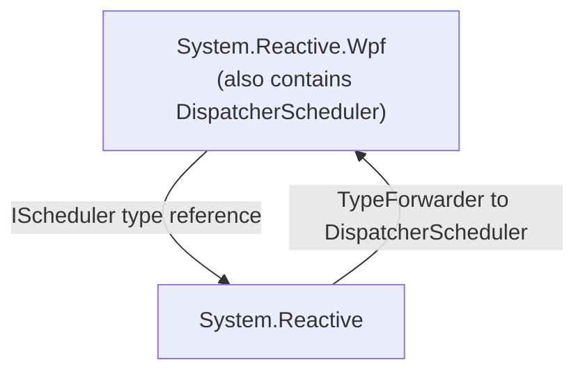
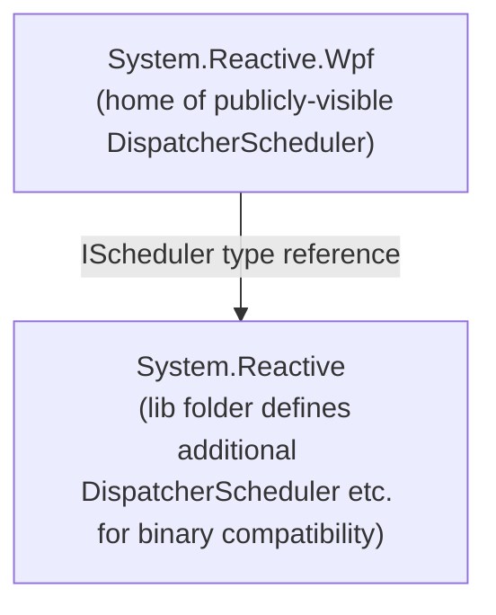
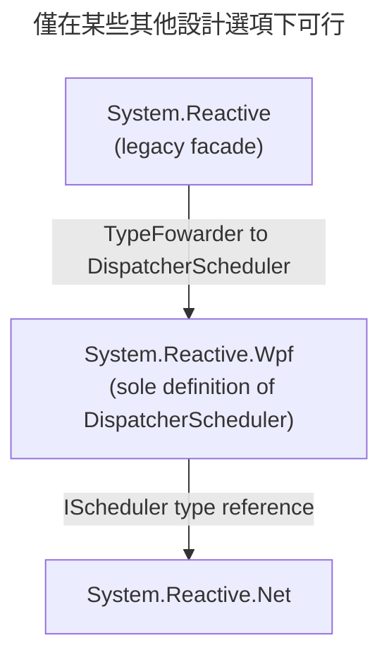

# 將 UI 框架支援移出 `System.Reactive`

在 Rx 7 之前，當以 Windows 為目標的 .NET 專案採用對 `System.Reactive` 的相依性時，在某些情況下會導致對 WPF 和 Windows Forms 框架產生非預期的相依性。這可能會使應用程式的可部署大小增加數十 MB。本文件說明 Rx 7.0 如何解決此問題。


## 狀態

已提議


## 作者

@idg10（[Ian Griffiths](https://endjin.com/who-we-are/our-people/ian-griffiths/)）。


## 簡述

這是一份非常長的文件，因為其中包含大量背景脈絡。本 ADR 的主要目的是完整描述所有背景脈絡，並使我們能夠根據所有相關資訊適當評估設計選擇。這使得它非常長。如果您不是在執行以下操作之一：

* 提出解決方案
* 審查提議的解決方案
* 實作解決方案
* 嘗試（在未來的某個時間點）理解過去的設計決策

那麼這將遠遠超出所需的細節。

如果您想了解問題、首選解決方案及其後果，則無需閱讀全部內容。閱讀以下內容即可：

* [概觀](#概觀)區段
* [首選設計選項](#選項-7ui-框架專屬套件隱藏-systemreactive-版本systemreactive-未被棄用)
* [決策](#決策)區段
* [後果](#後果)區段


## 概觀

下表顯示了針對 `net8.0-windows10.0.19041` 且採用各種部署模型的簡單主控台應用程式的輸出大小。（本 ADR 解決的問題僅影響具有 Windows 專屬 TFM 且僅限於指定 `10.0.19041` 或更新版本的應用程式。）主控台應用程式呼叫了一些 WinRT API，因此需要 `-windows` TFM，但未使用任何 UI 框架。最後一欄顯示了新增對 Rx（`System.Reactive` v6.0.1）的參考以及使用 Rx 的單行程式碼的影響。

| 部署類型 | 未使用 Rx 的大小 | 使用 Rx 的大小 |
|--|--|--|
| 相依於架構（Framework-dependent） | 20.8MB | 22.5MB |
| 獨立式（Self-contained） | 90.8MB | **182MB** |
| 獨立式經修剪（Self-contained trimmed） | 18.3MB | 65.7MB |
| 原生 AOT（Native AOT） | 5.9MB | 17.4MB |

最壞的情況是獨立式部署，它被需要 `-windows` TFM 的應用程式廣泛使用。它大約使該應用程式的大小增加了一倍，增加了超過 90MB！在修剪的情況下，絕對影響較小（Rx 增加了 47.4MB），但相對增加甚至更大，達到 3.6 倍。

根本問題在於，對於具有 Windows 專屬 TFM 的應用程式，`System.Reactive` v6 強制依賴 WPF 和 Windows Forms。（準確地說，它會導致對 `Microsoft.Desktop.App` 框架產生相依性，該框架是 .NET 針對 WPF 和 Windows Forms 的部署載體。）這些框架的完整複本都會包含在獨立式部署中，而修剪對此影響不大。

這個問題已導致一些專案完全放棄了 Rx。

在 [Avalonia 遇到這個問題](https://github.com/AvaloniaUI/Avalonia/issues/9549)之後，他們於 2023 年 1 月[移除了 Rx.NET 的所有使用](https://github.com/AvaloniaUI/Avalonia/pull/9749)。在 [#1461](https://github.com/dotnet/reactive/issues/1461) 的討論中，您會看到一些人談論因為這個問題而無法使用 Rx。

從那時起，發現了一種[因應措施](#因應措施)。不幸的是，儘管這在一定程度上緩解了問題，但該因應措施存在缺點，意味著它不能在所有情境中使用。它碰巧適用於我用來建立這些表格的特定範例，因此我們可以看到當它運作時，它大幅減少了輸出大小：

| 部署類型 | 未使用 Rx 的大小 | 使用因應措施的 Rx 大小 |
|--|--|--|
| 相依於架構 | 20.8MB | 22.5MB |
| 獨立式 | 90.8MB | **92MB** |
| 獨立式經修剪 | 18.3MB | 18.3MB |
| 原生 AOT | 5.9MB | 6.2MB |

對於顯示的四種部署模型，因應措施將新增 Rx 的影響分別減少到 1.6MB、1.6MB、小到無法測量以及 300KB。

Rx .NET 維護者的觀點是，使用 Rx 的專案不應被迫處於其部署變得過大的情況。這裡存在很多微妙之處和技術複雜性，但底線是我們希望 Rx 成為一個有吸引力的選擇。我們認為 Rx 在傳統型應用程式中特別有用，並且由於獨立式部署在這些情境中很受歡迎，Rx.NET 需要能夠與具有 Windows 專屬 TFM 的獨立式部署良好搭配運作。

決定解決方案花費了一段時間。我們希望找到一種修復此問題的方法，以盡量減少對 Rx.NET 打包方式的變更。過去由於 NuGet 打包的變更以及 Rx.NET 拆分為多個元件所產生的複雜性，已經造成了足夠的混亂。表面上發現的[因應措施](#因應措施)讓人們希望這是可能的，儘管這一發現來得相當晚，是在各個專案決定停止使用 Rx.NET 的一段時間之後。這是理解該主題早期討論的重要背景。早在 2023 年初 [endjin](https://endjin.com) 接管 Rx .NET 的維護和開發時，人們認為沒有因應措施，因此我們的計畫是 Rx 7.0 需要透過根本性的變更來解決此問題（例如，引入一個新的「主要」Rx 套件，而 `System.Reactive` 成為五年前不幸技術決策的令人遺憾的犧牲品）。隨後當顯然確定了一種因應措施時，我們認為迅速進行變更的壓力已經消除。看來 Rx 6.0 可以以不遇到這些問題的方式使用。因此，我們制定了一個不那麼激進、更為漸進的長期計畫。我們打算棄用導致此問題的函式庫部分，並在其他元件中引入替代項目，長期計畫是最終將它們從 `System.Reactive` 中移除，屆時將不再需要該因應措施。

不幸的是，一段時間後顯然該因應措施的局限性太過嚴重。這似乎讓我們回到了原點：更激進的方法看起來不可避免。然而，經過進一步的實驗，我們想到了一種新方法：

1. `System.Reactive` 仍作為主要 Rx 套件
2. `System.Reactive` 不再強制依賴 `Microsoft.Desktop.App`
3. UI 專屬程式碼保留在 `System.Reactive` 執行階段套件中，但編譯器不再可見（因為套件現在包含省略這些型別和方法的參考組件）
4. 希望繼續直接使用 UI 框架專屬 Rx 功能的應用程式和函式庫透過新的 UI 框架專屬套件來實現（因此它們需要新的套件參考，但無需變更原始程式碼）
5. 為針對較舊版本 `System.Reactive` 建構的任何應用程式和函式庫維持二進位相容性

（3. 是其中不尋常的部分。出於稍後解釋的原因，正是這一點使我們能夠做到 2。）

在*不*以 Windows 專屬 TFM 為目標的程式碼中使用 `System.Reactive` v6 的任何人在升級到 v7 時都不需要進行任何變更。使用 `System.Reactive` 但未使用任何 UI 框架專屬功能的任何人也是如此。

這確實給目前正在使用 UI 框架專屬功能的開發人員帶來了一些干擾。他們需要為相關的每個 UI 框架新增一個新的套件參考。

本文件說明了[問題的起源](#通往當前問題之路)、提議的[因應措施](#因應措施)及其缺點、[我們收到的社群意見回饋](#社群意見回饋)，以及[任何解決方案都必須滿足的限制條件](#限制條件)。然後它描述了[Rx .NET 7.0 中修復此問題的變更](#決策)。


## 背景

為了決定一個良好的解決方案，我們需要考慮很多資訊。首先有必要清楚地描述[問題](#問題)。也有必要了解[導致該問題的歷史](#通往當前問題之路)，因為這說明了[任何解決方案都必須滿足的限制條件](#限制條件)。此外，我們描述了[因應措施](#因應措施)，以明確說明為什麼我們最終無法使用它。

我們[發起了針對此問題的公開討論](https://github.com/dotnet/reactive/discussions/2038)，並從 [Rx.NET 社群獲得了大量有用的意見回饋](#社群意見回饋)。我們[可以嘗試透過幾種方式來解決此問題](#設計選項)，並且必須根據所有其他資訊對它們進行評估。

以下各節在進入[決策](#決策)之前解決了所有這些問題。

### 問題

基本問題已在本文開頭進行了描述，但我們可以更精確地描述它：

> 參考（直接或可轉移地）[`System.Reactive` NuGet 套件](https://www.nuget.org/packages/System.Reactive) v6 且具有指定 `10.0.19041` 或更新版本之 Windows 專屬目標的應用程式將獲得對 [.NET Windows Desktop Runtime](https://github.com/dotnet/windowsdesktop)（有時僅稱為「.NET Desktop Runtime」，有時也透過技術*共用架構名稱* `Microsoft.WindowsDesktop.App` 稱呼）的相依性。
>
> 發生這種情況是因為 `System.Reactive` 套件的 `nuspec` 檔案的 `frameworkReferences` 區段指出此套件的 `net6.0-windows10.0.19041` 目標對 `Microsoft.WindowsDesktop.App` 具有 `frameworkReference`。以下是 `System.Reactive` 6.0.1 中 `nuspec` 檔案的相關區段：
>
> ```xml
>  <frameworkReferences>
>    <group targetFramework="net6.0" />
>    <group targetFramework="net6.0-windows10.0.19041">
>      <frameworkReference name="Microsoft.WindowsDesktop.App" />
>    </group>
>    <group targetFramework=".NETFramework4.7.2" />
>    <group targetFramework=".NETStandard2.0" />
>    <group targetFramework="UAP10.0.18362" />
>  </frameworkReferences>
>  ```
>
> 框架參考是可轉移的，這就是為什麼不僅僅是對 `System.Reactive` 的直接參考會導致此問題。
>
> 對 .NET Windows Desktop Runtime 的非預期相依性會給獨立式部署（進而延伸到原生 AOT）帶來問題，因為這意味著這些部署最終會包含 Windows Forms 和 WPF 框架的完整複本。這可以在應用程式的最終可部署形式中增加數十 MB。修剪減輕了這種情況，但大小仍然大幅增加。對於既不使用 WPF 也不使用 Windows Forms 的應用程式來說，這尤其令人沮喪。

第一個括號中的「或可轉移地」很容易被忽視，但非常重要。一些開發人員發現自己遇到這個問題並不是因為他們的應用程式直接使用 `System.Reactive`，而是因為他們正在使用依賴於它的某些函式庫。為解決本 ADR 所處理問題而提出的許多簡單且最初看起來合理之解決方案，在應用程式透過可轉移方式取得對 Rx.NET 的相依性時（尤其是當它透過請求不同版本的多個不同參考取得時）都失敗了。

### 關於目標架構 Moniker 的說明

在 .NET 中，元件和應用程式使用目標架構 Moniker（TFM）指出它們可以在其上執行的環境。這些經常被誤解。本 ADR 描述的問題部分可歸咎於 TFM 的誤用。

TFM 可以非常廣泛。具有 `netstandard2.0` TFM 的元件可以在支援 .NET Standard 2.0 的任何 .NET 執行階段（例如 .NET 8.0 或 .NET Framework 4.7.2）上執行，並且不在乎它在哪個作業系統上執行。但是 TFM 可以更具體得多。如果元件具有 `net6.0-windows10.0.19041` 的 TFM，則它需要 .NET 6.0 或更新版本（因此它無法在任何版本的 .NET Framework 上執行），並且僅在 Windows 上執行。此外，它指出它是針對特定的 Windows API 介面建構的。該 `10.0.19041` 是一個 SDK 版本號碼，它對應於 Windows 10 的 2020 年 5 月更新（也稱為版本 2004 或 20H1）。

特定於版本的 TFM 不一定意味著最低作業系統版本需求。如果元件想要嘗試使用在該 Windows 版本中引入的 API，它必須指定 10.0.19041，但這裡的關鍵詞是「嘗試」。可以偵測失敗並在 API 不可用時切換至替代行為。因此，具有 `net6.0-windows10.0.19041` TFM 的元件很可能能夠在 Windows 10.0.18362 上執行。

所有特定於作業系統的 TFM 也都是特定於版本的。如果您不指定版本，.NET SDK 會為您挑選一個。例如，在自 5.0 以來發布的所有 .NET SDK 中（在撰寫本文時最新的是 9.0.306），`net6.0-windows` 等同於 `net6.0-windows7`。

儘管 TFM 的作業系統版本部分並不意味著最低需求，但 .NET 版本號碼確實意味著這一點。`net472` 元件無法在 .NET Framework 4.6 上執行。`net6.0` 元件無法在 `net5.0` 上執行。

TFM 的最後一個被普遍誤解的功能是，當 .NET 版本超出支援範圍時，其對應的 TFM 仍受支援。通常當人們看到具有例如 `net5.0` TFM 的函式庫時，他們認為該函式庫已失效，因為 .NET 5.0 在很久以前就停止支援了。這不一定是真的，因為當我撰寫本文時最新版本的 .NET 9.0 支援執行具有 `net5.0` TFM 的元件。事實上，它支援一路回溯到 `netcoreapp1.0` 的 TFM！

### 通往當前問題之路

本 ADR 解決的問題源於五年多前為解決其他問題而進行的一系列變更。我們需要確保不會重新引入任何這些較舊的問題，因此深入了解導致當前設計的以下因素非常重要：

1. Rx 套件結構中長期的混亂歷史
2. 外掛程式使用 Rx 時可能發生的微妙問題
3. 解決外掛程式問題的最初嘗試，以及這所產生的新問題
4. Rx 4.0 中解決了因嘗試修復外掛程式問題而引起問題的[「大統一」](https://github.com/dotnet/reactive/issues/199)，諷刺的是，它為後續版本中外掛程式問題的重新出現埋下了種子
5. .NET Core 3.0 中的變更，結合「大統一」，導致了本 ADR 旨在解決的問題
6. 在 Rx 5.0 中重新引入外掛程式問題的回歸，以及為什麼它可能不像過去那麼重要

#### Rx 令人困惑的打包歷史

Rx 的第一個公開預覽版早在 2009 年 NuGet 出現之前就出現了。這意味著 Rx 最初是以傳統方式分發的：您在開發電腦上安裝了一個 SDK，使 Rx 的組件可用於本機開發，並且必須安排在應用程式的安裝或部署流程中將必要的受轉散發檔案複製到目標電腦上。當[第一個受支援的 Rx 版本於 2011 年 6 月推出](https://web.archive.org/web/20110810091849/http://www.microsoft.com/download/en/details.aspx?id=26649)時，NuGet 確實存在，但處於早期階段，因此在相當長的一段時間內 Rx 擁有[兩個官方分發管道：NuGet 和可安裝的 SDK](https://cc.bingj.com/cache.aspx?q=microsoft+download+reactive+extension+sdk&d=5018270206749605&mkt=en-GB&setlang=en-GB&w=LCqKaZy3VgjqC_Zlig1e4qmTo82s8qt5)。

除了 .NET Framework 之外，當時還有幾種不同版本的 .NET。（順便提一下，這是在 .NET Core 出現之前的很長一段時間。）Silverlight 和 Windows Phone 都有自己的執行階段，後者將 Rx 版本預先安裝為作業系統的一部分。Windows 8 有自己的 .NET 版本，其運作方式與其他任何版本截然不同。（這就是為什麼您偶爾會看到 `netcore45` 或 `netcore451` TFM，儘管事實上 .NET Core 從 v3.1 直接跳到了 .NET 5.0。這也是為什麼前幾個 .NET Core TFM 的名稱中都包含 `app`，例如 `netcoreapp1.0`。到了這個時候，`netcore` 指的是 Windows 8 市集應用程式版本的 .NET，因此它們必須使用不同的名稱。）這些都有非常不同的 .NET 執行階段類別庫子集，特別是在執行緒支援方面。Rx 在這些平台中的每一個上都略有不同，因為嘗試針對最低公分母將意味著處處都是次佳的效能。每個不同的 Rx 版本主要在兩個方面有所不同：

* 排程器支援經過專門設計，以便在每個不同的目標上盡可能良好地運作
* 每個平台都有不同的可用 UI 框架，因此 Rx 的 UI 框架整合對於每個目標都不同

第一類中的某些差異是所有版本共用之 API 背後的實作詳細資訊，但也有一些公開 API 差異。（您仍然可以在 Rx 6.0 中看到對此的回應。`ThreadPoolScheduler` 類別在所有平台上都可用，但在 UWP 上（這實際上是舊 Windows 8 API 的繼任者），此類別具有兩個額外的屬性 `Priority` 和 `Options`，用於控制 WinRT 專屬的執行緒集區行為。）第二類必然涉及公開 API 中的差異，儘管在 Rx 歷史的這個時間點，其所有 UI 框架專屬的程式碼都在獨立的組件中，因此這些差異被隔離了。Rx 的公開 API 有一個在所有平台上都通用的核心。

這意味著原則上可以撰寫依賴 Rx 且可以在 Rx 支援的所有相同平台上使用的函式庫。然而，在 2011 年做到這一點並非完全直截了當。

這是在引入 .NET Standard 之前的幾年，當時如果您想撰寫跨平台函式庫，就必須建立所謂的可攜式類別庫（PCL）。Rx 希望在所有平台上提供通用的 API，同時提供最佳化的平台專屬排程器，因此它引入了平台抽象層和稱為「啟發（enlightenments）」的系統（以虛擬機器架構中的類似功能命名）。這奏效了，但導致了相當令人困惑的 DLL 激增。

混亂的另一個維度是，即使在任何單一目標平台內，Rx 也被拆分在幾個不同的元件中，而且原因並不十分明顯。有一個獨立的 `System.Reactive.Interfaces` 元件，用於定義 Rx 定義且不在執行階段函式庫中的核心介面，例如 `IScheduler` 和 `ISubject<T>`。最初的想法是這將是一個不需要頻繁發布的穩定元件，因為核心 Rx 介面極少變更。隨著時間的推移，這一預期被證明是正確的，但不幸的是，打包決策背後的理由顯然被遺忘了，因為不是讓 `System.Reactive.Interfaces` v2.0.0 成為所有時間的唯一真實定義，而是在每次推出 Rx 新版本時都產生該元件的新版本，即使沒有任何變更。這打破了為核心介面建立獨立元件的全部初衷。

（事實上事情有點更奇怪，因為 Rx 1.0 支援的某些 .NET 版本在執行階段類別庫中定義了核心 `IObservable<T>` 和 `IObserver<T>` 介面，但有些則沒有。例如，Rx 1.0 支援的 .NET 3.5 中就不存在這些介面。因此 Rx 必須為某些平台提供自己的定義。您可能會期望這些位於 `System.Reactive.Interfaces` 中，但它們沒有，因為微軟希望該套件在所有平台上都是相同的。因此在未內建 `IObservable<T>` 和 `IObserver<T>` 的平台上，混入了另一個 DLL，進一步增加了關於如果想要使用 Rx 您需要隨應用程式一起傳送哪些組件的混亂。）

其他拆分也很難理解——Rx 的 LINQ 部分為什麼在它們自己的套件中並不明顯。在實務上，任何使用 Rx 的人都會使用其 LINQ 功能。在這些早期存在的「providers」元件的角色也不明顯。

「platform services」部分可以說稍微容易理解一些，因為當時的 .NET 開發人員通常意識到 .NET 有很多風格，每種風格都有稍微不同的特性。即便如此，理解這在實務中是如何運作的也很棘手，這只是可能使 Rx 更難以使用的另一點複雜性。

總之，您不能簡單地新增參考並開始使用 Rx。了解您的應用程式或函式庫應該參考哪些元件以使用 Rx，並了解需要部署哪些特定的 DLL 並不容易，並且給新使用者帶來了採用障礙。

Rx 的 NuGet 發行版在 v2.2 中引入了一個簡化概念：此時 Rx 仍然分散在多個元件中，但簡化的措施是定義 NuGet 中繼套件（metapackages），使您能夠僅使用單一套件參考進行基本 Rx 使用。例如，對 [`Rx-Main` v2.2.0](https://www.nuget.org/packages/Rx-Main/2.2.0) 的單一參考將為您提供使用 Rx 所需的一切。還有適用於將特定 UI 框架與 Rx 一起使用的其他中繼套件。現在，您可以第一次僅新增一個參考並立即開始使用 Rx。

由於 Rx 一直支援許多不同的執行階段，因此每個 Rx.NET NuGet 套件都包含其元件的多個不同組建。在相當長的一段時間內，針對不同版本的 .NET Framework 存在不同複本的 Rx。例如，Rx 2.2.0 有一個以 .NET Framework 4.0 為目標，另一個以 .NET Framework 4.5 為目標。NuGet 可以處理這個問題——您最終只會在 `lib` 下得到 `net40` 和 `net45` 子資料夾。.NET SDK 會在建構時根據應用程式設定目標的執行階段計算出要使用的執行階段。

因此實際上存在兩個維度的零散化。首先，在每個中繼套件背後有多個 NuGet 套件。（例如，Rx 2.2 的 [`Rx-Main` 中繼套件](https://www.nuget.org/packages/Rx-Main/2.2.0#dependencies-body-tab)依賴於 [`Rx-Core`](https://www.nuget.org/packages/Rx-Core/2.2.0)、[`Rx-Interfaces`](https://www.nuget.org/packages/Rx-Interfaces/2.2.0)、[`Rx-Linq`](https://www.nuget.org/packages/Rx-Linq/2.2.0) 和 [`Rx-PlatformServices`](https://www.nuget.org/packages/Rx-PlatformServices/2.2.0)。而且更令人困惑的是，套件名稱與它們包含的組件名稱不同。這四個套件分別提供 `System.Reactive.Core.dll`、`System.Reactive.Interfaces.dll`、`System.Reactive.Linq.dll` 和 `System.Reactive.PlatformServices.dll`。）然後每個套件都包含從概念上講是同一組件的多個版本（但由於目標平台之間的差異而存在各種技術差異）。例如，如果您[查看 `Rx-Core` 2.2.0 內部](https://nuget.info/packages/Rx-Core/2.2.0)，您會看到其 `lib` 資料夾包含 8 個資料夾，每個資料夾都包含略有不同的 `System.Reactive.Core.dll` 組建。


對於 [`Rx-Interfaces`](https://nuget.info/packages/Rx-Interfaces/2.2.0) 和 [`Rx-Linq`](https://nuget.info/packages/Rx-Linq/2.2.0) 也是同樣的情況。對於 [`Rx-PlatformServices`](https://nuget.info/packages/Rx-PlatformServices/2.2.0) 幾乎也是如此，除了出於某種原因它沒有 `portable-windows8+net45+wp8` 資料夾。

每個 NuGet 套件的 `lib` 資料夾的每個子資料夾都包含針對該特定目標量身打造的該套件組件。因此 `Rx-Core` 包含 8 份 `System.Reactive.Core.dll`，`Rx-Interfaces` 包含 8 份 `System.Reactive.Interfaces.dll`，`Rx-Linq` 包含 8 份 `System.Reactive.Linq.dll`，而 `Rx-Core` 包含 7 份 `System.Reactive.PlatformServices.dll`。因此從概念上講我們這裡有 4 個組件，但由於所有不同的組建，實際上存在 31 個檔案！

#### 外掛程式問題

這種零散化導致了[外掛程式系統的問題 (#97)](https://github.com/dotnet/reactive/issues/97)。人們在為 Visual Studio 撰寫擴充功能時經常遇到這種情況。Visual Studio 是發生這些問題的常見場所，僅僅是因為很多人為它撰寫擴充功能，並且單個使用者使用很多外掛程式是很常見的，但是任何具有基於外掛程式之擴充性機制的基於 .NET Framework 的應用程式都可能遇到相同的問題。

如果編寫一個外掛程式使用 Rx.NET 2.2.0，並且該外掛程式是針對 .NET Framework 4.0 編譯的，則部署該外掛程式將需要提供由 `Rx-Main` 參考的四個套件中每個套件的 `net40` 資料夾中的組件複本。如果另一個外掛程式也被編寫為使用相同版本的 Rx.NET 但針對 .NET Framework 4.5 進行編譯，則其部署檔案將包含這些套件中每個套件的 `net45` 資料夾中的 DLL。

Visual Studio 能夠載入為較舊版本的 .NET Framework 編譯的元件，因此在 .NET Framework 4.5 上執行的 Visual Studio 版本將樂於載入這些外掛程式中的任何一個。但是如果它最終同時載入了這兩者，那將意味著每個外掛程式都試圖提供自己的一組 Rx DLL。這導致了問題。

以下是會發生的情況。假設我們有兩個外掛程式，`PlugInOneBuiltFor40` 和 `PlugInTwoBuiltFor45`。兩者都是透過對 `Rx-Main` 2.2.0 的參考建構的。這意味著如果我們要查看這些外掛程式在安裝到目標應用程式後在磁碟上的外觀，我們會看到類似這樣的內容：

* `PlugInInstallationFolder`
  * `PlugInOneBuiltFor40`
    * `PlugInOneBuiltFor40.dll`
    * `System.Reactive.Core.dll` v2.2.0 (`net40` 組建)
    * `System.Reactive.Interfaces.dll` v2.2.0 (`net40` 組建)
    * `System.Reactive.Linq.dll` v2.2.0 (`net40` 組建)
    * `System.Reactive.PlatformServices.dll` v2.2.0 (`net40` 組建)
  * `PlugInTwoBuiltFor45`
    * `PlugInTwoBuiltFor45.dll`
    * `System.Reactive.Core.dll` v2.2.0 (`net45` 組建)
    * `System.Reactive.Interfaces.dll` v2.2.0 (`net45` 組建)
    * `System.Reactive.Linq.dll` v2.2.0 (`net45` 組建)
    * `System.Reactive.PlatformServices.dll` v2.2.0 (`net45` 組建)

（Visual Studio 在現實中使用了更複雜的資料夾配置，但這並不重要。*任何*外掛程式主機都會遇到相同的問題。）

此處需要注意的關鍵事項是，對於四個 Rx 組件中的每一個，我們有兩個複本，一個為 .NET 4.0 建構，一個為 .NET 4.5 建構。至關重要的是，*它們具有相同的版本號碼*。在所有情況下，它們都來自版本為 2.2.0 的 NuGet 套件。但是對於我描述的問題，更重要的是 .NET 組件版本號碼。（.NET 版本控制是與 NuGet 版本控制獨立的機制。沒有規則要求這兩個版本號碼以任何方式相關聯，儘管按照慣例它們通常是相關的，並且對於 Rx 2.2.0 來說也是如此。）組件版本號碼都是 2.2.0.0。（.NET 組件有 4 個部分，比 NuGet 套件多一個。但在 Rx 2.2.0 中，.NET 組件版本的第 4 部分始終設定為 0。）這裡需要理解的至關重要的事情是，對於任何 Rx 元件（例如 `System.Reactive.Core.dll`），我們有兩個*不同*的複本（一個 .NET 4.0 和一個 .NET 4.5），但它們在 *.NET 中具有完全相同的名稱*。

讓我們看看為什麼這會導致問題。假設 Visual Studio 碰巧先載入了 `PlugInOneBuiltFor40`。這將能夠使用其 Rx 組件的複本。但是當第二個外掛程式 `PlugInTwoBuiltFor45` 首次嘗試使用 `System.Reactive.Core` 時，.NET 組件解析器會注意到它已經載入了一個名為 `System.Reactive.Core` 且版本號碼為 2.2.0.0 的組件，這正是 `PlugInTwoBuiltFor45` 所要求的確切版本。在我描述的情境中，這個已經載入的複本將是 `net40` 版本，但組件解析器不知道它與 `PlugInTwoBuildFor45` 想要的不同。

.NET Framework 組件解析器假設完整名稱（簡單名稱、版本、公開金鑰語彙基元和文化特性的組合）唯一標識一個組件。但是 Rx 2.2.0 提供了多個具有完全相同完整名稱的不同組件，因此它未能遵守該基本假設，這意味著組件解析器沒有執行我們想要的操作。它甚至懶得查看 `PlugInTwoBuiltFor45` 資料夾中的 `System.Reactive.Core` 複本，因為它在記憶體中已經有一個具有正確名稱的組件。第二個元件最終使用的是 `net40` 版本，而不是它隨附的 `net45` 版本。碰巧的是，它們具有相同的公開 API 介面，因此在這個特定案例中我們不會遇到 `TypeLoadException` 或 `MissingMethodException` 失敗。但是存在行為差異。這是一個相當晦澀的差異，與當您使用 Rx 的 `ToTask` 或 `ForEachAsync` 時 [`OperationCanceledException`](https://learn.microsoft.com/en-us/dotnet/api/system.operationcanceledexception) 是否回報正確的 [`CancellationToken`](https://learn.microsoft.com/en-us/dotnet/api/system.operationcanceledexception.cancellationtoken) 相關。（據我所知，這是當時 Rx 的 `net40` 和 `net45` 版本不同的唯一方面。）如果 `PlugInTwoBuiltFor45` 依賴於此處的正確行為，那將是一個問題，因為它最終將使用 `net40` 版本，並且無法在 .NET Framework 4.0 上正確實作此功能。

儘管這是一個極其特定的問題，但更大的問題在於，如果未來版本的 Rx 在不同的 .NET Framework 版本上最終出現更大的分歧，則需要較新版本的外掛程式很可能最終會因為沒有獲得所需的版本而遇到 `TypeLoadException` 或 `MissingMethodException` 失敗。

這僅會影響外掛程式系統，因為它們打破了通常有效的假設。通常我們可以假設對於任何單一應用程式，該應用程式的建構流程將有機會查看構成該應用程式的所有元件（包括所有可轉移相依性），並偵測此類情況。在某些情況下，可能可以使用規則自動解決它。（您可能有一條規則指出，當 .NET 4.5 應用程式使用 .NET 4.0 元件時，可以為該元件提供其相依性之一的 .NET 4.5 版本。在這種情況下，這意味著 `PlugInOneBuiltFor40` 和 `PlugInTwoBuiltFor45` 最終都將使用 Rx 元件的 `net45` 組建。這將運作良好，假設 `PlugInOneBuiltFor40` 實際上並不依賴於 `net40` 組建中略有缺陷的 `CancellationToken` 處理。）或者它可能會偵測並回報無法安全自動解決的衝突，從而要求開發人員明確解決該情況。但是外掛程式系統的問題在於，正在使用的確切 .NET 元件集直到執行階段才會變得明顯，並且每次新增外掛程式時都會發生變化。在建構應用程式時不可能知道整個應用程式的外觀，因為外掛程式系統的整個初衷就是讓在應用程式發布很久之後向應用程式新增新元件成為可能。

此時值得注意的是，我剛才描述的問題不需要影響使用 .NET（相對於 .NET Framework）的應用程式。早在我們現在稱為「.NET」的產物仍被稱為 .NET Core 的時候，.NET Core 就新增了 [`AssemblyLoadContext` 型別](https://learn.microsoft.com/en-us/dotnet/core/dependency-loading/understanding-assemblyloadcontext)，這使得不同外掛程式各自載入自己的組件複本成為可能，即使它們與其他外掛程式載入的組件具有完全相同的完整名稱也是如此。但是該功能在 Rx 2.0 或 3.0 時代並不存在（即使在今天 .NET Framework 中仍然不存在）。

[Rx 3.1](https://github.com/dotnet/reactive/releases/tag/v3.1.0) 嘗試透過[在每個受支援目標上對同一個「邏輯」元件使用稍微不同的版本號碼](https://github.com/dotnet/reactive/pull/212)來解決外掛程式問題。您可能期望這會使用 .NET 組件版本具有的第四個部分，前 3 個部分與 NuGet 套件具有的 3 個部分相符，但事實上他們選擇使用第 3 個部分，將第 4 個部分保留為 0。您可以在 GitHub 中看到[根據目標設定不同版本號碼的程式碼](https://github.com/dotnet/reactive/blob/e0b6af3e204feb8aa13841a8a873d78ae6c43467/Rx.NET/Source/GlobalAssemblyVersion.cs)，但我已在此處複製了它：

```cs
#if NETSTANDARD1_0 || WP8
[assembly: AssemblyVersion("3.0.0.0")]
#elif NETSTANDARD1_1 || WINDOWS8 || NET45 || NETCORE45
[assembly: AssemblyVersion("3.0.1000.0")]
#elif NETSTANDARD1_2 || WINDOWS81 || NET451 || NETCORE451 || WPA81
[assembly: AssemblyVersion("3.0.2000.0")]
#elif NETSTANDARD1_3 || NET46
[assembly: AssemblyVersion("3.0.3000.0")]
#elif NETSTANDARD1_4 || UAP10_0 || NETCORE50 || NET461
[assembly: AssemblyVersion("3.0.4000.0")]
#elif NETSTANDARD1_5 || NET462
[assembly: AssemblyVersion("3.0.5000.0")]
#elif NETSTANDARD1_6 || NETCOREAPP1_0 || NET463
[assembly: AssemblyVersion("3.0.6000.0")]
#else // this is here to prevent the build system from complaining. It should never be hit
[assembly: AssemblyVersion("invalid")]
#endif
```

到這時，Rx.NET 已不再建構 .NET 4.0 版本，但它確實提供了 `net45`、`net451`、`net462` 和 `net463` 版本。因此在上述外掛程式情境的適當更新版本中，假設我們有 `PlugInTwoBuiltFor45` 和 `PlugInThreeBuiltfor46` 都使用 Rx v3.1.1。`PlugInTwoBuiltFor45` 將使用 .NET 組件版本為 `3.0.1000.0` 的 Rx 元件版本，而 `PlugInThreeBuiltfor46` 將使用版本 `3.0.3000.0`。.NET Framework 組件解析器會認為這些是不同的組件，因為它們具有不同的完整名稱，因此它會很樂意同時載入這兩個版本，從而避免了該問題。

這項變更早於 .NET Core/現代 .NET，並且該較新的執行階段系列採用了不同的組件版本控制方法：.NET Framework 要求嚴格的版本比對，而 .NET Core 及其後續版本（例如 .NET 6.0、.NET 8.0）則認為版本號碼大於或等於請求版本的任何組件都是相符項。這種 Rx 3.0 版本控制策略的一個基本假設——即組件解析器希望版本完全相符——在 .NET 的所有版本上都不再成立。（本 ADR 中描述的問題的一個共同主題是，許多決策都基於當時有效但現在已不再適用的假設。）幸運的是，這對於外掛程式情境通常無關緊要，因為 `AssemblyLoadContext` 在具有這種不同版本控制行為的較新執行階段上避開了這整個問題。

不幸的是，Rx 3.1 在版本編號上的變更繼續引發了各種新問題。[在議題 199 的一條評論中有這些問題的部分清單](https://github.com/dotnet/reactive/issues/199#issuecomment-266138120)，如果您瀏覽 [#205](https://github.com/dotnet/reactive/issues/205)，您會看到一些指向其他問題的連結。即使在提出這項變更時，人們也[承認繫結重新導向存在潛在問題](https://github.com/dotnet/reactive/issues/205#issuecomment-228577028)。繫結重新導向通常指定版本範圍，這意味著如果您將 3.x 升級到 4.x，3.0.2000.0 可能會升級到 4.0.1000.0，這實際上可能意味著 API 介面的降級（因為 x.x.2000.0 版本可能具有 x.x.1000.0 版本所沒有的目標專屬功能）。

正如在此問題的歷史中經常發生的那樣，在簡單設定下運作良好的事物在相依性樹變得更加複雜時被發現存在問題。直接使用 Rx 的應用程式（或外掛程式）沒有問題，但如果您使用依賴 Rx 的多個元件，並且這些元件支援不同目標組合，您可能會遇到問題。

例如，如果您的應用程式以 .NET 4.6.2 為目標，並且您使用兩個都依賴 Rx 3.1.1 的函式庫，但其中一個函式庫僅提供 `net45` 目標，而另一個僅提供 `net461` 目標，它們現在對它們想要的 Rx 版本存在分歧。第一個需要版本號碼為 `3.0.1000.0` 的 Rx 元件，而第二個需要版本號碼為 `3.0.4000.0` 的元件。這可能導致在建構應用程式時出現組件版本衝突報告。您可以透過組件繫結重新導向來解決此問題，甚至可以讓建構工具為您產生這些重新導向。但是在某些情境下工具無法確定該怎麼做，開發人員只能嘗試理解我迄今為止描述的所有歷史，以找出如何解開混亂的方法。（此時該歷史尚未寫入單一文件中，因此甚至很難弄清楚歷史是什麼，這對此毫無幫助。）這也依賴於在外掛程式情境中被破壞的相同「我們可以在建構應用程式時解決這一切」假設，因此這*仍然*可能給外掛程式帶來問題！

此處的基本問題在於，當建構任何單一可部署目標（應用程式或外掛程式）時，您可能會使用針對多個不同執行階段的元件混合。這些可能是相互相容的組合（例如，如果您使用以 `net40`、`net45` 和 `net46` 為目標的元件，它們都可以在 .NET 4.6.2 上順利執行），但如果其中任何一個使用了 Rx 3.1.1，您現在可能會遇到問題，因為它們各自可能想要 Rx 3.1.1 的 NuGet 套件中可用的各種組件版本中不同的一個。

#### Rx 4.0 的大統一

[Rx 4.0](https://github.com/dotnet/reactive/releases/tag/rxnet-v4.0.0) 嘗試了一種不同的方法：只擁有一個沒有相依性的 Rx 套件 `System.Reactive`。這消除了先前 Rx 被拆分為四個部分所造成的所有混亂。

Rx 4.0 能夠避開外掛程式問題，因為到了這時，不再需要為多個版本的 .NET Framework 提供獨立的 Rx 組建。這在較舊版本上是必要的，因為不同的 .NET Framework 發行版本具有與執行緒集區或其他工作相關功能相關的不同功能，這意味著在 .NET Framework 4.0 上運作的 Rx 版本在 .NET Framework 4.5 上將是次佳的。但在 Rx 4.0 推出時（2018 年 5 月），微軟已經結束了對 .NET Framework 4.0 的支援，因此 Rx 不需要支援它。事實上，在這一點上以 4.6 為目標是最合理的 .NET Framework 最舊版本，而且事實證明，在後續版本的 .NET Framework 中新增的任何新功能對 Rx.NET 都沒有特別的用處，因此針對不同版本的 .NET Framework 建構多個版本的 Rx.NET 不再具有任何價值。

這是環境中的一項關鍵變革，因為它為 Rx.NET 創造了機會。

由於現在只有一個 .NET Framework 目標（`net46`），最初的外掛程式問題不再可能發生。（它們最初發生的唯一原因是 Rx 過去提供針對不同版本 .NET Framework 的不同組件。）此外，將 Rx 濃縮為單一組件 `System.Reactive`，解決了 Rx 3.1 時代嘗試透過在 .NET 組件版本號碼上玩遊戲來解決外掛程式問題所產生的所有新問題。

這種簡化非常巧妙，並且運作得非常出色。直到它不再運作為止。但我們稍後會談到這一點。

儘管現在只以一個版本的 .NET Framework 為目標，`System.Reactive` 仍然是一個多目標 NuGet 套件。如果您下載 v4.0 套件並解壓縮（`.nupkg` 檔案只是 ZIP 檔案），您會發現 `lib` 資料夾包含適用於 5 個不同 TFM 的子資料夾：

* `net46`（.NET Framework 4.6）
* `netstandard2.0`
* `uap10`（UWP）
* `uap10.0.18362`（UWP）

每個都包含一個 `System.Reactive.dll` 檔案，並且每個都略有不同。`netstandard2.0` 實際上是最低公分母，並且缺少在更專門的版本中可以找到的一些型別。例如，`net46` 中的版本包含 `ControlScheduler`，這是一種提供 Rx 與 Windows Forms 傳統型用戶端框架之間整合的型別。Windows Forms 是內建於 .NET Framework 中的——不可能在沒有 Windows Forms 的情況下安裝 .NET Framework——因此 Rx 的 `net46` 版本可以包含該型別。但 `netstandard2.0` 不包含 Windows Forms——該版本的 Rx 可能會發現自己在 Linux 上執行，而 Linux 上絕對沒有 Windows Forms。因此，套件的 `netstandard2.0` 資料夾中的 `System.Reactive.dll` 不包含 `ControlScheduler`。

這說明透過這種*大統一*，當您新增對 `System.Reactive` 的參考時，您會在應用程式設定目標的任何平台上獲得 NuGet 所提供的一切。因此，如果您使用的是 .NET Framework，您會獲得 Rx 的 WPF 和 Windows Forms 功能，因為 WPF 和 Windows Forms 內建於 .NET Framework 中。如果您正在撰寫 UWP 應用程式並新增對 `System.Reactive` 的參考，您會獲得 Rx 的 UWP 功能。

這聽起來非常方便，但事實證明這是一次過度的簡化。

#### 大統一產生的問題

*大統一*一直運作良好，直到 .NET Core 3.0 問世。這帶來了麻煩，因為它破壞了*大統一*所做的一個基本假設：假設您的目標執行階段將決定哪些 UI 應用程式框架可用。在 .NET Core 3.0 之前，UI 框架的可用性完全取決於您使用的是哪個執行階段。如果您在 .NET Framework 上，則 WPF 和 Windows Forms 都可用，如果您在任何其他 .NET 執行階段上執行，它們將不可用。如果您在 UWP 上可用的古怪 .NET 版本上執行（令人困惑的是，它與以 `uap` 開頭的 TFM 相關聯，甚至更令人困惑的是，它還與 `netcore50` TFM 相關聯，該 TFM 與 .NET 5.0 完全*無關*），唯一可用的 UI 框架將是 UWP 框架，並且在任何其他執行階段上都不可用。

但 .NET Core 3.0 結束了這種簡單的關係。請考慮下表：

| 框架 | 哪些用戶端 UI 框架可用？ |
|--|--|
| .NET Framework（`net462`、`net48` 等） | Windows Forms 與 WPF |
| UWP（`uap10.0` 等） | UWP |
| 3.0 之前的 .NET Core（例如 `netcoreapp2.1`） | 無 |
| .NET Core 3.0 與更新的 .NET（`netcoreapp3.0`、`net6.0`、`net8.0` 等） | **視情況而定...** |

.NET Core 3.0 打破了目標架構的選擇將完全決定哪些用戶端 UI 框架可用的假設。

為什麼這是個問題？那麼，Rx 應該在其各個目標中提供什麼 UI 框架整合？下表嘗試為 [Rx 4.2](https://github.com/dotnet/reactive/releases/tag/rxnet-v4.2.0)（新增 [.NET Core 3.0 支援](https://github.com/dotnet/reactive/pull/857)的版本）支援的所有目標回答該問題：

| TFM | Rx 應該支援哪種 UI 框架？ | 它實際上支援什麼？ |
|--|--|--|
| `net46` | Windows Forms 與 WPF | Windows Forms 與 WPF |
| `uap10.0` | UWP | UWP |
| `uap10.0.18362` | UWP | UWP |
| `netstandard2.0` | 無 | 無 |
| `netcoreapp3.0`| **可能無**（見下文） | **Windows Forms 與 WPF（！）** |

考慮到 .NET Core 3.0 新增了 WPF 和 Windows Forms 支援，為什麼我在 `netcoreapp3.0` 資料列的中間欄填寫了「無」？因為這些 UI 框架僅在 Windows 上可用。`netcoreapp3.0` TFM 與作業系統無關。以此為目標，您可能會發現自己在 macOS 或 Linux 上執行。Windows 專屬的基礎設施不一定存在，這就是為什麼我認為該資料列的正確答案是「無」。

作為 Rx.NET [為 .NET 5 支援做準備](https://github.com/dotnet/reactive/pull/1291)的一部分，新增了 `net5.0` 目標。這**不**包含 Windows Forms 和 WPF 功能。這無可爭議是正確的，因為如果您建立一個以 `net5.0` 為目標的新專案並將 `UseWPF` 或 `UseWindowsForms`（或兩者）設定為 `true`，您將收到建構錯誤，告知您只有在目標平台為 Windows 時才能這樣做。它建議您使用特定於作業系統的 TFM，例如 `net5.0-windows`。

為什麼 .NET 5.0 是這樣，而 .NET Core 3.0 不是？這是因為 [TFM 在 .NET 5.0 中的運作方式發生了變化](https://github.com/dotnet/designs/blob/main/accepted/2020/net5/net5.md)。特定於作業系統的 TFM 在 .NET 5.0 之前並不存在。因此，在 .NET 5.0 及更高版本中，我們可以附加 `-windows` 來表示我們需要在 Windows 上執行。由於之前無法做到這一點，`netcoreapp3.0` 沒有告訴您目標作業系統需要是什麼。

我的觀點是，既然 `netcoreapp3.0` TFM 無法讓您知道 Windows Forms 和 WPF 是否必定可用，那麼最好不要發行具有此 TFM 且要求其可用的元件（除非該元件專門設計為*僅*在這些框架可用的環境中使用）。這就是為什麼我在該資料列的第 2 欄中填寫了「無」。然而，似乎當 Rx 團隊新增 .NET Core 3.0 支援時，他們對對 `System.Reactive` 的參考意味著您可以存取適用於您目標的所有 Rx 功能這一概念選擇了最大化解釋。由於在 .NET Core 3.0 上執行*可能*意味著 Windows Forms 和 WPF 可用，Rx 決定它*將*包含對此的支援。

我不知道如果您在實際上沒有 Windows Forms 或 WPF 的環境中在 .NET Core 3.0 上使用 Rx 4.2 會發生什麼。（可能發生這種情況的原因有兩個。首先，您可能沒有在 Windows 上執行。其次，更微妙的是，您可能在 Windows 上執行，但在未安裝 .NET Core 3.0 的 WPF 和 Windows Forms 支援的環境中。這是 .NET Core 3.0 的選用功能。例如，它通常不存在於 Web 伺服器上。）可能它完全無法運作。或者只要您從不嘗試使用 Rx 的任何 UI 框架專屬部分，它就可以運作。這是無意義的，因為 .NET Core 3.0 現在已不受支援，但不幸的是，Rx 團隊在 .NET 3.0 Core 時期做出的決定仍然伴隨著我們。

在 .NET 5.0 中新增特定於作業系統的 TFM 使情況更加清晰。您知道使用 `net5.0-windows` 的 TFM 肯定會在 Windows 上執行，儘管這不能保證 .NET 5 的 Windows Forms 和 WPF 支援實際可用。（在 Windows 上，如果您願意，您可以僅安裝 [.NET 5.0 執行階段](https://dotnet.microsoft.com/en-us/download/dotnet/5.0)而不包含 .NET Desktop Runtime。）而 `net5.0` 的 TFM 增加了它們不可用的機會，因為您甚至可能沒有在 Windows 上執行。因此，讓我們在這個新的 .NET 5.0 世界中再次檢視這些選項，列出 [Rx 5.0](https://github.com/dotnet/reactive/releases/tag/rxnet-v5.0.0)（第一個支援 .NET 5.0 的版本）提供的所有 TFM：

| TFM | Rx 應該支援哪種 UI 框架？ | 它實際上支援什麼？ |
|--|--|--|
| `net472` | Windows Forms 與 WPF | Windows Forms 與 WPF |
| `uap10.0.18362` | UWP | UWP |
| `netstandard2.0` | 無 | 無 |
| `netcoreapp3.1`| **可能無**（見下文） | **Windows Forms 與 WPF（！）** |
| `net5.0` | 無 | 無 |
| `net5.0-windows10.0.19401` | **可能無**（見下文） | **Windows Forms 與 WPF（！）** |

這對 .NET Core 3.1 重複了 .NET Core 3.0 的問題，但這是可以理解的：考慮到 Rx 4.2 的所作所為，相容性意味著 Rx 5.0 幾乎必須執行相同的操作，無論您認為這是對還是錯。

它**沒有**對 `net5.0` TFM 重複該錯誤，但它也無法這樣做：以 .NET 5.0 或更高版本為目標時，建構工具會阻止您嘗試使用 Windows Forms 或 WPF，除非您已指定目標平台必須是 Windows。

最後一列很有趣。同樣，我說過它可能不應該包含 Windows Forms 和 WPF 支援。僅僅使用某些 `-windows` TFM 不應自動開啟 WPF 和 Windows Forms 支援是有充分理由的，但如果您同意這一點，那麼為什麼還要提供 `-windows` TFM 呢？事實上，有一個想要不提供任何 UI 框架支援的 Rx.NET `-windows` TFM 的理由：排程器需要感知應用程式暫停/繼續事件，以避免在無益的「趕上」嘗試中產生串聯的計時事件。（在早期版本的 Rx.NET 在 Windows Phone 上被發現當使用者切換回使用 Rx 計時器功能的應用程式時消耗了明顯的電池電量之後，新增了這種暫停/繼續感知功能。）Rx.NET 使用 Windows 執行階段 API 來偵測應用程式暫停和繼續。該 API 適用於 .NET Framework 版本（因為 .NET Framework 支援使用 Windows 執行階段 API）。但顯然它不能適用於普通的 `net5.0` 目標，因為該目標可能會在 Linux 或 macOS 上執行，那裡沒有 Windows 執行階段 API。因此，為了能夠在 .NET 5+ 上提供此應用程式暫停/繼續感知功能，Rx.NET 必須提供特定於 Windows 的 TFM。

這確實是 Rx.NET 提供 Windows 專屬 TFM 的唯一原因。所有其他 Windows 執行階段功能都可以透過額外的選用 NuGet 套件來處理，但由於排程器是 Rx.NET 的核心功能，我們無法將此暫停/繼續感知放在獨立的元件中：我們沒有為此新增任何新的 API 型別或方法，我們變更了現有型別的行為。

還有一種情況可以用於可能進入 Rx.NET 的 Windows 專屬 TFM 的其他內容。Rx.NET 5.0 的 `.net5.0-windows10.0.19401` TFM 包含支援 Windows 執行階段型別的功能，例如 `IAsyncOperation<T>` 和 `IObservable<T>` 之間的整合。由於 Windows 執行階段內建於作業系統中，這些功能不依賴於安裝某些選用的 .NET UI 框架。因此，*可以*提供這種特定功能，而不會強加對傳統型框架的相依性。但它*不需要*如此：這些功能很容易存在於獨立的元件中（而排程器暫停/繼續支援確實需要內建）。

但是 Windows Forms 和 WPF 支援是不同的。我認為這些不應該僅僅因為您使用了 `-windows` TFM 就自動包含在內，因為應用程式指定此類 TFM 有許多不同的原因，其中許多與 Windows Forms 或 WPF 無關。例如，這是一個完全合法的 C# 主控台應用程式：

```cs
using Windows.Devices.Input;

MouseCapabilities mouseCapabilities = new();
KeyboardCapabilities keyboardCapabilities = new();
TouchCapabilities touchCapabilities = new();

Console.WriteLine($"Mouse {mouseCapabilities.MousePresent}");
Console.WriteLine($"Keyboard {keyboardCapabilities.KeyboardPresent}");
Console.WriteLine($"Touch {touchCapabilities.TouchPresent}");
```

這使用[基於 WinRT 的 API 來探索機器上是否提供某些形式的輸入](https://learn.microsoft.com/en-us/windows/apps/design/input/identify-input-devices)。如果我使用合適的 Windows 專屬 TFM，這些 API 是可用的。它們僅在 Windows 10 或更新版本中提供，因此我需要使用指定版本的 Windows 專屬 TFM，例如 `net8.0-windows10.0.18362.0`。（我使用的 API 實際上從版本 10.0.10240.0 開始可用，但我選擇了版本 10.0.18362，因為這是目前 .NET 工具支援的最舊 Windows 組建編號。）如果我僅指定 `net8.0` 的 TFM，則該程式碼將無法編譯，因為這些是僅限 Windows 的 API。

這說明了作業系統專屬 TFM 的非常特定的意義：它們決定了您的程式碼可以嘗試使用哪些作業系統專屬的 API 介面。以下是作業系統專屬 TFM **不代表**的一些事項：

* 最低支援的作業系統版本（因為程式碼在最新的作業系統版本上執行時可能會使用新的 API，但能夠妥善處理其不可用的情況）
* 使用 WPF 或 Windows Forms 的意圖（例如，此特定程式是主控台應用程式）

如果您想指定最低作業系統版本，可以在專案檔案中使用 [`SupportedOSPlatformVersion`](https://learn.microsoft.com/en-us/dotnet/standard/frameworks#support-older-os-versions) 屬性來完成。這被允許低於 TFM 中的版本（但隨後您需要偵測何時處於較舊版本上並妥善處理缺少 API 的情況）。

如果您正在撰寫想要使用 WPF 的應用程式，則在專案檔案中將 `UseWPF` 屬性設定為 true。對於 Windows Forms，您可以設定 `UseWindowsForms`。完全有可能需要指定 Windows 專屬 TFM 而不想使用這兩個框架中的任何一個。上面顯示的主控台應用程式是一個有些不尋常的範例。另一個可能更常見的情境是您想使用不同的 UI 框架。（例如 Avalonia。或 WinUI。）

但不幸的是，Rx 5.0 採取的立場是，如果應用程式以 Windows 為目標，Rx 應該提供其 WPF 和 Windows Forms 功能。（事實上，Rx 不支援指定早於 10.0.19041（亦即 Windows 10 2004）之 Windows API 版本的 TFM。因此，如果您的 TFM 指定了較舊版本或根本沒有版本（順便提一下，這隱含意味著 Windows 7），則 Rx 的 WPF 和 Windows Forms 支援將不可用。）

問題在於，如果您使用任何獨立式的部署形式（包括原生 AOT），其中 .NET 執行階段及其函式庫作為應用程式的一部分隨附提供，這意味著您的應用程式將隨附提供 .NET 執行階段函式庫的 WPF 和 Windows Forms 部分。通常那些是選用的——基本 .NET 執行階段不包含它們——因此這不是「反正你也會這樣做」的情況。

讓我們來看看影響。下表的第一欄顯示了上面顯示程式碼的可部署輸出大小（不包括偵錯符號；預設情況下這些會出現在發布的輸出中，但在此處包含它們會扭曲較小輸出的結果）。第二欄顯示了新增對 `System.Reactive` 的參考並撰寫使用它的單行程式碼（以確保 Rx 不會因為未真正使用而被移除）的影響，但在該欄中我設定以 `net80-windows10.0.18362` 為目標。請記住，Rx 不支援 10.0.19041 之前版本的 WPF 或 Windows Forms，因此這顯示了新增 Rx 而不包含其 WPF 或 Windows Forms 支援的影響。如您所見，在前面兩列中它增加了略高於 1 MB 的大小——事實上是 `System.Reactive.dll` 的大小——並且在後兩列中它的影響更小，因為修剪可以移除其中的大部分。

| 部署類型 | 未使用 Rx 的大小 | 使用以 18362 為目標的 Rx 大小 | 使用以 19041 為目標的 Rx 大小 |
|--|--|--|--|
| 相依於架構 | 20.8MB | 22.1MB | 22.5MB |
| 獨立式 | 90.8MB | 92.1MB | 182MB |
| 獨立式經修剪 | 18.3MB | 18.3MB | 65.7MB |
| 原生 AOT | 5.9MB | 6.2MB | 17.4MB |

但第三欄看起來非常不同。在這種情況下，我設定以 `net8.0-windows10.0.19041.0` 為目標，這是 Rx 在 .NET 6.0 及更高版本上提供支援的最舊 Windows 版本。Rx 決定，既然它能夠為該目標提供 Windows Forms 和 WPF 支援，它*將*提供它，即使我的程式碼中沒有任何內容真正使用它。

在相依於架構的資料列中，它只產生很小的差異（因為我們得到的 `System.Reactive.dll` 複本稍微大一點）。但這具有誤導性：產生的可執行檔現在不僅需要主機系統安裝基本 .NET 8.0 執行階段，還需要安裝選用的 Windows Desktop 元件。因此，除非目標機器已經安裝了該元件，否則實際上我將必須執行更大的安裝。

獨立式部署是最糟糕的。它的大小大約增加了一倍——增加了 90MB！而且行為絕對沒有任何改變。我為最後兩欄編譯了完全相同的程式碼，只是在 18362 欄中我選擇了一個目標執行階段，該執行階段將阻止 Rx 嘗試提供我未使用的 Windows Forms 和 WPF 支援。

這裡發生的情況是，因為 Rx 堅持提供其 Windows Forms 和 WPF 支援，.NET SDK 必須包含構成 Windows Forms 和 WPF 的所有 .NET 執行階段函式庫元件，而且這些元件很大。這就是額外 90MB 的來源：兩個使用者介面框架的完整複本，而我的應用程式甚至沒有使用它們中的任何一個！

獨立式修剪版本表現稍微好一點。它能夠確定有大量我未使用的程式碼。但是它的能力是有限的。修剪器顯然無法確定我根本沒有使用 Windows Forms 或 WPF，因此部署大小仍然增加了超過 47MB。換句話說，將其與該資料列中的其他兩欄進行比較，我們可以看到部署大小大約是其所需大小的 3.5 倍！

原生 AOT 版本做得更好。顯然絕對大小都明顯較小，但沒有 Windows Forms 和 WPF 的 Rx 與具有 Windows Forms 和 WPF 的 Rx 的比例也更好，這裡約為 2.8 倍。這比普通的修剪好得多。11.2MB 的絕對增加相對適中，並且在較大的應用程式中只佔整體較小的比例。

但這仍然不理想。並且在許多情境中根本無法選擇原生 AOT。在相當多的情況下也無法使用修剪。因此，在獨立式部署中不需要的 90MB 在許多情境中都是一個真正的問題。

（如果您想知道為什麼*沒有* Rx.NET 的相依於架構的部署如此龐大，達到 20.8MB，其中大部分是 `Microsoft.Windows.SDK.NET.dll` 函式庫。這是由於使用了 Windows 專屬 TFM，並使用其提供的一些 WinRT 風格 API 而包含進來的。該函式庫是我範例使用的 `MouseCapabilities` 等型別的來源。）

這就是為什麼在前面的表格中，我說對於 `net5.0-windows10.0.19401`，「Rx 應該支援哪種 UI 框架？」這個問題的答案應該是「無」。但為什麼我將其限定為「可能」呢？這是因為我認為早在 Rx 5.0 時代維護 Rx.NET 的人們可能別無選擇：到這個時候他們已經將自己逼入了絕境。為了避免這種情況，他們必須以不同的方式設計 Rx 4，但那艘船已經啟航了。

依我之見，解決這整個問題的最佳方案應該是 Rx 的所有 UI 框架專屬部分都保留在獨立的函式庫中。（*大統一*不應該走得太遠而包含 UI 框架支援。）儘管透過單一套件參考獲取 Rx 所能提供的所有功能的簡潔性很吸引人，但如果 UI 框架專屬部分保持獨立，我們今天根本不會遇到這個問題。

事後看來這當然很容易說，特別是因為現在使用 .NET 建構用戶端 UI 有許多不同的選項。在 Avalonia、MAUI、Windows Forms、WPF 和 WinUI 都是 .NET 應用程式可能性的世界中，`System.Reactive` 應該處理所有事情的想法看起來顯然是不可持續的，這在 Rx 4.0 時代是不同的。


#### Rx 5.0 中外掛程式問題的回歸

在描述[大統一](#rx-40-的大統一)的章節中，我解釋了 Rx 4.0 如何比 Rx 3.1 嘗試解決相同問題的方式更好地處理外掛程式問題。然而，這些問題在 Rx 5.0 中又捲土重來。

但為什麼呢？這是該節的關鍵文字：

> ……針對不同版本的 .NET Framework 建構多個版本的 Rx.NET 不再具有任何價值。
>
> 這是環境中的一項關鍵變革，因為它為 Rx.NET 創造了機會。
>
> 由於現在只有一個 .NET Framework 目標（`net46`）……

在 Rx 5.0 中，仍然只有單一 .NET Framework 目標。但它改變了。現在是 `net472` 而不是 `net46`。事實證明這產生了新版本的外掛程式問題。

請記住，當單一版本的 Rx 包含可在同一版本 .NET Framework 上執行的多個具有相同強式名稱的不同組件時，就會發生基本的外掛程式問題。Rx 4.0 看起來可能存在該問題，因為它包含 `net46` 和 `netstandard2.0` 目標。.NET Framework 4.6.2 支援這兩個 TFM。然而，NuGet 套件的解析方式意味著對於支援 `netstandard2.0` 的任何 .NET Framework 版本（4.6.2 或更新版本），它都會認為 `net46` TFM 比 `netstandard2.0` 更相符。

簡而言之，沒有任何版本的 .NET Framework 會讓建構系統選擇 `netstandard2.0` 元件。較舊版本的 .NET 不支援 .NET Standard 2.0。對於較新版本，它將始終挑選 `net46` 函式庫。（從技術上講，您可以故意製造問題：您可以推翻建構系統並告訴它使用 `netstandard2.0` 函式庫，即使 `net46` 是更好的相符項。但在外掛程式中這樣做將是一件奇怪的事情，因此在實務上它往往不是問題。）

不幸的是，Rx 5.0 的情況有所不同。Rx 5.0 提供的唯一 .NET Framework TFM 是 `net472`。

當我們以 .NET Framework 版本 4.6.2、4.7 或 4.7.1 為目標時，將使用哪個 Rx 目標？這些都無法載入 `net472` 目標，因為這需要 .NET Framework 4.7.2 或更高版本。但它們都可以載入 `netstandard2.0` 目標。

這開啟了外掛程式問題的大門。如果有人建構了一個以 .NET Framework 4.6.2 為目標並使用 Rx 5.0 的 Visual Studio 外掛程式，該外掛程式將包含 `System.Reactive.dll` 的 `netstandard2.0` 複本。以 .NET Framework 4.7.2 為目標且同樣使用 Rx 5.0 的外掛程式將包含 `net472` DLL 的複本。如果第一個外掛程式先載入，它將導致 `netstandard2.0` DLL 被載入，並且由於它具有與 `net472` DLL 完全相同的強式名稱，第二個外掛程式也將獲得該 `netstandard2.0` 組件。因此，如果第二個外掛程式嘗試使用例如 Rx 的 WPF 功能，它將因 `TypeLoadException` 或 `MissingMethodException` 而失敗。

然而，似乎沒有人回報過這個回歸問題。這是為什麼呢？

答案很可能是，與 Rx 2.0 和 3.0 時代的問題不同，該問題在預設情況下不會發生。任何在 Visual Studio 外掛程式中使用 Rx 5.0 或更新版本的人很可能都以 .NET Framework 4.7.2 或更新版本為目標。在 Rx 5.0 發布時，從來沒有任何充分的理由來撰寫以較舊版本 Visual Studio 為目標的外掛程式。當然，周圍仍然有大量較舊的外掛程式，但那些外掛程式將使用較舊版本的 Rx.NET。

在極少數需要撰寫以早於 4.7.2 的 .NET Framework 版本為目標的新外掛程式的情況下，您始終可以使用舊版本的 Rx。因此，這個問題並不像舊版 Rx.NET 中那樣是致命的障礙。


### 因應措施

如果您的應用程式遇到了[本 ADR 解決的主要問題](#問題)（對 WPF 和 Windows Forms 產生非預期且有問題的相依性），您可以透過在 `csproj` 中新增以下內容來解決該問題：

```xml
<PropertyGroup>
  <DisableTransitiveFrameworkReferences>true</DisableTransitiveFrameworkReferences>
</PropertyGroup>
```

這只需要放在建構應用程式可執行輸出的專案中。它不需要放在每個專案中——如果您已將程式碼拆分到多個函式庫中，那些函式庫不需要包含此設定。它也不需要進入 NuGet 套件。此問題僅困擾可執行檔，不影響 DLL。

以下是上一節中表格的更新版本。最後兩欄適用於與上次相同的應用程式，以 `net8.0-windows10.0.19041.0` 為目標。其中一欄顯示與上一節最後一欄相同的值，其中 Rx 引入了 Windows Forms 和 WPF。此處的最後一欄顯示套用因應措施的效果。

| 部署類型 | 未使用 Rx 的大小 | 使用 Rx，無視應措施 | 使用 Rx 與因應措施 |
|--|--|--|--|
| 相依於架構 | 20.8MB | 22.5MB | 22.5MB
| 獨立式 | 90.8MB | 182MB | 92.5MB |
| 獨立式經修剪 | 18.3MB | 65.7MB | 18.3MB |
| 原生 AOT | 5.9MB | 17.4MB | 6.2MB |

如您所見，這合理得多。在前面兩種情況下，使用 Rx.NET 會使輸出增加 `System.Reactive.dll` 檔案的大小。在後兩種情況下，影響要適中得多。Rx 對修剪後的情況幾乎沒有產生明顯的影響。它在原生 AOT 中稍微更明顯一些，但它僅增加了約 300KB，大小大約增加了 5%。

因此這看起來相當有效。

為什麼不直接將 [`UseWPF`](https://learn.microsoft.com/en-us/dotnet/core/project-sdk/-msbuild-props-desktop#usewpf) 和 [`UseWindowsForms`](https://learn.microsoft.com/en-us/dotnet/core/project-sdk/msbuild-props-desktop#usewindowsforms) 設定回 `false`？簡短的回答是：這不起作用。但為什麼呢？問題在於這些設定實際上只決定專案中的程式碼是否可以使用 WPF 或 Windows Forms 功能。您的專案可能不使用它們，但這並不能改變一個事實：如果您依賴的任何元件確實對 .NET 執行階段 Windows Desktop 元件具有相依性，您的應用程式將自動取得該相依性，即使您尚未為自己的組建開啟 WPF 或 Windows Forms 功能。但是 `<DisableTransitiveFrameworkReferences>` 讓我們可以告訴 SDK 不要這樣做。

#### 因應措施的問題

不幸的是，此因應措施並不總是有效。對於不直接使用 Rx 且僅透過其他元件將 `System.Reactive` 作為可轉移參考相依的應用程式，它通常是可以的。但如果應用程式本身使用 Rx，則可能會遇到此因應措施帶來的問題。例如，如果您的應用程式曾經呼叫 `IObservable<T>` 的 `ObserveOn` 擴充方法，您將遇到令人費解的編譯器錯誤。以這個針對 Rx 6.0.1 編譯的簡單範例為例：

```cs
using System.Reactive.Linq;

SynchronizationContext.SetSynchronizationContext(new SynchronizationContext());

IObservable<int> numbers = Observable.Range(1, 10);
IObservable<int> numbersViaSyncContext = numbers.ObserveOn(SynchronizationContext.Current!);
numbers.Subscribe(x => Console.WriteLine($"Number: {x}"));
```

您不會在真實應用程式中撰寫完全相同的程式碼；這樣做的目的是提供一個小而完整的範例來說明問題。在現實中，如果您使用 `ObserveOn` 的這個特定多載，它很可能處於某些其他框架為您設定好 `SynchronizationContext` 的情境中。此處的關鍵部分就是這一行：

```cs
IObservable<int> numbersViaSyncContext = numbers.ObserveOn(SynchronizationContext.Current!);
```

接受 `SynchronizationContext` 的 `ObserveOn` 擴充方法多載在所有目標中均可用。Rx.NET 的 `netstandard2.0` 目標定義了此方法，所有其他目標也是如此，因為 `SynchronizationContext` 是 .NET 執行階段函式庫中普遍可用的功能。但是，如果此程式碼出現在以 `net8.0-windows10.0.19041` 為目標的專案中，並且您套用了因應措施，您將收到以下錯誤：

```
C:\dev\RxWorkaroundFail\Program.cs(6,42,6,59): error CS0012: The type 'Control' is defined in an assembly that is not referenced. You must add a reference to assembly 'System.Windows.Forms, Version=6.0.2.0, Culture=neutral, PublicKeyToken=b77a5c561934e089'.
C:\dev\RxWorkaroundFail\Program.cs(6,42,6,59): error CS7069: Reference to type 'Dispatcher' claims it is defined in 'WindowsBase', but it could not be found
C:\dev\RxWorkaroundFail\Program.cs(6,42,6,59): error CS7069: Reference to type 'DispatcherObject' claims it is defined in 'WindowsBase', but it could not be found
```

這些錯誤令人惱火，因為它們指的是我們在該程式碼中絕對*沒有*嘗試使用的功能。（事實上，它們正是我們透過指定 `<DisableTransitiveFrameworkReferences>` 旨在避免使用的功能集的一部分。）此處的問題（事實證明這是本 ADR 描述的修復問題的一些不可行提案中反覆出現的主題）歸結為擴充方法的運作方式。每當您撰寫 `using` 指示詞時，編譯器都會查看該命名空間中定義的所有型別，以查看它們是否提供擴充方法。在這種情況下，將考慮 `System.Reactive.Linq` 中定義的*所有*型別。由於我們的目標是 `net8.0-windows10.0.19401`，而且我們使用的是 Rx 6.0，這意味著該命名空間中的各種 UI 框架專屬型別都將對編譯器可用，因此當到達呼叫 `ObserveOn` 的程式碼行時，編譯器將詢問：範圍內有哪些名為 `ObserveOn` 的 `IObservable<int>` 擴充方法？

答案將包括錯誤中提到的三個 `ObserveOn` 方法：接受 `Control` 的 Windows Forms 方法，以及接受 `Dispatcher` 和 `DispatcherObject` 的 WPF 方法。因為這三者都定義在 `System.Reactive.dll` v6.0 的 `net6.0-windows10.19041` 目標中，編譯器必須考慮所有這三者。碰巧此程式碼沒有使用這三個多載中的任何一個，但編譯器需要充分理解這些多載以確定我們沒有使用它們。在這樣做的嘗試中，它嘗試載入理解這三個方法所需的型別資訊。而它失敗了，因為我們使用 `<DisableTransitiveFrameworkReferences>` 因應措施實際上告訴了建構系統 Windows Forms 和 WPF 函式庫實際上是禁止存取的。

因此，當它檢視接受 Windows Forms `Control` 的 `ObserveOn` 多載時，編譯器會看到 `System.Reactive.dll` 期望該 `Control` 型別定義在名為 `System.Windows.Forms` 的組件中，而該組件不可用。這阻止了編譯器理解該方法，因此它無法確定該 `ObserveOn` 多載是否可能是候選者。（據編譯器所知，可能存在由 `System.Windows.Forms` 定義的隱含轉換使其成為候選者。其實沒有，但編譯器需要載入 `Control` 型別來確定這一點。）

WPF 的多載更加奇怪。這兩個多載參考了在 `WindowsBase` 中定義的型別，該型別是 WPF 的一部分。奇怪的是，即使我們告訴建構系統我們不想取得對傳統型框架的可轉移相依性，*確實*有一個可用的 `WindowsBase` 組件。但事實證明，當您以 Windows 專屬 TFM 為目標但您*沒有*對 `Microsoft.Desktop.App` 的框架參考時，建構系統會提供一個完全不同的 `WindowsBase`，其 API 介面比真正的 WPF 小得多！這不包含 `Dispatcher` 或 `DispatcherObject`，因此我們遇到了上面顯示的相當令人困惑的錯誤：編譯器找到了 `WindowsBase` 元件，但它不包含 `System.Reactive` 期望它包含的型別。

我們不知道有任何好的解決方法。唯一可用的因應措施是使用靜態方法語法直接呼叫擴充方法。（這避免了該問題，因為此擴充方法有問題的多載定義在與應用程式打算使用的類別不同的類別中。）這是一個非常不令人滿意的解決方案。

因此，儘管上述因應措施適用於某些應用程式，但它不是一個良好的通用解決方案。

### 社群意見回饋

我們[發起了針對此主題的公開討論](https://github.com/dotnet/reactive/discussions/2038)以收集意見和建議。有大量的意見回饋。以下各節嘗試總結這些主題。

#### 大小真的重要嗎？

[Anais Betts 質疑這是否真的是個問題](https://github.com/dotnet/reactive/discussions/2038#discussioncomment-7610677)：

> 我們在 2023 年真的還在擔心磁碟空間嗎？這值得毀滅我們整個生態系統嗎？

我不會輕易忽視 Anais 關於 Rx 的任何言論。她是資深的 Rx 老將，並持續是 Rx 社群中的積極力量。特別是，我認為我們需要密切注意她對如果我們過度複雜化 Rx 打包可能造成的損害所提出的擔憂。

然而，證據迫使我不同意她的第一個反問句的含義。我對她的問題的回答是：

* 是的，人們已經因為這個原因離開了 Rx
* 是的，即使在 2023 年（事實上在 2025 年仍然如此）
* 不，我們不應該「毀滅我們的整個生態系統」

我們知道人們擔心大小問題，因為他們抱怨過，而且一些主要專案純粹因為這個問題而放棄了 Rx。他們不是輕率做出決定的。這表明是的，人們確實很擔心。

就其價值而言，我不認為這完全與磁碟空間本身有關。網路頻寬是一個問題。並非每個人都擁有數百兆位元的網際網路連線。我住在英國，這是一個相當先進的經濟體，我可以在家裡獲得 1GB 的網際網路，但這只是因為我住在建成區。很大一部分人口甚至無法獲得該速度的 10%。而且這還是在一個平均人口密度相當高且高科技經濟的國家。有許多國家的連線不良比這裡更普遍，而且短期內沒有改變的前景。因此，在下載中不必要地增加 90MB 對世界許多地區來說都是一個問題。

即使在十億位元網際網路的世界中，網頁下載大小也很重要。我們專門為了回應人們希望在 Blazor 中使用它的需求而在 Rx 6.0 中新增了修剪支援。請記住，在該情境中，修剪僅從下載大小中移除了 1MB，但這仍然是人們關心的功能。如果 1MB 可能是個問題，我認為可以肯定地說，今天仍然存在 90MB 舉足輕重的情境。

但無論原因是什麼，人們今天顯然對磁碟空間感到足夠擔憂以至於放棄 Rx。這意味著我們必須採取行動。

至於 Anais 的最後一點，不，我不想毀滅任何東西。Anais 可能已經閱讀了其他一些評論（在[下一節](#對中斷性變更力量的特殊信念)中討論），其中似乎對完全放棄所有相容性希望抱有令人驚訝的熱情。在這種背景下，「毀滅」這種極端用語是可以理解的。

雖然我不同意 90MB 算不了什麼的前提，但我認為 Anais 提供了極其重要的分析。她擔心這個問題的解決方案可能是：

> 比「哇，DLL 太多了」的原生問題更糟糕。請不要再次把 Rx 命名空間弄得一團糟，我們已經經歷過這種情況，Rx 已經夠令人困惑了，我們從第一次就知道「太多 DLL」引起了用戶巨大的混亂，並且（出於某種原因）因為「參考太多」而被指責為「臃腫」——現在我們正在提議讓它變得更加令人困惑

我的結論是我們應該保持事情盡可能簡單，但不能過於簡單。而那個「不能過於簡單」正是棘手的部分。

我相信我們今天面臨的問題是，事後看來，*大統一*過於簡化了。所以對我來說問題是：

* 什麼是不算過於簡化的最簡單方法？
* 我們如何最好地從現狀過渡到該方法？

我認為第二個是更難回答的問題，我們需要牢記這個要求：「請不要再次把 Rx 命名空間弄得一團糟。」

#### 對中斷性變更力量的特殊信念

社群回應中讓我感到驚訝的一個特點是，許多人似乎對中斷性變更非常開放。有些人更進一步，對它們積極熱情：

* 對中斷性變更持開放態度
  * [「我認為引入中斷性變更沒問題」](https://github.com/dotnet/reactive/discussions/2038#discussioncomment-7559009)
  * [「我也覺得這些『中斷性變更』是可以接受的」](https://github.com/dotnet/reactive/discussions/2038#discussioncomment-7603636)
* 積極鼓勵中斷性變更
  * [「我希望看到拆分」](https://github.com/dotnet/reactive/discussions/2038#discussioncomment-7977086)
  * [glopesdev 關於他為什麼只想變更 `System.Reactive` 的廣泛解釋](https://github.com/dotnet/reactive/discussions/2038#discussioncomment-7627617)
  * [如果顛覆性變更能解決當前問題並符合未來規劃，那麼它是值得的，它還有助於更快地推出新功能和錯誤修正。](https://github.com/dotnet/reactive/discussions/2038#discussioncomment-8170628)
  * [我真的很希望團隊考慮到主要版本更新就是主要更新，並且中斷性變更是可以接受的](https://github.com/dotnet/reactive/discussions/2038#discussioncomment-8279135)

其中大約一半的人根本沒有試圖解釋為什麼他們認為中斷性變更會有所幫助。僅僅打破一切並不能保證解決問題！不打破雞蛋就做不出煎蛋捲，但這並不意味著你應該抓住第一個機會去砸碎一些雞蛋。你更有可能得到一團糟而不是煎蛋捲。

`System.Reactive` 每月似乎有大約 50 萬次下載，因此可以合理得出結論，任何變更都有可能影響很多人。你個人可能會發現中斷性變更是可以接受的，但可能有成千上萬的人持不同看法。此外，在我的職業生涯中，我幫助許多團隊解決了因考慮不周的中斷性變更所引起的相依性混亂。我親眼目睹了中斷性變更帶來的損害。因此，對於在廣泛使用的套件中引入中斷性變更，我想極其謹慎。

還值得指出的是，並非所有的中斷性變更都是平等的。以下是一些範例：

1. 近期版本的 .NET 最佳化了 `FileStream` 的效能
2. CLR 序列化正處於非常漫長的棄用過程的後半段
3. 我們可以（假設地）在 v7 中從 `System.Reactive` 完全移除 UI 專屬功能

從技術上講，這些都是二進位中斷性變更，但它們彼此之間非常不同。

例如，考慮 `FileStream` 中二進位中斷性變更之一的本質：此類別在與作業系統同步其某些內部狀態方面變得不再那麼激進。這在某些情境下極大地提高了效能，但這確實意味著針對 .NET Core 3.1 撰寫的、對 `FileStream` 的具體實作方式做出某些假設的任何程式碼都可能會在 .NET 8.0 上中斷。微軟將其歸類為二進位中斷性變更，但現實情況是絕大多數 `FileStream` 使用者都不會受到影響。他們的程式碼執行速度會快一點，但其他都不會改變。微軟竭盡全力將任何實際的不相容性降至最低，並且在幾個發行版本中，他們提供了還原為舊行為的方法。這是經過深思熟慮的，對於新行為將如何分階段引入有一個多發行版本規劃，並設有防護措施以防負面影響超出預期，並為受到不利影響的任何人提供了跳脫出口。雖然這在技術上是一個中斷性變更，但該類別的大多數使用者不會遇到負面影響。

第二個案例，逐步移除 CLR 序列化，則完全不同。在這種情況下，功能正在被移除。一旦它完全消失，依賴該功能的任何人都將陷入困境。這樣做是因為 CLR 序列化存在安全隱患，而且這是沒有人真正應該使用的功能。但過去很多人使用過它，這就是為什麼它從 .NET Framework 帶到了 .NET。因此，儘管這是一種比上述 1）更殘酷的中斷性變更，但它的處理方式旨在為使用它的開發人員提供非常長的緩衝期以最終徹底擺脫它。關於如何逐步淘汰它有一個[公開的規劃](https://github.com/dotnet/designs/blob/main/accepted/2020/better-obsoletion/binaryformatter-obsoletion.md)。採用了一種分階段的方法，最初只是警告，然後進行了一項預設停用但可以輕鬆重新啟用的變更。它最終將完全消失，但我們提前幾年收到了它即將退出的通知。（即使到那時，如果您真的想要它，仍然會有一個實作該行為的未受支援的 NuGet 套件。）儘管 CLR 序列化在 .NET Core 中作為權宜之計明確地重新引入，非常明確地標記為僅旨在支援從 .NET Framework 移植程式碼，而不是在新開發中使用的內容，但棄用是在大約半個年代和 5 個 .NET 版本中完成的。

現在將其與 3）進行比較，即我們應該對回溯相容性放鬆並直接從 Rx 中移除有問題的 API 的想法。這與 2）非常不同（而 2）又與 1）非常不同）。這對 Rx 的現有使用者來說將是一個突然的打擊。這絕對會保證給以非常符合其設計方式使用 Rx 的任何人帶來問題。這是一種與僅影響明知使用注定失敗之 API 的人，或者不影響以正常方式使用 API 的任何人之變更非常不同的中斷性變更。

我應該澄清，我們並非完全反對中斷性變更，我們只是想確保以下幾點：

* 它們確實具有預期的效果
* 它們不會比必要的更糟糕
* 人們有足夠的通知以便能夠應對變更

值得注意的是，如果我們選擇保留 `System.Reactive` 作為主要 Rx 套件，那麼從長遠來看，原始程式碼層級的中斷性變更是不可避免的。（不過可以避免二進位層級的中斷性變更。）我們只能透過達到 `System.Reactive` 中沒有編譯器可見的 UI 框架專屬程式碼的狀態，來解決本 ADR 處理的問題。一種方法是棄用 `System.Reactive`，並引入一個新的主要 Rx 套件。我們希望避免這種情況，但重要的是要意識到保留 `System.Reactive` 作為主要 Rx 套件的代價是從其公開 API 中移除程式碼。因此，這永遠不可能像上述 1）那樣溫和的中斷性變更：我們打算從 API 中移除某些內容。（`ref\` 與 `lib\` 的技巧使我們能夠透過從公開 API 中移除它而無需完全移除它來分階段進行。這將完全保留二進位相容性，但對於在升級到新版本 Rx 時正在使用 UI 框架專屬功能的任何人來說，仍然會存在非常突然的原始程式碼層級中斷性變更。透過新增一個或多個額外的 NuGet 套件可以輕鬆解決該問題，但它仍然具有顛覆性。）

它也不會像 2）那樣溫和。關於 CLR 序列化的一點是，在 .NET Core 中使用它的任何人都從一開始就知道它的日子屈指可數。但在 Rx 中，我們談論的是 2018 年 Rx API 採用當前形式時未曾預見到的變更。目前使用 Rx.NET 的 WPF 和 Windows Forms 功能的人們並不知道變更即將到來。

但我不想做任何像 3 那樣殘酷的事情。2 和 3 之間的差異本質上是適當警告與時間的結合，因此結論是我們對中斷性變更持開放態度，但它們需要逐步發生，並且人們需要及時發現即將到來的變更以便做出回應。棄用 `System.Reactive` 並引入新的替代品（暫定名為 `System.Reactive.Net`）將完全避開這個問題：不需要對 `System.Reactive` 進行中斷性變更。然而，變更為新的主要 Rx 套件會造成重大混亂，這就是為什麼我們更偏好可以保留 `System.Reactive` 作為主要套件的解決方案。


#### 由於擴充方法的多義性，「全新開始」並非如此

David Karnok 提出了[反對所謂全新開始的決定性論點](https://github.com/dotnet/reactive/discussions/2038#discussioncomment-7557205)：

> 至於全新開始，由於擴充方法的使用會產生很多衝突，對吧？例如，如果舊 Rx 和新 Rx 需要互通，那麼該 IObservable 上將套用誰的 Select()？

對我來說，這幾乎摧毀了透過「乾淨切斷」來實現中斷性變更的想法。此處假設的「乾淨切斷」的確切含義在本文稍後的[選項 2：「乾淨切斷」區段](#選項-2乾淨切斷引入與當前-rx-無關聯的新套件)中進行了描述。該節還解釋了為什麼 David 在此提出的觀點對於該設計是致命的。（我只是想在文件的這部分提及它，因為這是我們收到的所有社群意見回饋的總結，並且我們一再收到「乾淨切斷」的建議。）


#### 我們是否對 Rx 要求過高？

有些人認為我們試圖維持高水準的回溯相容性是錯誤的。我認為這值得商榷，但如果你要採取這種立場，那麼就需要問一個問題：多少回溯相容性才算足夠？我們可以中斷多少？

碰巧的是，我從我們社群參與的一開始就明確表示完全相容不是目標。例如。如果可能的話，我非常渴望將舊版 UWP（`uap10.0.18362` TFM）拋棄，因為它在 Rx 程式碼庫中的持續存在是一個巨大的麻煩，並且隨著時間的推移可能會導致更多問題。（現代 .NET SDK 從未對其提供適當支援，而我們直到最近用於解決此問題的系統是一個不再處於積極開發中的開源專案。我們已用未受支援的 hack 取代了它。）儘管如此，我們目前的計畫仍然使我們能夠繼續支援舊版 UWP，因此我們打算這樣做，儘管我非常想放棄它。

以下是提出我們可能對自己要求過高的討論：

> [我不明白鑑於此，為什麼我們假設 System.Reactive 需要以某種方式讓自己遵守比核心框架本身更高的標準。](https://github.com/dotnet/reactive/discussions/2038#discussioncomment-7627617)

這談到了 .NET 本身如何經歷了一些斷然不回溯相容的時刻。從 .NET Framework 到 .NET Core/.NET 5.0+ 的過渡就是一個範例，從 ASP.NET 到 ASP.NET Core 的變更是另一個範例。該論點本質上是：微軟準備做出開天闢地的非回溯相容變更，那麼為什麼 Rx.NET 要如此努力？

我認為這個論點忽略了框架與函式庫有根本的不同。框架比廣泛使用的通用函式庫更容易徹底打破過去。

我不相信 Rx.NET 可以強加微軟透過引入 .NET Core 所施加的那種分裂。（或者他們透過引入 ASP.NET Core 所施加的類似分裂。）當你選擇主機執行階段（或應用程式框架）時，這是一個應用程式層級的決定，你選擇身處一個世界而不是另一個世界。這是一個由上而下的決定：你選擇 .NET 或 .NET Framework，然後一系列後果從你的選擇中產生。作為應用程式開發人員，你將仔細選擇你的框架。升級到較新版本的框架是一個比升級函式庫重大得多的決定，正是因為我們預期框架會做出中斷性變更，特別是當它們本質上是全新的事物而沒有假裝只是對其前身的更新時。

但作為撰寫函式庫的開發人員，當我決定使用例如 `System.Text.RegularExpressions` 時，我不會做出這種選擇。或者 `List<T>`。或者——我認為這可能實際上是 Rx 最相關的比較——LINQ to Objects。或者在 .NET FX 和現代 .NET 世界中幾乎相同的任何其他函式庫型別。

因此我們需要問的問題是：Rx 更像是一個框架還是一個通用的函式庫功能？我們更像 ASP.NET Core 還是 `System.Linq`？我認為我們提供 `netstandard2.0` 目標的事實很大程度上指向了後者。（此外，Rx.NET 的本質使得我們非常像 `System.Linq`：我們是一個渴望具有普遍適用性的 LINQ 提供者。）

正如在[關於中斷性變更意願的章節](#對中斷性變更力量的特殊信念)中所討論的，當您檢視 .NET 本身的中斷性變更時，儘管框架變更通常具有顛覆性，但對通用函式庫功能（如 `FileStream`）的變更通常會盡可能嘗試保持相容性，即使該變更被正式歸類為二進位中斷性變更也是如此。之所以如此，是因為這些函式庫功能常常被其他函式庫作為實作詳細資訊悄悄使用。它們是由下而上強加給應用程式的，使應用程式作者對他們使用的版本具有少得多的控制權。因此對於此類函式庫，相容性標準需要更高。

在這方面，我們實際上並未將 Rx.NET 保持在與 .NET 執行階段類別庫一樣高的水準。甚至差得很遠——我們沒有 .NET 那樣的預算。（我們只有不到 1 名全職開發人員。）但我們確實需要小心不要做出絕對肯定會給大類使用者帶來問題的變更。


#### 利用激進變革作為機會

如果激進的變革是不可避免的（這是一個很大的「如果」），有一種觀點認為它提供了一個實現通常不可能實現的事情的機會。這本質上是「絕不浪費任何一次危機」的心態，一個值得注意的範例是 Chris Pulman [在 Rx.NET 中進一步分離關注點的提案](https://github.com/dotnet/reactive/discussions/2038#discussioncomment-7559424)。

Chris 是基於 Rx 的開源專案 ReactiveUI 的主要開發人員之一。Anais Betts 過去也深度參與了該專案。我感到驚訝的是，他們兩人對此得出了幾乎截然相反的結論：Anais 對 Rx 早期的複雜性感到退縮，並強烈主張堅持目前的單組件解決方案，而 Chris 實際上主張一種看起來非常類似於 Rx 最早版本但如果有的話稍微更複雜的事物！

我很想聽聽他們兩人的辯論，因為他們在 Rx 方面都擁有豐富的經驗。


#### Windows 版本號碼

我們收到的一個請求（透過後台管道，所以我無法發布連結）是在任何仍具有 Windows 專屬 TFM 的 Rx.NET 元件中支援較舊的作業系統版本。

這是指要存取 Rx.NET 的 Windows Forms 或 WPF 功能，應用程式僅以 `net8.0-windows` 為目標是不夠的。您必須指定 `net8.0-windows10.0.19041` 或更高版本。

我相信這個請求背後的主要原因僅僅是現狀確實讓人們感到困惑。據我所知，這項變更不會啟用任何新的情境。我認為這更多與特定於版本的 TFM 經常被誤解有關。

例如，所有特定於作業系統的 TFM 也都是特定於版本的，這一點似乎沒有被廣泛理解。如果您不指定版本，SDK 會為您挑選一個。（文件似乎沒有告訴您它挑選了*哪個*版本，但如果您使用 MSBuild 結構化記錄檢視器等工具檢視組建變數，您就可以找出來。或者您可以在 .NET SDK 安裝資料夾中四處探尋，看看其中的各種 `.props` 和 `.targets` 檔案在做什麼。）在 .NET 9.0 SDK 上，如果您在 Windows TFM 上省略版本號碼，則意味著 Windows 7。

此外，指定版本並不一定意味著最低要求的版本，這一點似乎也沒有被很好地理解。它僅決定您是否能夠嘗試使用 API；如果您使用的 Windows 版本未提供所需的 API，則嘗試將失敗，但這可能沒問題——也許您的應用程式可以妥善降級其操作。

因此總體而言，指定 Windows 10.0.19041 TFM 並不會真正導致任何技術問題。透過將 Rx 變更為以 `net8.0-windows` 為目標主要實現的是，更少的人會因為對作業系統專屬 TFM 運作方式的不完全理解而受阻。

話雖如此，有一個潛在的好處：指定特定於 Windows 10 版本的 TFM 確實會導致應用程式中包含大約 20MB 大小的 interop DLL。可以說，移除該大小的能力將是一個好處。

目前我不知道這是否可行。當 [endjin](https://endjin.com) 接管 Rx.NET 的維護時，我們確實嘗試從早期的維護人員那裡找出為什麼 Windows 專屬 Rx.NET 目標選擇了 10.0.19041。我從未得到答案。（我最好的假設是 10.0.19041 是 Rx.NET 首次新增 `-windows` TFM 時最新可用的 SDK，選擇它不是因為 Rx.NET 需要它，而只是因為它是*最新的*。）我們無法回到比 10.0.17763 更早的版本，因為 [C#/WinRT](https://learn.microsoft.com/en-us/windows/apps/develop/platform/csharp-winrt/) 需要該版本或更高版本，而 10.0.18362 似乎是我們在實務中可以使用的最低版本，因為這是 Visual Studio 2022 支援的最舊 SDK。


#### 使用 obsolete

其中一條評論建議使用 `[Obsolete]` 來處理這個問題：

https://github.com/dotnet/reactive/discussions/2038#discussioncomment-7604157

我們最初沒有提出這個建議的原因是我們認為我們需要迅速採取行動來解決這個問題。`[Obsolete]` 僅在您制定了多年計劃來移除 API，而人們當前正遇到實際問題時才真正適用。

如果[因應措施](#因應措施)沒有被證明存在缺陷，那麼如果最終狀態是移除所有現有的 UI 框架專屬 API 功能並在新的套件中用完全不同的型別替換它們，使用 `[Obsolete]` 將是最佳選擇。但我們現在重新認為我們需要儘早使 WPF 和 Windows Forms 型別從主要的面向公開的編譯期 API 中消失。


### 限制條件

我們需要對該問題的任何可能解決方案施加一些限制。以下各節描述了這些限制以及施加這些限制的原因。

#### 在經過漫長的 Obsolete 期間之前不能完全移除型別

為了轉移本文檔描述的主要問題，我們可以做的最簡單的事情就是從 `System.Reactive` 的公開 API 介面中完全移除所有 UI 框架專屬型別。（我們仍然需要保留 `netX.0-windows10.0.19041` 目標以便能夠提供適當的暫停/繼續處理。我們將放棄 `net472` 和 `uap10.0.18362` 目標。）UI 框架專屬型別可以移至 UI 專屬 NuGet 套件中，我們還需要一個 Windows 執行階段套件作為 Windows 專屬但非 UI 框架專屬功能（例如與 `IAsyncOperation<T>` 整合）的歸宿。應用程式不會陷入困境：所有功能都將保持可用，只是分佈稍微不同。

不幸的是，這會產生一些嚴重的全新問題。考慮一個依賴於使用不同版本 Rx 的兩個函式庫的應用程式。假設 `LibraryBefore` 依賴於 Rx 6.0，而 `LibraryAfter` 依賴於進行剛才描述變更的某個假設的未來 Rx 7.0。因此我們有這種相依性樹：

* `MyApp`
  * `LibraryBefore`
    * `System.Reactive` 6.0
  * `LibraryAfter`
    * `System.Reactive` 7.0（沒有 UI 框架專屬功能的假設版本）
    * `System.Reactive.Wpf` 7.0（包含目前內建於 System.Reactive 6.0 中之 WPF 專屬功能的假設新函式庫）

假設 `LibraryBefore` 正在使用 Rx 6.0 中的某些 WPF 專屬功能——假設它呼叫了 [`ObserveOnDispatcher` 擴充方法](https://introtorx.com/chapters/scheduling-and-threading#subscribeon-and-observeon-in-ui-applications)。由於它依賴於 Rx 6.0，因此它需要該方法及其包含的 `DispatcherObservable` 型別位於 `System.Reactive` 中。

這會產生一個問題，因為實際編譯到使用 Rx 的元件中的內容。以下是針對依賴 Rx 6.0 的函式庫發出的 IL 中使用 `ObserveOnDispatcher` 的外觀：

```cil
call class [System.Runtime]System.IObservable`1<!!0> [System.Reactive]System.Reactive.Linq.DispatcherObservable::ObserveOnDispatcher<int32>(class [System.Runtime]System.IObservable`1<!!0>)
```

如果您不熟悉 .NET 的 IL，我將為您做個分析。`call class` 部分表示我們正在呼叫由類別定義的方法。`call` 指令需要標識特定方法。IL 的原始二進位透過中繼資料語彙基元（本質上是對方法表中的特定資料列的參考）來執行此操作。編譯後的 .NET 元件包含本質上是一個小型的、高度專門化的關聯式資料庫，其中一個資料表是該元件所使用的每個方法的清單。`call` 指令包含一個數字，該數字實際上是該資料表的偏移量。（我省略了由內部定義方法和匯入方法之間的區別引起的複雜性，因為這超出了此處所需的細節。）

上面顯示的 IL 是 IL 反組譯器 ILDASM 為我們解讀的方式。它沒有只顯示中繼資料語彙基元，而是去尋找資料表中的相關資料列。事實上，它找到了一組相關資料列——有一個用於參數的資料表，並且它還必須去尋找與所參考的各種型別相對應的所有資料列：在這種情況下，有傳回型別、唯一的標準參數型別，以及型別引數，因為這是一個泛型方法。

事實上在該 IL 中只有一個對本次討論非常重要的部分，我將在此指出：

```
[System.Reactive]System.Reactive.Linq.DispatcherObservable::ObserveOnDispatcher<int32>
```

這實質上表示我們想要的方法是：

1. 定義在 `System.Reactive` 組件中
2. 定義在該組件中的 `System.Reactive.Linq.DispatcherObservable` 類別中
3. 名為 `ObserveOnDispatcher`
4. 具有一個型別參數的泛型方法，我們想要使用 `int32`（C# 稱之為 `int`）作為型別引數

這裡重要的是第 1 點。這表示該方法定義在 `System.Reactive` 中。這就是在這種情境下會給我們帶來問題的原因。但為什麼呢？

讓我們將其套用到我們的範例中。我們已經確定 `LibraryBefore` 將包含至少一個 IL `call` 指令，該指令表示它期望在 `System.Reactive` 組件中找到 `ObserveOnDispatcher` 方法。

`LibraryAfter` 看起來會是什麼樣子？請記住，在這個假設的情境中，Rx 7.0 已將所有 WPF 專屬型別從 `System.Reactive` 移出，並移至我們在此範例中稱為 `System.Reactive.Wpf` 的新元件中。因此 `LibraryAfter` 中呼叫完全相同方法（`DispatcherObservable` 類別的 `ObserveOnDispatcher` 擴充方法）的程式碼在 IL 中看起來像這樣：

```cil
call class [System.Runtime]System.IObservable`1<!!0> [System.Reactive.Wpf]System.Reactive.Linq.DispatcherObservable::ObserveOnDispatcher<int32>(class [System.Runtime]System.IObservable`1<!!0>)
```

同樣，我將挑出重要的一點：

```
[System.Reactive.Wpf]System.Reactive.Linq.DispatcherObservable::ObserveOnDispatcher<int32>
```

這與 `LibraryBefore` 幾乎相同，只有一個關鍵變更。我們從前面的清單中的第 1 點看到，`LibraryBefore` 表示它想要的方法定義在 `System.Reactive` 組件中。但 `LibraryAfter` 正在 `System.Reactive.Wpf` 中尋找它。

那又怎樣？

嗯，當應用程式使用兩個採用相同 NuGet 套件不同版本的函式庫時，.NET SDK 會*統一*參考。在這種情況下，`LibraryBefore` 和 `LibraryAfter` 都使用 `System.Reactive` NuGet 套件，但一個需要 v6.0.0，另一個需要某個假設的未來 v7.0.0。

統一意味著 .NET SDK 挑選每個 NuGet 套件的確切一個版本。預設情況下是最高最低需求獲勝。（`LibraryBefore` 可能會施加一個上限：它可能會將其版本需求聲明為 `>= 6.0.0` 且 `< 7.0.0`。在這種情況下，這將導致建構失敗，因為存在無法解決的衝突。但是大多數套件僅指定下限。當您撰寫依賴 `System.Reactive` 6.0.0 的 NuGet 套件時，當 .NET SDK 需要為使用您的函式庫的應用程式挑選版本時，除非您另有說明，否則它將其解釋為 `>= 6.0.0`。）

所以 `MyApp` 將獲得 `System.Reactive` 7.0.0。這是應用程式執行時實際載入記憶體中的版本。

這對 `LibraryBefore` 意味著什麼？嗯，如果它碰巧從未執行呼叫 `ObserveOnDispatcher` 的程式碼行，則不會有問題。但如果執行了，當 CLR 嘗試 JIT 編譯呼叫該方法的程式碼時，我們將收到異常。它將查看 IL 並確定程式碼想要呼叫的方法是，如我們之前所見：

```
[System.Reactive]System.Reactive.Linq.DispatcherObservable::ObserveOnDispatcher<int32>
```

然後 JIT 編譯器將檢查 `System.Reactive` 組件並發現它沒有定義名為 `System.Reactive.Linq.DispatcherObservable` 的型別。然後 JIT 編譯器將擲出 `TypeLoadException` 以回報 IL 參考了實際上不存在的型別中的方法。

這就是為什麼我們不能直接從 `System.Reactive` 完全移除型別。如果針對 Rx.NET 6.0 建構的程式碼在某些其他元件使用 Rx.NET 7.0 的專案中使用，則可能會中斷。

（重要的是要意識到我們提議的解決方案避免了這個問題，在該解決方案中，我們從編譯器可見的公開 API 中移除型別，但我們*沒有*從執行階段組件中移除它們。只要 UI 專屬型別和成員在執行階段可用，二進位相容性就得以維持。此處描述的問題僅在我們*完全*從 `System.Reactive` 中移除型別或成員時才會發生。）

型別轉發器（Type forwarders）似乎可以提供解決方案，但不幸的是並非如此。如果我們想將 `ObserveOnDispatcher` 移出 `System.Reactive` 並放入 `System.Reactive.Wpf`，理論上我們可以透過為 `System.Reactive.Linq.DispatcherObservable` 新增型別轉發項目以回溯相容的方式執行此操作。基本上 `System.Reactive` 包含一個通知告訴 CLR「我知道有人告訴你這個型別在這個組件中，但它實際上在 `System.Reactive.Wpf` 中，所以請去那裡尋找。」

這不能解決問題嗎？並非如此，因為如果 `System.Reactive` 組件包含對某些提議的 `System.Reactive.Wpf` 組件的型別轉發器，.NET SDK 將要求產生的 `System.Reactive` NuGet 套件對 `System.Reactive.Wpf` 具有相依性。

這又讓我們回到了原點：如果對 `System.Reactive` 採取相依性會導致您取得對 `System.Reactive.Wpf` 的可轉移相依性，這意味著使用 Rx 會自動讓您選擇使用 WPF，無論您是否需要。（此外，由於包含 WPF 專屬 Rx.NET 功能的新元件需要依賴 `System.Reactive` 來獲取其 `IScheduler` 定義，因此嘗試以這種方式使用型別轉發器將建立循環參考。所以在實務上，如果不回到在 `System.Reactive.Interfaces` 中定義此類事物的較舊設計，這是不可能的，而我們不想這樣做。）

從技術上講，可以干預建構系統的正常行為以產生具有適當型別轉發器的 `System.Reactive` 組件，但產生的 NuGet 套件不具有相應的相依性。然而，這是不受支援的，並且可能會給實際想要 WPF 功能的人帶來很大的混亂，因為僅新增對 `System.Reactive` 的參考（這一直是 Rx v4 到 v6 所需的全部內容）在升級到這種假設形式的 v7 時仍會使使用 WPF 功能的程式碼能夠編譯，但由於找不到 `System.Reactive.Wpf` 組件，將導致執行階段錯誤。因此這不是一個可接受的因應措施。

簡而言之，每次我們引入二進位中斷性變更時，我們不僅僅是製造了應用程式在升級時需要修復一些問題的情況。我們還製造了使用其他函式庫的某些組合變得**無法使用**的情況。解決此問題的唯一方法要麼是希望所有函式庫很快升級，要麼是決定不使用您想要的所有函式庫。

（再次澄清，我們提議的解決方案在參考組件中從編譯器可見的 API 中移除型別，但將它們保留在執行階段組件中，這*不會*導致此問題。它會導致原始程式碼層級的中斷性變更，但不會導致二進位中斷性變更。）

通常情況下，相依性情境會帶來麻煩。出於這個原因，我們的目標是從 Rx 6.0 升級到 Rx 7.0 不應該是一個中斷性變更。語意化版本控制規則實際上允許中斷性變更，但由於 Rx.NET 定義了 `System.*` 命名空間中的型別，並且由於許多人似乎沒有意識到它多年來已經不是微軟支援的專案，因此人們對回溯相容性抱有很高的期望。

這些期望並非不合理，因為 Rx.NET 一直被定位為核心、靈活的技術。其廣泛的使用受到了強烈鼓勵，並且作為其新（相對而言）維護者，我們 [endjin](https://endjin.com) 繼續鼓勵這一點。這樣做我們實際上設定了圍繞回溯相容性的期望，類似於合理適用於 `Microsoft.Extensions.*` 命名空間中的型別，甚至可能適用於 .NET 執行階段類別庫本身中的型別。

無論人們的期望如何，Rx.NET 被廣泛使用的事實意味著如果我們突然引入中斷性變更，我們可能會給人們帶來一些真正的問題。所以這就是為什麼我們希望在移除任何內容之前有一個漫長的 `[Obsolete]` 期間。

##### ……UWP 除外

我們正在考慮針對 UWP（更具體地說是使用 `uap` TFM 的 UWP 程式碼形式）對剛討論的限制進行例外處理。`uap10.0.18362` TFM 的存在造成了相當大的麻煩，因為它不是一個得到適當支援的目標。現代 .NET SDK 建構系統無法完全辨識它，並且在 endjin 接管 Rx.NET 的維護時，它正在使用 [`MSBuild.Sdk.Extras`](https://github.com/novotnyllc/MSBuildSdkExtras) 套件來解決這個問題。該存放庫自 2021 年以來一直沒有更新，它最初撰寫時希望在微軟實施適當的 UWP 支援時作為權宜之計。

微軟現在提供了使用 UWP 的現代方式，但它需要放棄舊的 `uap` 執行階段並改為使用 `net9.0` 或更新版本。對於應用程式開發人員來說這無疑是一個改進，但問題仍然存在：Rx 應該為仍在使用 `uap10.x` 的應用程式做些什麼？適當的 `uap` 支援從未到來，最初是因為微軟長期以來一直告訴人們不要使用 UWP 這種技術，現在是因為微軟告訴人們如果必須使用它，.NET 9.0+ 現在是實現這一點的方式。但如果我們直接移除 `uap` TFM，這將是一個二進位中斷性變更。

我們不想完全放棄 `uap` 支援，但我們準備考慮比任何其他目標更早地移除 UAP 專屬目標（`uap10.0.18362`）。UWP 長期以來一直支援 .NET Standard 2.0，因此如果我們這樣做，Rx.NET 仍然可用。相關功能將繼續在 `System.Reactive.WindowsRuntime` 中提供，但對於無法重建以使用它的程式碼來說，這將是一個二進位中斷性變更。

由於前一節剛討論的所有原因，這是有問題的。然而，UWP 從未真正變得非常流行，並且微軟從未向 .NET SDK 新增對 `uap` 的適當支援這一事實樹立了一個先例，使我們可以放心地相對突然地放棄它。使用 UWP 的現有 Rx.NET 使用者將有三種選擇：1）升級其應用程式以使用新的 .NET 支援 UAP 代替 `uap` 執行階段，2）保留在 Rx 6.0 上，或 3）重建在 `System.Reactive` 中使用 UWP 專屬型別的程式碼以使用我們將新增的新 UWP 專屬套件。

這裡有幾個選項：

* 在 Rx v7 中移除 UWP 支援
* 在 Rx v7 中棄用 UWP 支援，然後在 v8 或更新版本中將其移除

儘管我非常想盡快擺脫 UWP，但我認為第二個選項可能是更好的選擇。

在任何一種情況下，我們都將保留一個緊急後退立場：如果事實證明我們低估了 UWP 的普及程度，並且在移除 UWP 時收到了大量投訴，我們可以恢復它。因此我們可以發行例如沒有 UWP 的 8.0.0，如果事實證明這是一個可怕的錯誤，我們可以發布重新啟用它的 8.0.1。（這意味著我們實際上需要在另一個發行週期中保留所有 UWP 程式碼，以防我們需要突然做出這種 180 度大轉彎。如果過去了一年沒有人抱怨我們將 UWP 支援移出到單獨的套件對他們來說是不可行的，那麼我們將考慮徹底移除 UWP（除了那一個 UWP 專屬套件）以消除與保留它相關的所有建構問題。）

#### 對不同版本的可轉移參考

考慮一個應用程式 MyApp，它具有以下形式的兩個相依性（可能是間接的、不明顯的相依性）：

* `UiLibA` 使用 `System.Reactive` v5.0。這是一個 UI 函式庫，它依賴於 `DispatcherScheduler`
* `NonUiLibB` 使用 Rx 7，它不使用任何 UI 框架專屬的 Rx 功能，但它確實使用了 Rx 7 中的新功能

為了便於討論，假設 Rx 7 新增了一個 `RateLimit` 運算子，以解決幾乎沒有人喜歡 `Throttle` 的事實。

所以我們現在面臨這種情況：

* `UiLibA` 將需要透過 `System.Reactive` 提供 `DispatcherScheduler`
* `NonUiLibB` 將需要透過它用於獲取 Rx 7 的任何參考提供 `Observable.RateLimit`

這需要能夠正常運作。此限制阻止我們在 v7.0 中直接從 `System.Reactive` 完全移除 UI 專屬型別。（僅將它們保留在執行階段組件中的提議解決方案處理了這種情境。）


#### 中斷性變更的最低可接受路徑

當使用 Rx.NET 的開發人員升級到較新版本時，我們準備認為中斷是可以接受的最小版本增量是多少？Rx.NET 發行版本的推出與後續進行中斷性變更的發行版本之間的最短時間長度是多少？我們在透過 `[Obsolete]` 註解給予適當通知方面的最低要求是什麼？

（有兩種中斷：原始程式碼層級和二進位層級。這些可接受的時間範圍通常不同。）

讓我們從選擇一些上限和下限作為起點開始。這些並非最終答案。這裡的想法是選擇我們可以同意上限足夠長而下限太短的時間跨度：

* 如果一個專案從 Rx.NET 1.0 升級到 7.0，那麼某些內容中斷可能是合理的
* 依賴於 Rx 5.0 或 6.0 的元件在升級到 Rx 7.0 的應用程式中執行時不得因此次升級而中斷

這是一幅非常不完整的圖景，但它確立了可接受的立場介於這兩個極端之間。（話雖如此，有些人似乎[對中斷性變更積極熱情](#對中斷性變更力量的特殊信念)，並且實際上會不同意我在這裡設定的下限。但我們的觀點是，Rx 5.0 直到最近的 2023 年 5 月 18 日仍然是最新版本。大約兩年半過去了，這似乎遠遠不夠徹底移除即使在當前版本中也未標記為已棄用的 API 功能的時間。因此，儘管我們承認有些人認為比上述下限建議更快地中斷事物是可以的，但我們不會這樣做，這意味著在實務中這是一個下限。）

我們還需要考慮另一個維度：

* 選擇較高 Rx.NET 版本的應用程式
* 選擇較高 Rx.NET 版本的 NuGet 套件

第二種類別具有更潛在的危害，因為這可能意味著應用程式獲得了「意外」升級。作為應用程式開發人員，您可能會升級對某些第三方函式庫的參考，而沒有意識到其最新版本依賴於 Rx.NET 的最新版本。

這在已經開發多年的大型複雜專案中尤其麻煩。這些專案通常會以大量不同年代的相依性告終。一個成功的大約 5 年前的專案很可能在早期依賴於使用 Rx 4.0 的某些元件。也許該相依性在那段時間一直運作良好，無需升級。現在假設對一個新元件新增了相依性，而這個新元件需要 Rx.NET 7。

因為那個舊元件依賴於非常舊版本的 Rx.NET 而導致程式碼中斷是否可以接受？在此情境中，Rx 4.0 將比最新版本落後 3 個主要版本，並且這是一個在半個年代前發布的版本。

有些人會爭辯說，這使得應用程式在這種情境中中斷是可以接受的。然而，這並非完全明確。以下是一些不同意的理由：

* 我們尚未明確指出（例如將事物標記為 [Obsolete]）計劃從 Rx.NET 中移除此處討論的任何功能，因此這實際上將是晴天霹靂——Rx 4.0 可能已有半個年代的歷史，但我們仍然完全沒有發出任何變更通知
* 這可能會製造應用程式開發人員被迫放棄他們想要使用的其中一個元件的情況
* 儘管目前的 .NET 執行階段引入了 3 年算作「長期支援」的激動人心的世界，但 .NET Framework 仍然處於支援通常持續 10 年的 Windows 世界中，因此期望與 5 年前的發行版本相容並非完全不合理

鑑於目前的 LTS 政策是 .NET 持續 3 年，我認為絕對最低要求是如果我們想進行中斷性變更，我們必須在將相關 API 介面標記為 `[Obsolete]` 之後至少 3 年才能這樣做。但我還認為我們需要考慮人們可能發現我們已新增此類註解的時間。.NET 8.0 於 2023 年 11 月問世，許多應用程式已經升級到該版本，並且可能計劃將這種狀態保持至少 2 年。因此，如果我們在 2025 年末發布新版本的 Rx.NET，某些應用程式的開發人員可能要到 2026 年開始準備升級到 .NET 10.0 時才會注意到我們這樣做了。因此，如果我們從 `[Obsolete]` 進展到從現在起 3 年後完全移除 API，那麼對那些開發人員來說這看起來只有 1 年的通知時間。

這表明對於我們今天宣布的棄用，我們實際上最早要在 2030 年（距現在 5 年）才能實作它。

我認為我們可能需要比這更加保守，因為當透過可轉移參考間接使用 Rx 時，應用程式開發人員可能完全不知道他們依賴於它，並且可能在其程式碼中根本看不到任何警告。他們獲得的第一個指示可能是在升級元件時發生建構失敗。

這表明我們需要考慮 .NET 生態系統對我們的變更做出回應需要多長時間。元件作者可能需要 3 年時間來處理 Rx 中即將到來的中斷性變更，但隨後使用該元件的應用程式可能還需要另外 3 年時間才能著手更新。

這表明 6 年的期間可能是合理的。我們今天在 2025 年標記為已棄用的任何內容，要到 2031 年才能完全移除（除了[前面討論的 UWP](#uwp-除外)）。

原始程式碼層級的中斷性變更是另一回事，因為這些變更僅在開發人員在場時出現，通常僅因為開發人員剛剛變更了某些內容。如果開發人員需要進行重大變更來解決問題，我們仍需要幾年的執行時間。但如果有一種明確且直接的方法來解決問題，例如僅新增一個新的套件參考，那麼我們甚至可以考慮立即進行變更。


#### 對中斷性變更的容忍度有限

雖然我們希望完全沒有中斷性變更，但在某些情況下它們是可以接受的：例如安全考量可以勝過回溯相容性。（並非我們目前知道 Rx 中有任何這方面的範例。）在考慮中斷性變更時，我們需要詢問在變更確實中斷應用程式的情況下，以下哪一項適用：

1. 應用程式作者需要進行一些變更以使一切重新運作
2. 我們使應用程式作者處於不可能使一切重新運作的境地

直接在 `System.Reactive` v7 中完全移除 UI 專屬型別將是第 2 類變更（因為[當我們對多個版本具有間接相依性時需要一切正常運作](#對不同版本的可轉移參考)）。

我們認為第 2 類變更是不可接受的，除非[已經過去足夠的時間並給予了足夠的警告](#中斷性變更的最低可接受路徑)（或者關鍵的安全問題使得它絕對必要）。我們認為所有中斷性變更都是不希望發生的，但如果在較短（例如 1-4 年，或者如果修復很微不足道則更短）的時間範圍內不存在更好的替代方案，我們將對第 1 類變更持開放態度。


#### 外掛程式系統必須正常運作

本 ADR 的早期草案指出，我們不得重新引入具有外掛程式模型的主機應用程式陷入外掛程式對於特定版本的 Rx 到底載入了哪個確切 DLL 意見不一致的狀態的問題。這是在發現 Rx 5.0 已經重新引入了完全相同的問題之前。所以我們現在有了一個稍微不那麼宏大的目標：不讓它變得比現在更糟。

值得重申的是，這在 .NET 5.0+ 主機上不是問題。在這些執行階段上裝載外掛程式的應用程式將使用 [`AssemblyLoadContext`](https://learn.microsoft.com/en-us/dotnet/core/dependency-loading/understanding-assemblyloadcontext)，使每個外掛程式能夠就其使用的元件做出自己的決定。如果外掛程式做出衝突的決定也沒關係，因為 `AssemblyLoadContext` 旨在允許這種情況。

因此我們只需要考慮 .NET Framework。自從 Rx.NET 首次遇到導致當前情況的問題以來，發生了兩項相關變更：

* 從 v4.0 開始，Rx.NET 現在僅定義確切一個 .NET Framework 目標。原生問題僅在我們同時擁有 `net40` 和 `net45` 目標時發生。在 v6.0 中，我們只有 `net472`。
* 從 v5.0 開始，我們設定為目標的 .NET Framework 版本晚於 `netstandard2.0` 目標將在其上執行的 .NET Framework 最舊版本

這兩者中的第一個修復了問題，而第二個問題如[前面所討論](#rx-50-中外掛程式問題的回歸)將問題帶了回來。但正如之前的討論所說，現在情況沒有那麼糟糕，因為很少有充分的理由來撰寫以 4.7.2 之前的 .NET Framework 版本為目標的外掛程式。因此，只要我們將目標 .NET Framework 的版本保持在實際可行的範圍內盡可能舊，我們就應該繼續將此問題降至最低。

然而，在將 Rx.NET 拆分到多個套件中的設計選項中（例如，我們將 UI 框架專屬部分移出到獨立的 UI 框架專屬套件中），我們還需要注意不要重現 Rx 3.0 中發生的其他類型的外掛程式問題。我們需要確保使用兩個 Rx.NET 組件（例如主要 Rx.NET 組件和包含 WPF 整合的組件）的外掛程式不會因為某些其他外掛程式已經強制僅載入這些組件之一的較舊版本而以不相符的對告終。

由於我們在每個主要版本中都會變更 Rx.NET 組件版本，因此我們不應該遇到 `PlugInOne` 載入例如 `System.Reactive` 7.0.0，而 `PlugInTwo` 想要 `System.Reactive` 和（例如）`System.Reactive.Wpf` 的 v8.0.0 但最終得到 `System.Reactive` 的 v7（因為這是 `PlugInOne` 已經載入的內容）和 `System.Reactive` 的 v8 的情況。這兩個不同版本的 `System.Reactive` 將具有不同的強式名稱，因此在這種情境下 .NET Framework 將載入這兩個版本。

但存在一個更微妙的情境。`PlugInOne` 和 `PlugInTwo` 可能都依賴於 Rx v8 的稍微不同的版本。假設我們在 Rx 的主要發行版本中繼續保持 .NET 組件版本號碼固定，這意味著來自 Rx 8.0.0 和 Rx 8.0.1 的組件將具有相同的強式名稱。因此 `PlugInTwo` 可能會以 8.0.0 和 8.0.1 組件的混合告終。

其影響是強加了以下限制：在單個 major.minor 發行版本中，`System.Reactive` 與任何 UI 框架支援 Rx 元件之間必須具備回溯相容性和向前相容性。例如，`System.Reactive` v8.0.X 和 `System.Reactive.Wpf` v8.0.Y 必須能夠在 X 和 Y 的任何組合中共存。

請注意，我們不打算嘗試修復當 `PlugInOne` 載入某個 Rx.NET 組件的較舊版本時，當它們具有相同的主要版本號碼時阻止 `PlugInTwo` 載入同一組件的較新版本的問題。該問題今天存在，並且在 .NET Framework 外掛程式系統中根本無法避免。


#### 跨多個元件的一致版本

在[嘗試修復此問題的 Rx 3 時代](https://github.com/dotnet/reactive/pull/212)發生的問題之一是，人們有時發現[參考兩個具有相同外觀版本號碼的 Rx.NET 元件可能會產生版本衝突](https://github.com/dotnet/reactive/issues/305)。（這本質上是外掛程式問題的根本原因。但我將[外掛程式系統正常運作](#外掛程式系統必須正常運作)的要求保留為一個單獨的限制，因為這是一個關鍵情境。擁有一個單獨的章節來解決根本原因可能看起來有些多餘，但該問題可能會導致我們不知道的其他問題。）

Rx 4.0 透過將所有內容簡化為單一 NuGet 套件 `System.Reactive` 來解決這個問題（並且 Rx 6.0 仍然使用相同的方法）。要存取 UI 框架專屬功能，您不再需要新增對 UI 框架專屬套件（如 `System.Reactive.Windows.Forms`）的參考。從開發人員的角度來看，該功能就在 `System.Reactive` 中。您看到的確切 API 介面由您的目標平台決定。如果您建構了 UWP 應用程式，您將獲得內建了 UWP 專屬排程器支援的 `lib\uap10.0.16299\System.Reactive.dll`。如果您的應用程式是針對 `net6.0-windows10.0.19041`（或指定較新 Windows SDK 的 .NET 6.0 TFM）建構的，您將獲得內建了 Windows Forms 和 WPF 排程器及相關型別的 `lib\net6.0-windows10.0.19041\System.Reactive.dll`。如果您的目標是 `net472` 或更新的 .NET Framework，您將獲得 `lib\net472\System.Reactive.dll`，其中還包含 Windows Forms 和 WPF 排程器支援（但針對 .NET Framework 建構，而不是 .NET 6.0）。如果您沒有使用任何用戶端 UI 框架，則行為取決於您使用的是 .NET Framework 還是 .NET 6.0+。使用 .NET Framework 您將獲得 `net472` DLL，其中包含 WPF 和 Windows Forms 支援，但這並不重要，因為這些框架作為任何 .NET Framework 安裝的一部分存在。如果您以 .NET 6.0 為目標，您將獲得 `lib\net6.0\System.Reactive.dll`，它沒有 UI 框架支援，但這沒關係，因為任何未提及「windows」的 .NET 6.0+ TFM 都不提供 WPF 或 Windows Forms。

值得注意的是，即使我們回到多套件方法，如果您使用現代專案系統，這個問題也會消失。[#305](https://github.com/dotnet/reactive/issues/305) 中描述的問題僅發生在舊的 `packages.config` 系統中。如果您嘗試在使用 MSBuild 15（Visual Studio 2017）中引入的 .NET SDK 專案系統的專案中重現該問題，則該問題不會發生。Visual Studio 2017 是獲得主流支援的 Visual Studio 最舊版本。

儘管今天仍有一些專案繼續使用 `packages.config`，但適當的套件參考已經存在很長時間了，即使對於仍然卡在舊式專案檔中的專案也是如此。

明確非目標是支援 `packages.config`。我們的立場是卡在那個世界中的專案可以繼續使用 Rx 6.0。因此我們的限制只是我們不會以某種方式製造這樣一種情況：即使在使用套件參考時，對多個 Rx.NET 套件的參考也可能導致不一致的版本集。


#### 盡可能減少混亂

[Anais Betts 懇求我們](#大小真的重要嗎)不要再次「把事情弄得一團糟」。這是一個主觀要求，但儘管如此卻是一個重要要求。這裡的基本目標應該是讓開始使用 Rx.NET 變得容易。在正常使用中，這意味著您應該只需要單一 NuGet 套件參考，並且找出您需要哪一個不應該很困難。

我們並沒有將此解釋為必須保留目前的立場，即只有一個套件（`System.Reactive`）且它服務於所有目的。我們目前的觀點是，將 UI 框架專屬支援放在獨立元件中是可以接受的。對於 Rx.NET 未提供內建支援的框架（例如 Avalonia），情況必然如此。而且現在 .NET 有如此多的 UI 框架，我們認為 Rx.NET 無法為所有框架提供內建支援是不言自明的真理。一旦您接受在單獨的 NuGet 套件中可以找到某些 UI 框架專屬支援，那麼如果它們都以這種方式運作，可以說就沒有那麼令人困惑了。

人們顯然對目前的（v4 到 v6）設定感到困惑。儘管單套件方法很簡單，但人們仍然會因為將其 TFM 從 `net6.0-windows` 變更為 `net6.0-windows10.0.19041` 的高度不明顯之要求而受阻。（接管此專案的維護一年多後，我仍然未能找到關於為什麼是那個特定版本的令人滿意的答案。似乎很明顯 10.0.18362 對於最終包含 Windows 執行階段支援的任何元件都是實際的最低限度，因為目前的 .NET SDK 不支援較舊版本，但 19041 的選擇仍然是一個謎。）

因此我們對多個套件持開放態度。但我們不想讓這意味著我們打開了通向更加細緻的方法的大門。

[glopesdev 提出了一個相關的關於混亂和命名的觀點](https://github.com/dotnet/reactive/discussions/2038#discussioncomment-7627617)：

> 我不接受計算「相依性樹」中的節點作為複雜性度量的論點。人類通常更關心名稱而不是數字。我對「明智」的定義不僅僅是我們只有一個套件，而且命名空間 System.Reactive 的根不應該在名為 System.Reactive.Base 的套件中。


#### .NET Standard 不得中斷事物

`netstandard2.0` 元件是美中不足之處，因為它原則上可以在 .NET Framework 行程中執行。這就是[外掛程式問題在 Rx 5.0 中重新出現](#rx-50-中外掛程式問題的回歸)的原因。這是可以想像的，因為即使在完全超越 .NET Framework 4.7.2 的世界中，我們仍然可能會以某種外掛程式以某種方式載入 `netstandard2.0` DLL 告終，從而阻止後續外掛程式載入 `net472` 版本的任何嘗試。

我將此節放在這裡不是因為我預期它會發生，而只是因為我們需要仔細檢查它沒有發生。在上述的外掛程式情境中，它不應該發生。各個外掛程式的建構流程知道它們以 .NET Framework 為目標，因此它們應該優先選擇 `net472` 版本而不是 `netstandard2.0` 版本。（如果它們以較舊版本（例如 `net462`）為目標，那麼它們將改為挑選 `netstandard2.0`，但對於 Rx 5.0 和 6.0 來說這已經是事實。我們無法對該情境做任何事情。）

另一個考量是現代 NuGet 工具比 2016 年確立當前設計時更好。現在可能可以使用在引入 Rx 4.0 時無法運作的替代解決方案。

當談到 .NET 6.0 及更新版本時，由於 `AssemblyLoadContext` 的存在，這些問題應該不是問題，因為存在更好的外掛程式架構。


#### 由於 WASM，執行緒限制又回來了

對 WASM 的興趣逐漸增加。這是 Rx 6.0 中新增修剪支援的主要動力。我們最近收到了僅在瀏覽器 WASM 情境中發生的問題回報。到目前為止，這些問題都圍繞著由於當今無法在瀏覽器 WASM 中建立執行緒而產生的排程器問題。

這實際上將我們帶回了似乎值得慶幸的是已經過去的時代：需要支援無法建立執行緒的目標。只是這一次情況更糟：

* 瀏覽器 WASM 沒有獲得自己的 TFM：它會很樂意嘗試載入任何 `net6.0` 元件
* 至少 Windows 8 和 Windows Phone 有一些有限的執行緒集區支援；在瀏覽器 WASM 中，今天確實只有一個執行緒

我們目前沒有關於如何解決這個問題的連貫計劃。目前我們尚未正式支援瀏覽器 WASM，因為無法在該執行階段中執行單元測試套件。這意味著我們只是不知道什麼有效。MS Test 團隊在回答關於這是否可能實現的問題時發出了積極的聲音，但目前沒有承諾也沒有時間表，因此我們無法說何時可以為 WASM 提供適當的支援。

但是我們需要在打包計劃中牢記這一點，因為這正是導致早期打包設計並在 Rx.NET 中引起混亂的那種問題。在確定打包計劃之前，我們需要對如何處理此問題有所了解。

#### 簡化 `System.Reactive` TFM 的長期目標

我們希望 `System.Reactive` 僅支援以下 TFM：`netstandard2.0;net8.0;net8.0-windows10.0.19041`。這是最小可能的集合，因為：

 * `netstandard2.0` 是我們支援 .NET FX 和 UAP 的方式
 * `net8.0` 是支援更現代功能所必需的
 * 在面對 Windows 上的暫停/繼續時正確處理計時器需要一個獨立的 `net8.0-windows10.0.19041` 目標，即使公開 API 介面與 `net8.0` 目標相同

目前，二進位相容性要求我們還要以 `net472` 和 `uap10.0.18362` 為目標。但我們正在展望一個我們準備放棄二進位相容性的時間點（幾年後）。我們需要避免在 `System.Reactive` 中保留會使此步驟變得不可能的 API 功能。


### `System.Reactive` 中部分或完全特定於 UI 框架的型別

在我們繼續考慮各種設計選項之前，了解目前 Rx.NET API 的哪些確切部分可能需要變更是很有用的。由於*大統一*，`System.Reactive` 現在在不同平台上具有稍微不同的 API 介面。有些型別僅在特定目標上可用。有一種型別在所有目標上都可用，但在一個目標上具有稍微不同的公開 API。還有一些型別在所有目標上具有相同的 API 介面，但行為有所不同。本節描述了受影響的 API 介面。

僅在特定目標中可用的型別：

* `net472`
  * `RemotingObservable`
* `net6.0-windows` 和 `net472`
  * `DispatcherScheduler`
  * `DispatcherObservable`
  * `ControlScheduler`
  * `ControlObservable`
* `net6.0-windows*` 和 UWP
  * `CoreDispatcherScheduler`
  * `CoreDispatcherObservable`
  * Windows Foundation 事件處理常式支援：
    * `IEventPatternSource<TSender, TEventArgs>`
    * `EventPatternSource<TSender, TEventArgs>`
    * `WindowsObservable`（另請參見非同步作業）
  * `IObservable<T>` 與 WinRT 的非同步動作/作業/進度之間的調整：
    * `AsyncInfoObservableExtensions`
    * `AsyncInfoObservable`
    * `WindowsObservable`（另請參見 Windows Foundation 事件處理常式支援）

存在於所有目標中，但在相關目標中包含特定於 UI 框架之公開成員的型別：

* UWP
  * `ThreadPoolScheduler` 具有基於 UWP 執行緒集區的不同實作，並提供對 `WorkItemPriority`（UWP 特有特性）的支援

在不同平台上不同的行為：

* UWP
  * `Scheduler` 週期性排程具有針對 WinRT 不支援 &lt;1ms 解析度的因應措施
* `net6.0-windows10.*` 和 UWP
  * 啟發提供者提供的 `IHostLifecycleNotifications` 服務
  * 僅當對這些目標使用 `System.Reactive` 時，週期性排程才會感知 Windows 暫停/繼續事件


### 設計選項

以下各節描述了迄今為止考慮的設計選擇。

#### 選項 1：不作任何變更

維持現狀永遠是一種選擇。這是預設設定，但也可以是一種深思熟慮的選擇。[因應措施](#因應措施)的可用性使這成為比我們剛開始研究這個問題時看起來更具吸引力的選項（但因應措施受到限制的事實使其吸引力降低）。

Rx 5.0 和 6.0 都已發布，並且很多人使用它們，因此一個選擇就是繼續以相同的方式做事。這不是一個好的解決方案。早在 Rx 5.0 是最新版本時，有些人似乎認為我們在 Rx 6.0 中採用的變更將足以解決本文件中描述的問題。我們認為它們不足以解決問題，現在很明顯它們確實不行。

不作任何變更符合許多[限制條件](#限制條件)。具體而言，它符合所有關心不讓事情變得比現在更糟的限制條件。這*就是*我們所處的現狀，所以它不可能比我們所處的現狀更糟。但最大的問題是本 ADR 開頭陳述的問題：獨立式部署因對 Windows Forms 和 WPF 的不必要相依性而大幅膨脹的事實。

我們相信這是繼續具有統一結構的任何事物的根本問題：如果每當您以類似 `netX.0-windowX` 的框架為目標時，`System.Reactive` 都不可避免地為您提供 WPF 和 Windows Forms 支援，那麼您將遇到這個問題。必須有某種方法來指出您是否需要該功能。[因應措施](#因應措施)提供了解決此問題的方法，但因應措施通常有其自身的問題，而且我們不希望人們必須發現然後套用修復程式才能使用 Rx.NET。我認為將這些部分分離出來是實現這一目標的唯一途徑。無論如何，我們知道存在無法使用因應措施的情況。

此設計選項也沒有針對我們如何為其他框架提供 UI 框架專屬支援的好答案。（例如，我們將如何為 MAUI 的 `IScheduler` 提供 `DispatcherScheduler`？）

簡而言之，我（[@idg10](https://github.com/idg10)）一直未能想出一種既能保持統一方法又不會遇到本 ADR 討論的主要問題的設計。我也沒有看到可以實現這一目標的可行提案。

該設計選項唯一的吸引力在於它最不可能引起任何無法預料的新問題，因為它*就是*現有設計。


#### 選項 2：「乾淨切斷」引入與當前 Rx 無關聯的新套件

**注意**：我們已經排除了這一點。

這個想法是從 https://github.com/dotnet/reactive/pull/2034 上對[選項 3](#選項-3新的主要-rx-套件將-systemreactive-降級為外觀套件)早期原型的討論中產生的想法之一。

在此設計中，我們實際上引入了一套全新的 Rx 套件，這些套件與任何現有套件絕對沒有任何關聯。它實際上是 Rx.NET 的一個分支，只是碰巧由當前 Rx.NET 的維護者製作。

想要使用最新 Rx 的應用程式將使用新套件。（`System.Rereactive`？`System.ReactiveEx`？）現有程式碼可以繼續使用 `System.Reactive`。理論上，我們將可以自由進行中斷性變更，因為參考現有 Rx 的程式碼將完全不受影響。這將使我們能夠將 UI 專屬功能移回單獨的套件中。這也將提供一代人一次的機會來修復其他問題，儘管這種思維方式可能會將其變成實現每個人各自偏好功能的載體。

然而，這一切都沒有意義，因為我們不會這樣做。

David Karnok 優雅地擊沉了這個選項。[前面關於「乾淨切斷」是神話的章節](#由於擴充方法的多義性全新開始並非如此)包含了相關引言和連結。我現在將解釋為什麼這是一個糟糕的主意。

這個想法的決定性特徵是在 Rx 的「前」和「後」版本之間沒有統一。今天，如果單個應用程式使用多個採用多個版本 Rx 的函式庫，它們最終都會使用相同的版本——建構工具基本上會選擇所參考的最高版本號碼，每個人都會得到該版本。這稱為*統一*。（對於外掛程式，這種統一發生在外掛程式的範圍內，而不是應用程式。）引入與現有套件無關的全新套件的效果是，建構工具會將這些套件視為完全不同的函式庫。如果您的應用程式使用一些採用 Rx 6 的函式庫和一些採用 RxNew 7 的函式庫，建構工具將不會意識到這些是對邏輯上相同事物的不同版本的參考。它會看到對 `System.Reactive` v6.0.0 的參考，以及對 `System.Newreactive`（或任何名稱）v7.0.0 的參考，並將它們視為兩個獨立的函式庫。

到那時，您的應用程式中現在同時擁有 Rx 6 和 Rx 7。那麼如果您也想在應用程式程式碼中使用 Rx 會發生什麼？假設您寫了這個：

```cs
public IObservable<string> FormatNumbers(IObservable<int> xs) => xs.Select(x => x.ToString("G"));
```

編譯器將挑選哪一個 `Select` 實作？問題在於您現在從兩個不同的組件獲得了 `System.Reactive.Linq.Observable` 的兩個定義。具有 `using System.Reactive.Linq;` 指示詞的任何檔案在其範圍內都將同時具有 `Observable` 的 v6 和 v7 定義。編譯器應該選擇哪一個？

對 `Select` 的呼叫是模稜兩可的。編譯器將發出錯誤，因為它不知道使用哪一個。如果您走這條所謂的「乾淨切斷」路徑，這就是您產生的問題。

從技術上講，可以使用很少使用的 [`extern alias` 功能](https://learn.microsoft.com/en-us/dotnet/csharp/language-reference/keywords/extern-alias)消除同名類別的多義性。您可以將別名與 NuGet 參考相關聯，如下所示：

```xml
<ItemGroup>
  <PackageReference Include="System.Reactive" Version="6.0.0">
    <Aliases>RxV6</Aliases>
  </PackageReference>

  <PackageReference Include="HypotheticalRxVNext" Version="7.0.0">
    <Aliases>RxV7</Aliases>
  </PackageReference>
</ItemGroup>
```

就緒後，您可以具體指定使用的是哪一個：

```cs
extern alias RxV6;
extern alias RxV7;

// 這將 Rx v7 在 System 命名空間中定義的擴充方法帶入
// 範圍。這意味著當我們呼叫下面的 Subscribe 擴充方法時，我們
// 獲得 Rx v7 版本。
using RxV7::System;

// 這將 Rx v7 在 System.Reactive.Linq
// 命名空間中定義的擴充方法帶入範圍。這意味著當我們在下面呼叫 Select 時，我們得到
// Rx v7 版本。
using RxV7::System.Reactive.Linq;

// 這裡我們表示我們想要 Observable 的 Rx v6 版本。
IObservable<int> numbers = RxV6::System.Reactive.Linq.Observable.Range(0, 3);

// 這將來自 Rx v6 的 Range observable 插入到來自 Rx
// v7 的 Select 運算子中。這是允許的，因為所有版本的 Rx 都遵循
// IObservable<T> 協定。這可能是次佳的，因為 Rx 運算子在您組合
// 它們時會識別彼此，並且可以執行某些最佳化，而這在這裡不會發生，
// 因為 v7 函式庫不會將此 Range 運算子識別為其自己的運算子之一。
// 但它仍然可以正常運作。
IObservable<string> strings = numbers.Select(x => x.ToString());

// 這套用回呼驅動的 Subscribe 擴充方法
// 的 Rx 7 版本，因為我們在上面的 using 指示詞中
// 指定了 RxV7 前綴。
strings.Subscribe(Console.WriteLine);
```

這使用了 `Observable.Range` 的 Rx v6 實作，但使用擴充方法的兩個位置（對 `Select` 的呼叫和對委派架構的 `Subscribe` 多載的呼叫）將使用 Rx v6 實作，因為那是我們在匯入相關命名空間時在 `using` 指示詞中指定的內容。

所以可以使其運作，但我們認為這是令人困惑和痛苦的。只有在某處發生嚴重錯誤時，您才真正需要使用 `extern alias` 機制。我們不想讓它成為 Rx 使用中的常態。誠然，直接使用 Rx 的簡單應用程式不需要它。但是每當您間接參考來自此所謂「乾淨切斷」兩側的 Rx 版本時，它都會變得必要。

避免這種情況的唯一方法是不僅變更 NuGet 套件名稱，而且變更所有命名空間。（如果任何檔案最終需要使用來自這兩個世界的命名空間，即使這樣仍有可能引起混亂。）這有點類似於 Azure SDK 團隊幾年前所做的事情：他們在完全不同的命名空間集合下引入了一組新的函式庫。沒有任何延續性的嘗試或假象。發布了新的 NuGet 套件，它們替換的舊套件已逐漸被棄用。在處理了我們必須執行此特定遷移的幾個專案之後，我可以說「乾淨切斷」似乎不是一個恰當的描述。

你可以爭辯說我們已經完全完成了這個提議的乾淨切斷。在 https://github.com/reaqtive/reaqtor 上有一個全新版本的 Rx，它實作了 `System.Reactive` 中不可用的功能。（最顯著的是持久化訂閱的能力。在此 [Rx 的「reaqtive」實作](https://reaqtive.net)中，隨時間累積狀態的運算子，例如 [`Aggregate`](https://introtorx.com/chapters/aggregation#aggregate)，可以跨機器遷移並進行檢查點設定，從而使可靠、持久的 Rx 訂閱能夠長期執行，甚至可能執行多年。）NuGet 套件名稱和命名空間完全不同。這裡沒有試圖建立任何延續性。

其結果是沒有從 `System.Reactive` 遷移到 [reaqtive Rx](https://reaqtive.net) 的直接方法。（Azure SDK 改造具有相同的特性。您不能僅變更 NuGet 套件參考：您需要變更程式碼以使用較新的函式庫，因為很多事情就是不同。）

我們的觀點是我們不想要三個版本的 Rx。`System.Reactive` 和 [reaqtive Rx](https://reaqtive.net) 之間的分裂在後者開源時本質上是*既成事實*。而且後者的獨特功能有助於的使用案例足夠專門化，以至於在大多數情況下嘗試從一個遷移到另一個可能沒有意義。但是為 .NET 中的 Rx 建立另一個公開 API 介面會引起混亂。我們認為它沒有提供足夠的好處來抵消這一點。

因此出於所有這些原因，我們拒絕這個設計選項。

#### 選項 3：新的主要 Rx 套件，將 `System.Reactive` 降級為外觀套件

在此設計中，我們引入了一個取代 `System.Reactive` 的新 NuGet 套件（就像 `System.Reactive` 在 Rx v4.0 中取代 `Rx-Main` 一樣）。這個新套件本質上將是移除了所有 UI 專屬功能的 `System.Reactive`。我們將新增每個 UI 框架的新套件，並且 UI 專屬功能將移至這些套件中。我們將繼續建構和發布 `System.Reactive`，它將成為一個外觀套件，僅包含型別轉發器。`System.Reactive` 將繼續支援相同的目標。它的使用將被棄用，但我們可能會在很長一段時間內繼續支援它——我們仍然建構為了使大統一前的程式碼能夠繼續使用舊套件結構而新增的型別外觀套件。

該選項的一個顯著吸引力在於它為本 ADR 中的主要問題提供了相當快速的解決方案。我們可以立即發布一個套件，以絕對不會新增任何不需要的 UI 框架參考的方式提供 Rx 的核心功能。

該選項的最大缺點是它是使用 Rx.NET 方式的又一次變更，因此這與[盡可能減少混亂](#盡可能減少混亂)的限制條件衝突。特別是，它製造了參考兩個不同版本 Rx 的可能性：由於可轉移參考，您最終可能會依賴 `System.Reactive` 6 和 `System.Reactive.Net` 7，如果應用程式隨後嘗試自己使用 Rx，將會因為模稜兩可的擴充方法而出現編譯器錯誤。這很容易解決：應用程式只需要新增對 `System.Reactive` 7 的參考，型別轉發統一意味著問題將消失，但我們將再次為人們製造令人費解的問題，然後他們必須找出如何修復。

當我們認為存在處理當前問題的因應措施時，這個缺點看起來代價太高了。然而，我們現在知道了因應措施的問題。避免這種重新命名的大多數替代方案要麼不可行，要麼存在問題，因此這可能是危害最小的選項。我們相信提議的方法將使我們能夠保留 `System.Reactive` 而不會出現此問題，但有可能我們遺漏了某些內容，並且可能需要在未來的版本中退回到此設計。

這在 https://github.com/dotnet/reactive/discussions/2038#discussioncomment-7557014 進行了討論，我們在 https://github.com/dotnet/reactive/pull/2034 上建構了一個原型（早在我們知道因應措施之前）。

這種方法存在一個微妙的問題：由於 `System.Reactive` 繼續提供完整的舊版 API，它必然需要對 WPF 和 Windows Forms 的相依性。這意味著如果您的應用程式不直接使用 Rx，但確實使用了使用 Rx 6 的某些元件，您就無法解決膨脹問題。


#### 選項 4：`System.Reactive` 仍是主要套件並成為外觀套件

這與[選項 3](#選項-3新的主要-rx-套件將-systemreactive-降級為外觀套件)幾乎完全相同，但有一個區別：`System.Reactive` 繼續成為 Rx 的代表。

就像選項 3 一樣，`System.Reactive` 將是一個外觀套件，所有真實的部分都在其他地方。只是我們不必告訴人們抱歉，我們已經變更了主要 Rx 套件。而且我們最有可能希望在此模型中棄用特定於 UI 框架的型別，以便從長遠來看可以將它們移除，並且我們最終可以達到從 `System.Reactive` 中最終移除這些型別的長期最終狀態。

這可能也像選項 3 一樣能夠提供快速修復，因為會有某些包含沒有 UI 相依性之程式碼的 `System.Reactive.Common`（或其他名稱），需要的應用程式可以使用它來確保它們不會取得不需要的框架相依性。但是，這可能無助於可轉移相依性。

此選項的一個未解決問題（並且不是此選項所獨有的）是如何處理 Rx v6 透過在 `ThreadPoolScheduler` 上定義額外方法來提供 UWP 專屬執行緒集區處理的事實。UWP 版本的 `System.Reactive` 應該將 `ThreadPoolScheduler` 轉發到哪裡？如果我們最終想達到 `System.Reactive` 沒有特定於 UI 框架之介面的狀態，我們該如何處理 `ThreadPoolScheduler`？我們不能直接將其棄用並移除，因為核心非 UI 專屬的 Rx.NET 風格也具有 `ThreadPoolScheduler`，而我們不想移除它。

這也具有選項 3 的問題，即如果您的應用程式對 Rx 6 具有間接相依性，則無法解決膨脹問題。為了避免膨脹，您依賴的所有使用 Rx 的函式庫都需要透過 `System.Reactive.Common` 函式庫來實現，如果我們將 `System.Reactive` 定位為使用 Rx 的主要方式，大多數函式庫可能會這樣做，而不是使用 `System.Reactive.Common`。

此選項可以提供一種方法來擴展可以從 Rx-WPF/Windows Forms 膨脹問題中解脫出來的情境數量。但這不是一個完整的解決方案，並且可能會增加混亂。


#### 選項 5：掏空 UI 專屬型別使其成為空殼

David Karnok [建議我們將 `DispatcherScheduler` 變成委派者並將真正的實作移至其他地方](https://github.com/dotnet/reactive/discussions/2038#discussioncomment-7557205)。

除非我遺漏了某些內容，否則我認為這對我們完全沒有幫助，因為所有這些型別都將 UI 專屬型別作為其公開 API 的一部分。因此，即使您移除了所有實作詳細資訊，您最終仍然會對相關框架產生相依性，因為它們的函式簽章繼續參考特定於 UI 框架的型別。（請記住，對 WPF 和 Windows Forms 的那些不需要的相依性是這裡的問題，如果其方法簽章參考了來自這些框架的型別，即使是完全空的方法也將繼續具有這些相依性。）


#### 選項 6：UI 框架專屬套件，棄用 `System.Reactive` 版本

在此選項中，`System.Reactive` 將繼續作為使用核心 Rx 功能的套件，但我們將為我們希望支援的每個 UI 框架新增新的 NuGet 套件。`System.Reactive` 中的所有 UI 框架專屬功能都將複製到這些新套件中。這些型別也將保留在 `System.Reactive` 的相關目標中，但將被標記為 `[Obsolete]`，長期規劃是[在可接受的情況下盡快](#中斷性變更的最低可接受路徑)將其移除。

我們需要在此類新框架中定義全新的型別來取代最終將被移除的型別。我們無法使用型別轉發器，因為不可能透過型別轉發器棄用型別的使用，但在直接使用它時不將其棄用。

這也具有與在[選項 4](#選項-4systemreactive-仍是主要套件並成為外觀套件)中討論的關於 `ThreadPoolScheduler` 類似的未解決問題。最可能的解決方案是棄用 `ThreadPoolScheduler` 中 UWP 特有的成員，並在獨立元件中新增具有相同功能（但未棄用）的新型別。這將是最終讓 UWP 獲得與其他所有項目相同的 `ThreadPoolScheduler` 之道路上的第一步。


#### 選項 7：UI 框架專屬套件，隱藏 `System.Reactive` 版本（`System.Reactive` 未被棄用）

這是選項 6 的一個重要變體：儘管出於二進位相容性目的我們保留了現有的 UI 框架專屬型別，但我們將它們從公開 API 中隱藏。`System.Reactive` 將不再強制使用 `UseWPF` 或 `UseWindowsForms`。

我們隱藏 UI 框架專屬型別的方式是 NuGet 套件將具有[參考組件（reference assemblies）](https://learn.microsoft.com/en-us/dotnet/standard/assembly/reference-assemblies)，例如 `ref\net8.0\System.Reactive.dll`、`ref\net8.0-windows10.0.19041\System.Reactive.dll` 等，定義公開可用的 API。參考組件將省略 UI 專屬型別。但是，套件 `lib` 資料夾中的執行階段組件將針對相關目標包含這些型別。例如 `lib\net8.0-windows10.0.19041\System.Reactive.dll` *將*包含 WPF、Windows Forms 和 Windows 執行階段支援。

使用 Rx 7 或更新版本的新專案會將 Rx 視為沒有 UI 框架專屬型別的元件，因為建構系統將優先向編譯器提供套件 `ref` 資料夾中的組件，而不是 `lib` 資料夾中的組件。但由於型別存在於 `lib` 資料夾中，因此保留了二進位相容性。

我們曾希望 `lib` 中的執行階段組件可能能夠包含指向 UI 專屬型別新歸宿（`System.Reactive.Wpf` 等）的型別轉發器。不幸的是，在這種情況下這不起作用，因為這些套件需要對主要 Rx 組件的參考（至少獲取 `IScheduler` 的定義，並且碰巧它們使用了 `LocalScheduler` 基底型別）。如果 `System.Reactive` 仍然是主要的 Rx 元件，那麼它不可能參考特定於 UI 框架的元件，因為這會建立循環參考。



.NET SDK 不允許您建構此類項目。透過某些建構時期手段捏造出這種結構並非完全不可能，但繞過工具來建立未受支援的內容似乎是一個糟糕的主意。

因此，如果我們採用此設計選項，我們將需要



因此，對於 `System.Reactive` v6 中存在的每個 UI 框架專屬型別，我們將擁有*兩個*定義。唯一公開可見的定義將位於新的 `System.Reactive.Wpf` 等元件中，但為了確保二進位相容性，`System.Reactive` 需要在 `lib\net472\System.Reactive.dll`、`lib\net8.0-windows10.0.19041\System.Reactive.dll` 和 `lib\uap10.0.18362\System.Reactive.dll` 組件中包含這些型別的重複定義。

（這突顯了這種方法的另一個重大缺點：`System.Reactive` 必須繼續提供 `uap10.0.18362` 目標。這對任何解決方案都是如此，但對於 `System.Reactive` 仍然是主要組件的設計而言，這令人惱火，因為舊版 UWP 目標會導致問題。）

將其與如果 `System.Reactive` 只是舊版外觀套件，並以例如 `System.Reactive.Net` 作為新的「主要」元件時我們可以做的事情進行比較：



一個未知數：套件在某種程度上仍然有效地對 WPF 和 Windows Forms 具有相依性這一事實的後果是什麼？似乎只有兩種可能性：1）應用程式中實際上沒有任何內容使用任何 WPF 或 Windows Forms 功能，因此執行階段組件中具有這些相依性的程式碼將永遠不會發揮作用；2）應用程式確實使用了 WPF 或 Windows Forms，因此它將具有對 `Microsoft.Desktop.App` 的參考，在這種情況下，此程式碼將毫無問題地執行。可能應用程式使用了 WPF 或 Windows Forms，但未在其自己的專案檔案中明確說明這一點，並且碰巧依賴於 Rx 自動提供該框架參考的事實。我認為執行此操作的應用程式無論如何都應該明確說明其框架相依性，因此我可以接受讓這些應用程式現在處於需要明確宣告這一點的境地。


### 其他較少認真考慮的選項

還有一些其他想法我們很快就拒絕了。

#### 建構系統手段（Build system hackery）

正如在 https://github.com/dotnet/reactive/discussions/2038#discussioncomment-7628930 中所討論的：

> 從技術上講，我們有可能為 `System.Reactive` 建構一個包含 `net8.0` 目標且不包含 `net8.0-windows...` 目標的 NuGet 套件，但其中 `net8.0` 資料夾中的 DLL 包含的 DLL 實際上具有對 WPF 和 Windows Forms 組件的參考。如果您這樣做，那麼只要您從不嘗試使用任何 WPF/WinForms 功能，您就永遠不會知道這些參考存在。這樣做的吸引力在於，如果您碰巧在指定了例如 `<UseWPF>true</UseWPF>` 的應用程式中執行，那麼您將能夠使用此 `System.Reactive` 中的 WPF 專屬功能。

雖然這可能有效，但採用故意破壞建構系統運作方式的手段正是幾年後引發麻煩的那種事情。所以我們不想走這條路。而且我懷疑它不會起作用：我認為這會遇到與[因應措施](#因應措施)相同的問題。（參考 WPF 和 Windows Forms 型別的擴充方法多載的存在會導致不參考這些框架的應用程式中出現編譯器錯誤。）

即使使用 API 介面小於執行階段組件的參考組件（提議計劃的一部分）也讓我們有些擔憂，因為它感覺有點奇怪。但這至少只依賴受支援的機制。


#### 透過新增後續目標使 `windows10.0.19041` 成為死路

有人建議我們可以引入較晚的 Windows 專屬 TFM，以便使用 windows10.0.19041 成為一種死路。這個想法是 19041 版本將繼續適用於需要它的人，但預設情況下你不會得到 WPF 和 Windows Forms。

最大的問題是，任何已經使用 Rx.NET 且具有較晚 Windows 專屬 TFM 的專案都將因此中斷，而且尚不清楚它們將如何自行修復。


## 決策

我們將採用[選項 7](#選項-7ui-框架專屬套件隱藏-systemreactive-版本systemreactive-未被棄用)：

* `System.Reactive` 將保留為使用 Rx.NET 的主要套件
* 我們將為每個 UI 框架新增一個新的 NuGet 套件，並在其中放入特定於 UI 框架的支援（從開發人員的角度來看，現有型別將「移動」到這些新函式庫中，但如下所述，出於二進位相容性原因，這並不完全正確）
* 特定於 Windows 執行階段但非特定於 UI 框架的功能（例如 `IAsyncOperation<T>` 支援）移入 `System.Reactive.WindowsRuntime`
* `System.Reactive` 中特定於 UI 框架的型別將繼續在執行階段函式庫（`lib` 資料夾）中可用，以確保二進位相容性
* `System.Reactive` 中相同的特定於 UI 框架和特定於 Windows 執行階段的型別將透過在 `ref` 資料夾中放置省略這些型別的參考組件來對公開 API 隱藏（但是具有完全相同名稱和 API 的型別在新套件中可用，因此開發人員只需要新增適當的新套件參考）
* 我們具有完全移除這些型別的[非常長期的](#中斷性變更的最低可接受路徑)願景，可能不會早於 2030 年
* 其 `ThreadPoolScheduler` 在 `uap10.0.18362` 目標中特定於 UWP 的成員將保持公開可見，但將被標記為 `[Obsolete]`，並且在長期內也將被移除，但可能早於 2030 年

正如在[第一個 Rx 發行版本的公告](https://cc.bingj.com/cache.aspx?q=microsoft+download+reactive+extension+sdk&d=5018270206749605&mkt=en-GB&setlang=en-GB&w=LCqKaZy3VgjqC_Zlig1e4qmTo82s8qt5)中所說：

> 在分層圖中，對於像事件處理函式庫這樣通用的東西具有這些相依性並沒有太大的意義。因此，我們在 System.Reactive.Windows.Forms.dll（適用於 Windows Forms）和 System.Reactive.Windows.Threading.dll（適用於 WPF 和 Silverlight）中重構了 UI 相依性。

事後來看，這種智慧顯而易見。*大統一*有一些充分的理由，但當時使其看起來像最佳選項的許多因素已不再適用，並且*大統一*之後發生的 .NET 世界變更已將其轉變為一個有問題的決定。

因此，現在是時候取消 UI 框架專屬部分的一體化了。

其中一個不明顯的面向是為什麼非 UI 框架專屬的 Windows 執行階段功能會移至 `System.Reactive.WindowsRuntime`。在 Windows 專屬目標（例如 `net8.0-windows10.0.19041`）中，相關型別（`CoreDispatcher`、`IAsyncInfo` 等）都可以作為 Windows API 介面的一部分使用，而不需要任何額外的套件或框架參考。那麼為什麼不把對此的支援留在今天所在的 `System.Reactive` 中呢？

不這樣做的原因是它將使 `System.Reactive` 需要包含 `uap` TFM 的情況永久化。目前為了維持二進位相容性這是必要的，但鑑於我們最終在過去足夠的時間以放棄二進位相容性後簡化 TFM 清單的長期目標（特別是考慮到我們願意比其他任何東西更早地為 UAP 採取該措施），我們不想意外地讓採取該步驟成為不可能。傳統 UAP 應用程式無法取用 `net8.0-windows10.0.19041` TFM。因此在我們首選的最終狀態中，其中 `System.Reactive` 具有 `netstandard2.0`、某個 .NET TFM（例如 `net16.0`）和某個 Windows 專屬 .NET TFM（例如 `net16.0-windows10.0.19041`），UAP 應用程式將最終使用 `netstandard2.0` TFM，該 TFM 無法包含任何 Windows 執行階段功能。因此我們需要鼓勵升級到 Rx 7.0 的 UAP 開發人員從更專門的套件中獲取其 Windows 執行階段功能。這就是為什麼我們要恢復 `System.Reactive.WindowsRuntime` 套件——多年來它一直是舊版外觀套件，但在該設計選項中，它將再次成為獲取存取 Windows 執行階段 Rx 功能的權威套件。但它不包含任何 UI 框架專屬功能。（請注意，Windows 執行階段 `CoreDispatcher` 不是特定於 UI 框架的。現在實際上有一些使用它的不同 UI 框架。）對 XAML `DependencyObject` 的支援（目前作為 `System.Reactive` 中 `CoreDispatcherObservable` 類別上的擴充方法提供）將在新的 `System.Reactive.Uwp` 套件中重新實作。擴充方法將與舊方法在原始程式碼上相容，但實際上將在完全不同的型別上定義。我們還將為使用 .NET 的現代 UWP 應用程式新增對等效 `DependencyObject` 擴充方法的支援；今天，這些實際上無法存取傳統 UAP 應用程式可以使用的針對 `DependencyObject` 的 `ObserveOn` 和 `SubscribeOn` 擴充方法。


## 後果

主要的相關後果是：

* 這將干擾降至最低：`System.Reactive` 繼續成為使用 Rx.NET 的主要方式；具有非 Windows 專屬 TFM 的應用程式應完全不受影響
* 遇到本 ADR 中描述問題的應用程式應該能夠升級到最新版本的 Rx 以避免該問題（並且不需要任何其他變更；沒有二進位中斷性變更，唯一的原始程式碼層級中斷性變更是針對實際使用 UI 框架專屬功能的程式碼，如果您這樣做了，那麼您確實實際上需要 `Microsoft.Desktop.App` 框架）
* 透過在 `System.Reactive` 中保留特定於 UI 框架的程式碼的隱藏複本，除了 UI 框架專屬套件中的新可見型別之外，我們確實略微增加了 `windows` 目標中組建輸出的大小；對大小敏感的應用程式通常會使用修剪，這將解決這個問題
* 仍在使用舊的 `packages.config` 系統的 .NET Framework 專案不使用 `ref` 組件：它們從 `lib` 資料夾進行建構，因此對於這些專案，WPF 和 Windows Forms 型別仍將顯示為存在於 `System.Reactive` 中，因此它們可能能夠像什麼都沒有改變一樣繼續進行，但如果這些專案最終也參考了 `System.Reactive.Wpf` 或 `System.Reactive.Windows.Forms`，將會發生衝突；我們的官方立場是，如果您想在 Rx.NET 7+ 中使用特定於 UI 框架的型別，我們不支援使用 `packages.config`（您可能可以使用 `extern alias` 解決該問題，但沒有人應該仍然使用 `packages.config`）
* 有一天，我們將更新 `System.Reactive` 以完全擺脫 UI 框架專屬型別（儘管我們可以或多或少無限期地延後該操作）
* 將新增新的組件，我們支援的每個 UI 框架（Windows Forms、WPF 和 UWP）一個，非框架專屬 Windows 執行階段支援一個，其中包含 `System.Reactive` 中相關型別的替代品
* 這些新套件中的型別與現有型別具有相同的名稱和命名空間，因此使用它們的開發人員應該只需要新增必要的套件參考，而不需要任何其他變更
* 我們將無法新增從 `System.Reactive` 中的舊型別到其替代品的型別轉發器，因為您無法棄用型別轉發器
* 我們希望能夠在 3-4 年內從大部分原始程式碼樹中移除 `uap`
* 所有 UI 框架專屬支援將處於同等地位，從而使 MAUI、Blazor 和 Avalonia 能夠以與 Windows Forms 和 WPF 完全相同的方式受到支援（即透過單獨的 NuGet 套件）

有一些現有的舊套件最初包含一些特定於 UI 框架的型別，並在*大統一*中變成了回溯相容外觀套件。然而，這些並沒有完全分開所有框架：Windows Forms 擁有自己的 `System.Reactive.Windows.Forms`，但 WPF 支援存在於命名更令人困惑的 `System.Reactive.Windows.Threading` 中，並且該相同元件還定義了 UWP 整合。WPF 支援僅在 `net472` 組建中可用，而 UWP 支援僅在 `uap10.0.18362` 組建中可用，因此這單一套件在其兩個目標架構中包含完全不同的型別！而且更令人困惑的是，還有一個僅以 `uap10.0.18362` 為目標的 `System.Reactive.WindowsRuntime` 套件，但它碰巧包含適用於任何 Windows 執行階段應用程式而不僅僅是 UAP 應用程式的型別。

我們的計劃是在名稱合理的情況下恢復這些外觀元件，並在現有命名令人困惑的地方引入新元件。因此 UI 框架專屬功能將存在於：

* `System.Reactive.WindowsForms`（前外觀套件恢復為真正的函式庫）
* `System.Reactive.Wpf`（新函式庫）
* `System.Reactive.WindowsRuntime`（前外觀套件恢復為真正的函式庫）
* `System.Reactive.Uwp`（新函式庫）
